---
# שיעור 1 - הקדמה
---

# מדריך כיתת אמן: מבוא לתוכנית ולעולם ה־AI

## מטרת השיעור ומקורות

השיעור פותח את התוכנית בשני צירים: היכרות עם מבנה הקורס והפרויקט, וסקירה רעיונית של התפתחות AI, מודלי שפה והמעבר מעבודה עם prompts לעבודה עם coding agents. החומר הטכני להלן מסודר לפי התמלול. המצגת `latent-intro.pdf` היא בת 91 שקפים כתמונות; ניתן היה לקרוא את שקף הפתיחה ואת הכותרות הראשונות בתצוגה, אך לא לחלץ באופן אמין את מלוא תוכן השקפים. לכן אין כאן טענות על פרטי שקפים שלא אומתו. בתיקיית השיעור לא נמצאו קובצי תרגול מקומיים (`.html`, `.docx`, `.py` או נתונים), ולכן לא מומצאת מעבדה שאינה בחומר.

## מטרות למידה

בסיום המבוא כדאי לדעת:

- לתאר בקווים כלליים את המעבר ממערכות NLP ייעודיות ל־Large Language Models מבוססי Transformer.
- להסביר מה הם tokens, embeddings ו־attention, ולמה ההקשר משנה את ייצוג הטקסט.
- להבחין בין מודל שפה לבין harness שמעניק לו הקשר, כלים, הרשאות, לולאות ואפשרות לאמת תוצאות.
- לזהות סיכונים בעבודה עם agents: hallucination, goal drift, שימוש שגוי בכלי, context לא מתאים ועלויות לא צפויות.
- להבין את מבנה התוכנית ואת הקשר בין הלימוד הטכני לבין פרויקט ארגוני ישים.

## חלק א: מבנה התוכנית והפרויקט

### שני שלבים משלימים

התוכנית מחולקת לחלק טכני ולחלק מעשי של תכנון והטמעת פתרון בארגון. סדנאות leadership מחברות בין הטכנולוגיה לבין האנשים והתהליכים: אימוץ AI, עבודה עם stakeholders, ניהול התנגדויות ותרגום התקדמות למדדים עסקיים. מטרת הלמידה אינה רק לבנות demo, אלא לרכוש כלים להוביל שינוי ארגוני.

הפרויקט אמור לתת מענה ל־bottleneck ממשי, להיות ריאלי לביצוע בחלון של כחודשיים עד ארבעה חודשים, ולהיבנות כך שניתן יהיה לשקול הרחבה לצוותים נוספים. לפי המרצה, נדרש שילוב של עבודה אישית וקבוצתית; למידת עמיתים וקהילה הן חלק מכוון מהתהליך.

### סביבת למידה ושגרות

ההקלטות וחומרי השיעור מתפרסמים ב־Classroom ביום שאחרי השיעור, בשעות הבוקר. הסילבוס הוא חי ומתעדכן; יש לבדוק אותו לעדכונים ולא להסתמך על עותק PDF ישן. קבוצת ה־WhatsApp והדוא״ל משמשים לשאלות ארגוניות ולתיאומים עם הצוות. במהלך שלב הפרויקט צפויים טופס הצעה ראשוני ושאלוני התקדמות שבועיים. מטרת הדיווח היא לאפשר לצוות לזהות חסמים ולספק עזרה מוקדמת, גם כאשר אין התקדמות.

המרצה ציינה חובת נוכחות של לפחות 80% לצורך הסמכה, ובקשה לעדכן מראש במקרה של היעדרות ולהשלים את החומר. שאלות טכניות על נושאי הקורס מתאימות למרצים ולתרגולים; שאלות על נוכחות, סביבת הלמידה או התהליך הארגוני מתאימות לצוות התוכנית.

### פרטיות והעלאת חסמים

בפרויקט ארגוני עשויים להיות נתונים רגישים או מגבלות אבטחת מידע. התמלול ממליץ להעלות חששות כאלה כבר בטופס ההצעה, גם אם לא כל המידע ידוע. ציון מוקדם מאפשר לצוות להתייחס לאילוצים ולזהות אם נדרשת התערבות נוספת. אין להעביר נתונים אישיים או חסויים לכלי AI כחלק מתרגיל או ניסוי ללא אישור הארגון.

## מושגים ונושאים מהסילבוס

הסילבוס מונה את הנושאים הבאים למבוא. המצגת `latent-intro.pdf` היא סרוקה ללא שכבת טקסט, והתמליל המקומי אינו מפרט את כל המונחים; לכן כותרות שאין להן פירוט מקור מסומנות כך ולא מקבלות הגדרה משוערת.

| נושא | מה אומת במקורות המקומיים |
|---|---|
| **Vibe Coding** | מופיע בסילבוס לצד Andrej Karpathy. ההגדרה וה־case study בשם “Vibe Coding in Action” לא פורטו בתמליל המקומי; פירוט מעבר לכותרת לא אומת. |
| **Production Gap** | מופיע בסילבוס. הגדרה מפורטת לא נמצאה בתמליל המקומי; לא אומת. |
| **Burnout Paradox** | מופיע בסילבוס. הסבר מפורט למונח לא נמצא בתמליל המקומי; לא אומת. |
| **Trends and pace of technological advancement** | נושא בסילבוס; התמליל מתאר התפתחות של ארכיטקטורות ושיטות עבודה, אך אינו מספק כאן תחזית מסודרת לקצב או לכלי עדכון; ההמלצות המעשיות לא אומתו. |
| **Predictions** | נושא בסילבוס; תחזיות מסוימות לגבי מודלים, כלים וסביבת העבודה לא מופיעות בתמליל הנגיש; לא אומתו. |
| **Beads, Tasks MCP, Ralph Wiggum, Peon** | השמות מופיעים בסילבוס; הגדרותיהם ותרגיל “Vibe Coding in Action” לא נמצאו בתמליל המקומי. הגדרה לא אומתה. |

התמליל כן מתאר את המעבר ממיקוד בכתיבת קוד למיקוד ב־specification, ניהול agent ובדיקת התוצאה. הוא גם מזכיר עבודה בתהליכי loop ו־workflow, אך אינו מקשר במפורש את הדפוסים לשם Ralph Wiggum.
## חלק ג: מבנה התוכנית והקשר בין השיעורים

העולם של Prompt Engineering, Context Engineering, coding agents, RAG, Advanced RAG ו־Agents in Production אינו סדרת נושאים אקראית; כל אחד מהם מציב בעיה אחרת:

- prompting עוסק בהנחיה נכונה;
- context engineering עוסק בהימנעות מ־context rot;
- coding agents עוסקים ב־tools, hooks, permissions ו־validation;
- RAG עוסק בייצוג ידע וקבלת מידע אמין;
- Agents in Production עוסק בתכנון מערכת אמינה עם state, checkpoints, tracing והגבלות;
- leadership / adoption עוסק בהטמעת שינוי בארגון ולא רק בהתקנת כלי.

לכן המדריך הזה מופיע כמעבר הוליסטי: לא רק “ללמד AI”, אלא לייצר רציונל של שימוש אחראי, מדוד ומותאם לארגון.

## חלק ב: התפתחות מודלי שפה

### מ־NLP ייעודי למודלים כלליים

Natural Language Processing (NLP) כולל הבנה ויצירה של שפה (NLU ו־language generation). לאורך השנים נעשה שימוש בכללים מפורשים, בשיטות סטטיסטיות ובמודלים של Machine Learning ו־Deep Learning. מערכות מוקדמות נבנו בדרך כלל למשימה מוגדרת, כגון sentiment analysis, תרגום או question answering, ולא כמודל כללי אחד שמטפל במגוון משימות.

עם רשתות נוירונים ומודלי sequence-to-sequence ניתן היה ללמוד קשרים בין רצפים, אך עיבוד סדרתי של טקסט יצר מגבלות יעילות. ארכיטקטורת Transformer, שהוצגה במאמר *Attention Is All You Need* (2017), אפשרה לחשב קשרים בין חלקים רבים של הרצף במקביל ולשקלל את חשיבותם ביחס זה לזה. הקפיצה אינה אומרת שהמודל “מבין” כמו אדם; היא מתארת מנגנון למידת ייצוגים וחיזוי שמפיק התנהגות שימושית מתוך נתוני אימון.

### מייצוג מילים ל־embeddings הקשריים

מודלים מתמטיים עובדים על ייצוגים מספריים. TF-IDF מעריך עד כמה מונח חשוב במסמך ביחס לקורפוס. Word embeddings ממפים יחידות שפה לווקטורים כך שמילים בעלות שימושים דומים עשויות להיות קרובות במרחב. בייצוג סטטי, אותה מילה נוטה לקבל אותו וקטור גם כשהמשמעות משתנה.

מודלים הקשריים משנים את הייצוג בהתאם למילים שסביבו. למשל, `Apple` במשפט על iPhone מקבלת הקשר שונה מ־`apple` בהקשר של פירות. Transformer מפיק ייצוגים פנימיים שמושפעים מהרצף ומהקשרים בו. אפשר להשתמש בדמיון וקטורי כדי להשוות ייצוגים, אך אין לפרש כל ממד של וקטור כאילו הייתה לו תווית אנושית קבועה.

### Attention ו־Transformer

ב־self-attention כל יחידה בטקסט יכולה לשקלל מידע מיחידות אחרות ברצף. כך המודל יכול ללמוד אילו מילים מועילות לחיזוי או לייצוג הנוכחי. שכבות רבות של attention ו־feed-forward מעדכנות את הייצוגים, עד שהמודל מחשב התפלגות על token הבא. התהליך כולל חישובי מטריצות; הקוד והמשקלים של מודלים גדולים אינם בדרך כלל שקופים למשתמש של API.

היתרון ההנדסי של הארכיטקטורה הוא יכולת אימון יעילה יותר על רצפים גדולים ושימוש בהקשר רחב יותר לעומת גישות סדרתיות מוקדמות. לצד זאת, מודלים גדולים הם מערכות מורכבות שקשה לפרש מבפנים, ותוצאה משכנעת אינה ערובה לנכונות.

### Pre-training, instruction tuning ו־reasoning

ב־pre-training מודל שפה לומד דפוסים מנתוני טקסט; בגרסה autoregressive נפוצה הוא מאומן לחזות את יחידת הטקסט הבאה. זה מספק יכולת לשונית, אך אינו מבטיח שהמודל יענה באופן מועיל או בהתאם להעדפות משתמש.

ב־post-training משתמשים, בין השאר, בדוגמאות ובהעדפות אנושיות כדי לכוון את ההתנהגות. התמליל מתייחס ל־InstructGPT ול־RLHF (Reinforcement Learning from Human Feedback) כשלבים חשובים במעבר מחיזוי token הבא לתשובות שמותאמות יותר להנחיות ולהעדפות. מודלים שמבצעים reasoning נוסף עשויים להשקיע יותר חישוב לפני תשובה; במערכות מסוימות הדבר מעלה latency או צריכת tokens. יש למדוד את האיכות והעלות במשימה הספציפית ולא להסיק ממספר הפרמטרים לבדו איזה מודל עדיף.

## חלק ג: Tokens, הקשר ועלות

### מהו token

מודל אינו מקבל טקסט כיחידות מילים רגילות בלבד. Tokenizer מפצל את הקלט ל־tokens: לפעמים מילה שלמה, לפעמים חלק מילה, סימן פיסוק או רווח. החלוקה תלויה במודל ובשפה; לכן מספר מילים אינו מדד מדויק לצריכת tokens. התמלול מציין שעברית נוטה להשתמש ביותר tokens מאנגלית עבור תוכן דומה, אך היחס תלוי ב־tokenizer ובטקסט עצמו.

### איך נוצרת עלות

ספקי מודלים מתמחרים בדרך כלל input tokens ו־output tokens בנפרד. מחיר ה־output עשוי להיות גבוה ממחיר ה־input, וגם מודלים שונים או גרסאות tokenizer שונות עשויים לשנות את העלות. שיחות ארוכות, מסמכים גדולים, תשובות ארוכות ושלבי reasoning נוספים יכולים להגדיל את הצריכה. אין להעתיק מחיר שמופיע בהרצאה כהצעת מחיר עדכנית: המחיר משתנה בין ספקים וגרסאות.

דרכי הבקרה העולות מהשיעור:

1. לבחור מודל שמתאים למשימה ולא להשתמש במודל יקר כברירת מחדל.
2. לצמצם קלט מיותר בלי לפגוע באיכות ובכיסוי הנדרשים.
3. לנסח prompt ומפרט ברורים כדי להפחית תיקונים ולולאות מיותרות.
4. לבחון שימוש ב־caching או בכלים לצמצום context כאשר הם מתאימים ליישום.
5. למדוד בפועל צריכת input/output, latency ואיכות לאורך מספר בקשות.

## חלק ד: Prompting, harness ו־AI-assisted development

### שכבות שמתפתחות זו על גבי זו

המרצה מציגה מעבר הדרגתי, לא החלפה של שיטה אחת באחרת:

| שכבה | מוקד העבודה |
|---|---|
| Prompt engineering | ניסוח הנחיה ומשימה ברורה למודל |
| Planning | פירוק מטרה לתוכנית או לרשימת צעדים |
| Context engineering | בחירת המידע, הקבצים וההקשר שהמודל מקבל |
| Loop engineering | חזרה מבוקרת על פעולה, בדיקה ותיקון |
| Graph / workflow engineering | תיאור תהליך מרובה שלבים, תנאים ונקודות התערבות |
| Harness engineering | בניית סביבת ההרצה, הכלים, ההרשאות, הבדיקות והבקרה סביב המודל |

השלבים מתקיימים יחד: גם agent מתקדם צריך prompt מתאים ו־context איכותי. יותר אוטונומיה אינה מבטלת אחריות אנושית; היא מחייבת הגדרה מראש של תנאי הצלחה ושל גבולות פעולה.

### מהו harness

Harness הוא המעטפת שמאפשרת למודל לבצע משימה בתוך סביבת עבודה מוגדרת. לפי ההסבר בכיתה, הוא כולל את ההקשר וההנחיות, skills והרחבות, כלים והרשאות, גישה לקבצים או לסביבת sandbox, לולאות ואורקסטרציה, ולבסוף בדיקות, validation ו־observability. מודל לבדו יודע לייצר פלט; harness מספק לו יכולת לפעול ומגביל את מרחב הפעולות.

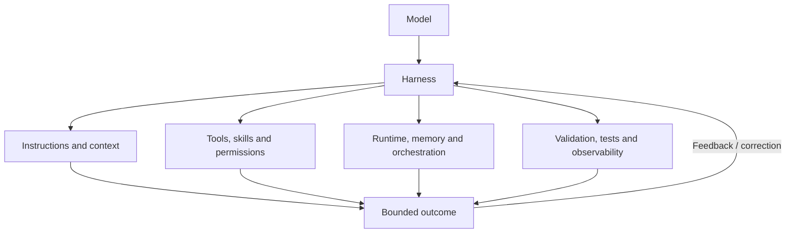

התרשים הוא סינתזה של רכיבי harness שהוזכרו בהרצאה, לא תרשים מוצר או API מסוים.

### תהליך עבודה עם coding agent

התמלול מתאר שינוי במרכז הכובד: פחות זמן בכתיבת כל שורת קוד ידנית, ויותר זמן במחקר הקוד הקיים, בכתיבת specification, בתכנון, בניהול פעולות agent ובבדיקת התוצאה. שלבי העבודה שנזכרו הם Research → Plan → Action/Build → Testing/Validation → Deployment, עם נקודות שבהן אדם בודק, מאשר או עוצר.

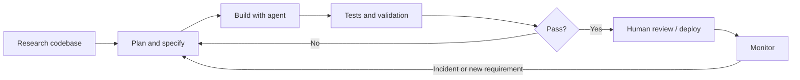

ה־workflow הוא איטרטיבי: כשל בבדיקה או incident מחזיר את העבודה לתכנון, במקום להמשיך ולצבור שינויים לא מאומתים. התמלול מדגיש שארגונים עדיין משלבים שיקול דעת אנושי; אוטונומיה מלאה אינה הנחת עבודה סבירה לתהליך זה.

### Loops ו־workflows

בתמליל מתוארים loops ו־workflows שבהם agent מתקדם בשלבים ומבצע פעולות באופן אוטונומי בנקודות מוגדרות, לצד gates שבהם אדם בודק, עוצר או מסלים. השם **Ralph Wiggum** מופיע בסילבוס, אך לא נקשר במפורש לתבנית מסוימת בתמליל המקומי; הגדרתו לא אומתה.

מאפיינים שנדונו:

- רשימת משימות קטנות וסדרתיות מתוך יעד רחב.
- חלון הקשר חדש לכל משימה, עם הוראות והקשר מינימליים ורלוונטיים.
- קובץ או מנגנון מצב שמעדכן מה הושלם ומה נשאר.
- בדיקה בסוף כל שלב, לפני מעבר לשלב הבא.
- עצירה מוגדרת כאשר המשימה הושלמה, נכשלה או דורשת החלטת אדם.

הקורס מבטיח העמקה בהמשך; לכן אין כאן פקודת CLI או מימוש ספציפי של plugin, משום שלא סופקו בשיעור קובצי התקנה או תרגול.

### כשלים שצריך לתכנן עבורם

**Hallucination:** המודל עשוי להחזיר פרטים שאינם נתמכים במידע שסופק.

**Goal drift:** agent ממשיך לעבוד, אך מתרחק מהמטרה המקורית. context מלוכלך, הוראות עמומות או כלים לא רלוונטיים יכולים להגדיל סיכון זה.

**Tool misuse:** בחירת כלי שגוי, ארגומנטים לא נכונים או סדר קריאות לא מתאים.

**Context overload:** עודף קבצים והודעות מקשה על המודל להבחין במידע החשוב ומגדיל צריכת tokens.

**Verification gap:** אם בודקים רק את הטקסט שהמודל אומר ולא מריצים בדיקות או מאמתים תוצאה, שגיאה עלולה להיראות כהצלחה.

הכיוון המומלץ בהרצאה הוא להגדיר כלים והרשאות מדויקים, לצמצם את מרחב הפעולה, ולהוסיף נקודות validation דטרמיניסטיות ככל שניתן. בדיקות צריכות להתאים לסיכון: בדיקת schema או test אוטומטי עדיפים על בקשה כללית למודל “לבדוק את עצמו”.

## תרגול בכיתה

בתיקיית שיעור 1 לא נמצאו קובצי תרגיל, מחברת, קובץ Python או data file. השיעור כולל שאלות ודיון; המדריך אינו ממיר אותם למשימת קוד מומצאת. הפעילות המתועדת היא היכרות משתתפים ושיתוף רקע, לצד דיון על מטרות הלמידה, העלויות, harness והמעבר לעבודה עם coding agents.

## סיכום ותזכורת מהירה

### מושגים

- **NLP:** עיבוד שפה טבעית; כולל הבנה ויצירה.
- **Embedding:** ייצוג וקטורי של תוכן; ייצוג הקשרי משתנה לפי הטקסט שסביבו.
- **Attention:** מנגנון לשקלול קשרים בין חלקים של הרצף.
- **Transformer:** ארכיטקטורה שמבוססת על attention ו־feed-forward layers.
- **Token:** יחידת הקלט/פלט של המודל לפי tokenizer, לא בהכרח מילה.
- **Harness:** סביבת ההפעלה והבקרה שסביב המודל.
- **Goal drift:** ביצוע פעולות שאינן מקדמות עוד את היעד שנקבע.
- **ADLC:** המונח מופיע בתמליל סביב `02:08:49`; ראשי התיבות אינם מפורשים בו, ולכן משמעותם המלאה לא אומתה.

### Checklist לתכנון עבודה עם agent

1. לנסח יעד ותנאי הצלחה שניתנים לבדיקה.
2. לחקור את הקוד או הנתונים לפני שמתחילים לשנות.
3. לספק רק context וכלים שנדרשים למשימה.
4. להגדיר הרשאות, גבולות, מספר ניסיונות ונקודת עצירה.
5. להריץ בדיקות אמיתיות ולבדוק את השינויים לפני קבלה.
6. למדוד איכות, tokens, latency ועלות לאורך שימוש.
7. לזהות מראש מידע רגיש ומגבלות פרטיות של הארגון.

### תקלות ואבחון

| סימפטום | סיבה אפשרית | פעולה מומלצת |
|---|---|---|
| תשובה משכנעת אך לא נכונה | hallucination או מידע חסר | לבקש מקורות/נתונים, לאמת מול מקור אמת ולהוסיף בדיקה דטרמיניסטית. |
| agent ביצע עבודה לא רלוונטית | יעד עמום, context לא נקי או כלים רבים מדי | לחדד specification, לצמצם context וכלים ולחלק למשימות קטנות. |
| עלויות גבוהות | הרבה input/output tokens, הקשר שיחה ארוך או loops רבים | למדוד צריכה, לצמצם קלט ופלט, לבחור מודל מתאים ולהוסיף מגבלות. |
| התהליך נעצר ללא תוצאה ברורה | אין תנאי סיום או מסלול כשל | להגדיר success/failure states, מגבלת ניסיונות והסלמה לאדם. |
| פלט agent לא מוכן למיזוג | חסרות בדיקות או review | להריץ tests, לבדוק diff ולוודא דרישות לפני אישור. |
| חשש לפרטיות או סודיות | מידע ארגוני רגיש עובר לכלי חיצוני | לעצור, לבדוק מדיניות ואישור ארגוני, ולהעלות את המגבלה לצוות הפרויקט. |

### מבט קדימה

לפי סדר התוכנית שהוצג בשיעור: Prompt Engineering; מפגשי AI Coding על כלים ומתודולוגיות; RAG Fundamentals ו־Advanced RAG; בניית Agents; ולבסוף Future of AI. התרגולים משולבים בתוך המפגשים ולא מתוארים כשיעורי בית נפרדים. סדר המפגשים עשוי להתעדכן בסילבוס החי.


---
# שיעור 2 - Prompt Engineering
---

# מדריך כיתת אמן: Prompt Engineering

## מטרת השיעור והערת מקורות

המטרה היא לבנות prompts חד־פעמיים (one-shot) יציבים מספיק לשימוש חוזר באוטומציות וב־agents. בשיחה אנושית אפשר לתקן את המודל בסבבים; באוטומציה, ה־prompt צריך להסביר מראש את התפקיד, הקלט, הפעולה, האילוצים והפלט. מדריך זה מבוסס על שני חלקי התמלול, מצגת `Prompt_engineering_full_deck.pdf` וקובץ הנתונים `tsla.csv`.

המצגת היא PDF תמונתי. שקף הפתיחה מאשר את זהות הקורס, אך לא ניתן היה לחלץ את מלוא תוכן 38 השקפים טקסטואלית. תרגיל schedule מתועד במפורש בתמלול; אין בתיקייה קובץ roster או נתוני זמינות שמאפשרים לאמת לוח עבודה ממשי. `tsla.csv` הוא קובץ נתונים מצורף, אך התמלול אינו מציין במפורש שהתרגיל הרשמי משתמש בו ואינו נותן תוצאות מספריות ממנו. בהתאם לכך, לא מיוחסות לו תוצאות שלא חושבו.

## מתי Prompt Engineering נחוץ

Prompt Engineering הוא תכנון הוראות למודל כך שיבצע משימה באופן עקבי, ולא רק ניסוח בקשה בשיחה. בשיחה המשתמש יכול לומר “זה כללי מדי”, להוסיף הקשר ולבקש תיקון. תבנית שמופעלת אוטומטית אינה יכולה להניח שיהיה אדם שינהל את התיקון הזה. לכן היא צריכה להבהיר:

- מה המטרה המדויקת ומי המשתמש של התוצאה.
- איזה מידע קבוע ואיזה מידע משתנה בין הרצות.
- מה על המודל לעשות, ובאיזה סדר כשיש כמה שלבים.
- אילו תנאים, מגבלות או כללי עסק חייבים להישמר.
- באיזה פורמט מוחזרת התשובה, ואיך מזהים חוסר מידע.

Prompt טוב מצמצם עמימות; הוא לא הופך מודל הסתברותי לדטרמיניסטי. אם האוטומציה צריכה ממשק קבוע, יש לבקש פלט מוגדר ולתקף אותו בתוכנה או בתהליך downstream.

## In-Context Learning ודוגמאות

In-context learning הוא שימוש במידע, דוגמאות או שיטת עבודה שמועברים יחד עם הבקשה, כדי שהמודל ייישם אותם בזמן ההרצה. זה אינו אימון מחדש של משקולות המודל. בתמלול מופיעים שלושה שימושים עיקריים:

1. **מידע:** לצרף עובדות או הקשר שהמודל צריך לצורך המשימה.
2. **טרנספורמציה:** להראות כיצד קלט מסוים הופך לפלט הרצוי.
3. **תהליך עבודה:** לפרט צעדים או כללים שעל המודל ליישם.

Zero-shot אינו כולל דוגמאות; one-shot כולל דוגמה אחת; few-shot כולל כמה דוגמאות. דוגמה יכולה להסביר פורמט או התנהגות טוב יותר מפסקת הוראות, במיוחד כשהכלל קשה לניסוח. חשוב שהדוגמאות ייצגו את טווח המקרים בפועל. אוסף מוטה של דוגמאות עלול ללמד את המודל התנהגות שאינה מתאימה למרבית הקלטים.

## Framework ‏RESPECT

התמלול מציג את ראשי התיבות **RESPECT** כדרך לזכור רכיבי prompt. אין חובה למלא כל רכיב בכל בקשה; זו מסגרת תכנון ובדיקה, לא נוסחת קסם.

| רכיב | תפקיד | שאלות מנחות |
|---|---|---|
| **R — Role** | הסילבוס מנסח זאת כיצירת קשרים סמנטיים טובים יותר; בתמליל, role מכוון את נקודת המבט או דרך העבודה | איזה אופן חשיבה או מומחיות רלוונטיים למשימה? |
| **E — Examples** | הסילבוס מנסח זאת כהוספת context; בתמליל, examples הם דוגמאות input/output שממחישות את התבנית | איזה מידע או דוגמה מבהירים את הפלט הרצוי? |
| **S — Structure** | ארגון ההוראות והקלט, וגם מבנה הפלט | האם המודל צריך להפנות למקטע מסוים? האם פלט יפורסר בקלות? |
| **P — Pipeline** | שלבים שבהם מפרקים משימה מורכבת | האם שלב ביניים מאפשר בדיקה או תיקון? |
| **C — Constraints** | אילוצים וכללי גבול | מה חייב להתקיים, מה אסור, ואיזה מידע חסר? |
| **T — Task** | הפעולה המבוקשת | האם ברור מה לעשות ומה נחשב תוצאה מוצלחת? |

### R — Role

תפקיד מתאים עשוי לכוון את המודל לסגנון ידע או דרך עבודה מסוימת, למשל “senior analyst” או “experienced backend engineer”. אין הכוונה שהמודל הופך למומחה אמיתי; ה־role מסייע לבחור דפוסי תשובה מתוך מה שנלמד. תפקיד אינו תחליף לדרישות מדויקות או לאימות. בחרו תפקיד רלוונטי, והימנעו מזהות דרמטית שאינה מוסיפה מידע למשימה.

### E — Examples

דוגמאות מספקות חוזה מוחשי. עבור כל דוגמה, הציגו input ותוצאה רצויה; אם יש מקרי קצה חשובים, כללו אותם. דוגמאות צריכות להיות מייצגות ולא רק “דוגמה יפה”. מספר גדול יותר אינו מבטיח שיפור: הוא מגדיל את גודל הקלט ואת עלותו, ולכן יש למדוד את התועלת.

### S — Structure

מבנה מסייע הן למודל והן למערכת שקוראת את התוצאה. בתמלול מודגמים delimiters ותגיות בסגנון XML כדי להפריד בין הוראות, דוגמאות, נתונים ומשימות. שמות התגיות אינם תקן מחייב; בחרו סימון עקבי וברור. שימוש חוזר בתגיות כגון `<report_1>` מאפשר להתייחס למקטע מסוים בלי לערבב אותו עם טקסט אחר.

חשוב במיוחד להגדיר פלט. פלט בפסקאות חופשיות עשוי להשתנות בין הרצות; טבלה, רשימה או JSON קבועים נוחים יותר לקריאה, להשוואה ולמסירה למערכת אחרת. עדיין יש לבדוק שפלט מובנה תקין לפני שימוש.

```text
<role>
You are a careful document analyst.
</role>

<task>
Extract the platform, trigger, impact, and workaround from the supplied report.
</task>

<constraints>
Use only information present in the report. If a field is absent, return null.
</constraints>

<report>
{report_text}
</report>

<output_format>
Return one JSON object with exactly these keys:
platform, trigger, impact, workaround
</output_format>
```

הדוגמה מדגימה ארגון הוראות ופלט, לא schema מאומת של מערכת קיימת. אם משתמשים בפלט JSON במוצר, יש לבצע parsing ו־validation בקוד ולא להסתפק בהצהרת המודל.

### P — Pipeline

התחילו ב־prompt יחיד. אם הוא פותר את הבעיה באיכות, בעלות ובזמן סבירים, אין סיבה לפצל. אם קשה לאתר שגיאות או לעמוד בדרישות, ניתן לפרק לשלבים כגון:

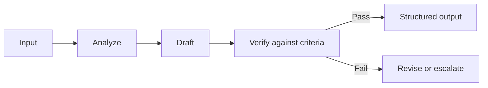

פיצול יוצר נקודות בדיקה, מקל על diagnosis ומאפשר לשפר כל שלב בנפרד. מנגד, הוא עשוי להוסיף קריאות מודל, latency, tokens ומורכבות תפעולית. הבחירה תלויה ב־use case, בסיכון ובשאלה אם שיפור מדיד מצדיק את העלות.

### C — Constraints

אילוצים מצמצמים את מרחב התשובות. דוגמאות מהשיעור הן דרישות זמינות, משך משמרת, הכשרה לתפקיד וכיסוי רציף של שירות. ככל שאילוץ חשוב יותר, צריך לתאר אותו במפורש ולא לקוות שהמודל יסיק אותו. אם האילוצים אינם אפשריים יחד, יש להנחות את המודל לדווח על חוסר היתכנות במקום להמציא פתרון.

### T — Task

כתבו פעולה חיובית ומדויקת: “סכם בשתי נקודות, עד 20 מילים כל אחת, והתחל בפועל פעולה” עדיף על רשימת איסורים בלבד. אילוצים שליליים עשויים לעזור, אך אינם מגדירים מה כן צריך להפיק. בדרך כלל כדאי לנסח גם מה לעשות וגם את האיסורים הקריטיים.

## תרגיל מעשי: בניית Working Schedule תחת אילוצים
## Fundamentals: Common Pitfalls

הסילבוס מקצה מקום ל־Fundamentals ול־common pitfalls. הנקודות הבאות נתמכות במצגת ובתמליל:

| מלכודת | למה היא נכשלת | תיקון שנלמד |
|---|---|---|
| להסתמך על שיחת תיקונים | template או אוטומציה עלולים לפעול ללא שיחת המשך או clarification | כתבו prompt שלם שניתן לבדוק ולהריץ מחדש. |
| משימה או פלט עמומים | המודל מחזיר תשובה כללית או מבנה משתנה | הגדירו task, תנאי הצלחה ו־output format. |
| היעדר context או דוגמאות כשנדרשות | המודל אינו מקבל את המידע או את התבנית שעליו להחיל | הוסיפו context ו־examples מייצגים; בדקו zero/one/few-shot לפי הצורך. |
| להאמין לתשובה בגלל שהיא נשמעת הגיונית | המודל עשוי לנמק באופן משכנע גם בעד וגם נגד אותה טענה | אמתו מול מקור, נתונים או בדיקה חיצונית. |
| לא לאפשר abstention | כשחסר מידע, המודל עלול לנחש | הגדירו “I don't know” או פלט חסר־מידע ותבדקו זאת. |
| להוסיף pipeline ופירוט לפני שיש baseline | כל שלב מוסיף עלות ו־latency | התחילו בפתרון הפשוט, הוסיפו שלבים רק כשבדיקה מצביעה על צורך, ואופטמו אחרי השגת איכות. |

## תרגיל מעשי: בניית Working Schedule תחת אילוצים

**מטרה:** להשתמש ב־Role, Pipeline, Constraints ו־Task כדי לייצר לוח עבודה שמכבד זמינות, הכשרות וכיסוי.

**דרישות קדם:** רשימת עובדים/מהנדסים, qualifications, שירותים או עמדות, טווח זמן, זמינות, משך משמרות וכללי מנוחה הרלוונטיים לארגון. התמלול אינו כולל נתוני roster מלאים, ולכן יש להשתמש בנתונים של המרצה/הכיתה. אין להריץ את הדוגמה על נתוני עובדים אמיתיים ללא אישור מתאים.

**קלט צפוי:** נתוני העובדים, הכשרות, עמדות, משמרות ואילוצים. דוגמאות לאילוצים שנאמרו בכיתה: עובד תומך בשירות אחד בלבד; עד שמונה שעות עבודה לאדם ביום; לפחות עובד מוסמך אחד בכל שירות ובכל זמן; יש להתאים בין הכשרה לבין העמדה.

**פלט צפוי:** טבלת schedule שמציינת תאריך/יום, טווח שעות, שירות או עמדה, עובד והכשרה מתאימה; בנוסף, רשימת אילוצים שלא ניתן לקיים או נתונים חסרים. המרצה הדגיש להתחיל במקרה קטן (יום אחד, עמדה אחת ומספר עובדים מוגבל) לפני הרחבה לשבוע שלם.

**שלבי עבודה:**

1. כתבו prompt בסיסי למשימה והפיקו schedule ראשוני.
2. בצעו אבחון: האם יש שמות אמיתיים או רק A/B/C? האם הוקצו שעות שרירותיות? האם כל העמדות מכוסות? האם ההכשרה נלקחה בחשבון?
3. הוסיפו input מפורש של שמות, qualifications, עמדות, shifts ואילוצים.
4. צמצמו את היקף הבעיה ליום ולעמדה אחת, ואז הגדילו בהדרגה.
5. דרשו פורמט פלט קבוע ושדה שמדווח על אילוצים לא פתירים.
6. השוו את התוצאה לאילוצים באופן ידני או באמצעות validator חיצוני; אל תחשיבו לוח שנראה סביר כפתרון מאומת.

```text
<role>
You are a scheduling assistant. Build a schedule using only the supplied roster.
</role>

<task>
Assign qualified people to the requested shifts and services. Return the schedule in the requested table format.
</task>

<constraints>
- Each engineer may support only one service at a time.
- No engineer may be scheduled for more than 8 hours in one day.
- Every service must have at least one qualified engineer for every required time interval.
- Do not invent people, qualifications, availability, or shift hours.
- If the input is insufficient or constraints conflict, list the issue and do not claim the schedule is feasible.
</constraints>

<roster>
{roster_and_availability}
</roster>

<services_and_shifts>
{services_and_required_intervals}
</services_and_shifts>

<output_format>
Return columns: day, start_time, end_time, service, engineer, qualification.
After the table, list uncovered intervals and unresolved assumptions.
</output_format>
```

ה־schedule אינו נחשב “verified” עד שנבדקו כל התנאים מול נתוני הקלט. כיוון שלא צורף roster מלא לתיקיית השיעור, לא מוצגת כאן תשובת schedule מומצאת. זהו prompt scaffold המבוסס על האילוצים שנאמרו בתמלול.

## שיטת שיפור: Draft → Test → Diagnose → Refine

Prompt נבנה באיטרציות:

1. התחילו מגרסה קצרה וממודל חזק מספיק כדי לבדוק את יכולת המשימה.
2. הריצו כמה מקרי מבחן, כולל מקרי קצה; בשיעור הודגמה גם הרצה חוזרת כדי לראות שונות.
3. בדקו את התוצאה מול קריטריונים: האם המידע נכון? האם הוא מבוסס בקלט? האם הפורמט עומד בדרישה? האם האילוצים קוימו?
4. אבחנו את הכשל לפני שינוי: חוסר הקשר, דוגמה חסרה, משימה עמומה, מבנה פלט חסר או pipeline שלא מאפשר בדיקה.
5. שנו רכיב אחד או קבוצה קטנה של דרישות, והריצו שוב את אותו סט בדיקה.
6. אחרי שיש איכות מספקת, נסו מודל זול או מהיר יותר ובדקו אם המדדים נשמרים.

המרצה המליץ להתחיל ב־strong model וב־prompt מלא, ואז לייעל. אם שלב יחיד אינו מספיק, אפשר להוסיף דוגמאות, לחזק constraints ולבסוף לפצל ל־pipeline. אין כלל אוניברסלי למספר איטרציות או לרמת פירוט; ההחלטה נגזרת מהבעיה, ממורכבותה ומהעלות המקובלת.

### Golden set והערכת איכות

לצורך השוואה, הכינו קבוצת קלטים מייצגת ותשובות צפויות או קריטריוני קבלה (golden set). אל תסתפקו ב־accuracy יחיד אם הוא מסתיר סוגי שגיאה שונים. בהתאם לדיון בכיתה, הערכה יכולה לבדוק בנפרד אם התשובה עונה לשאלה, נשענת על המידע שניתן, אינה ממציאה פרטים, ומחזירה את התוכן הנדרש. Frameworks כגון RAGAS הוזכרו כדוגמה לפירוק איכות במערכות מבוססות מידע; הם אינם תחליף להגדרת קריטריונים למשימה שלכם.

בדיקה של עשר הרצות יכולה להמחיש שונות, כפי שהודגם בשיעור, אך אינה לבדה הערכה מספקת לפרודקשן. השתמשו בסט בדיקה קבוע, תעדו מודל וגרסה, ובדקו מקרי כשל ולא רק ממוצע.

## אופטימיזציות מתקדמות שנדונו

### Trust, but verify

תשובה שנשמעת עקבית אינה בהכרח נכונה; מודל יכול לייצר טיעונים שנראים סבירים גם עבור עמדה וגם עבור היפוכה. יש לאמת מול מקור אמת, נתונים, כללי עסק או בדיקה דטרמיניסטית. במערכת מורכבת, בדיקת מודל נוסף או human review עשויים להוסיף נקודת מבט, אך אינם מבטיחים נכונות.

### תזכורת ו־recency

בהוראות ארוכות, אפשר לחזור בסוף על דרישות קריטיות. בתמלול הוסבר שהמודל עשוי להעניק משקל בולט למידע שבקצוות ההקשר, ובפרט להנחיות מאוחרות (recency effect). התנהגות זו אינה חוזה קשיח; אין להשתמש בה במקום מבנה ברור, בדיקות או הרשאות. שמרו כללים קריטיים בתחילת prompt, באזור המתאים, ובתזכורת מסכמת בעת הצורך.

### Abstention — לא לנחש

כאשר חסר מידע או שהמודל אינו בטוח, אפשר להגדיר במפורש: `If you are uncertain, say "I don't know" and do not guess.` יש להגדיר מה נחשב מידע מספיק ומהו פלט ה־abstention, ולוודא שהתנהגות זו מתקיימת בבדיקות.

### הגבלת הפלט

דרישה כגון “return JSON only”, “two bullet points” או “return only the code” יכולה להקל על parsing ולצמצם פלט מיותר. עם זאת, הגבלה חזקה מדי עלולה להסיר מידע הדרוש לפתרון. הפרידו בין שלב reasoning/analysis נחוץ לבין שלב עיצוב הפלט, ובדקו שהצמצום אינו פוגע באיכות.

### Emotional framing

המרצה הזכיר מחקרים שבדקו ניסוח רגשי או הדגשת חשיבות. זו טכניקה ניסיונית, ולא כלל הנדסי מובטח. אם בוחנים אותה, השוו מול baseline על אותם מקרי מבחן ואל תשתמשו באיום או ניסוח מטעה כאמצעי שגרתי.

### Reverse engineering של prompt

כשיש פלט לדוגמה שאיכותו רצויה, אפשר לבקש ממודל לנסח template שעשוי לייצר פלטים דומים. אפשר גם לספק כמה דוגמאות ולבקש לזהות את התבנית. זו נקודת פתיחה ל־prompt, לא הוכחה שהוא יפיק את אותה איכות בכל קלט; יש לערוך, לבדוק ולהתאים את התוצאה. המודל שמנסח את ה־prompt אינו חייב להיות המודל שיפעיל אותו, אך יש לבדוק את ה־prompt בפועל מול מודל היעד.

### Step-back prompting

בבעיות אנליטיות או טכניות מסוימות, צעד ביניים שמבקש לזהות עקרונות או trade-offs לפני המענה הקונקרטי יכול לספק מסגרת טובה יותר. השיעור מציג זאת כשיטה שכדאי לבחון, לא כתוספת חובה לכל prompt. מדדו אם היא משפרת את התוצאה ביחס לבקשה הישירה.

## קובץ הנתונים TSLA

`tsla.csv` מכיל עמודות `Date`, `Open`, `High`, `Low`, `Close`, `Volume`, כלומר תצפיות היסטוריות בפורמט OHLCV. בתמלול יש דוגמה כללית של מודל שמסביר בעד ונגד השקעה ב־Tesla כדי להמחיש שמודל יכול לתמוך בטיעונים סותרים; אין שם הוראות מפורשות לניתוח ה־CSV או חישובים מאומתים ממנו.

לכן יש להתייחס לקובץ כאל חומר נתונים שסופק, ולא כאל המלצת השקעה. אם משתמשים בו לתרגול, יש להבהיר ב־prompt מה טווח התאריכים ומה המדד המבוקש, לדרוש שהמסקנות יישענו על הנתונים בלבד, ולא לבקש מהמודל להמציא חדשות או להסיק תחזית ודאית. אין במקורות תוצאת ניתוח מספרית שאפשר להציג כפתרון רשמי.

## תבנית Prompt לשימוש חוזר

```text
<role>
{relevant_role}
</role>

<task>
{specific_action_and_success_criteria}
</task>

<context>
{stable_background_information}
</context>

<examples>
{representative_input_output_examples}
</examples>

<constraints>
{business_rules_and_limits}
</constraints>

<input>
{variable_input}
</input>

<output_format>
{schema_or_exact_format}
</output_format>

<uncertainty>
If required information is missing, identify it. Do not invent facts.
</uncertainty>
```

הסירו מקטעים שאינם רלוונטיים למשימה. הוסיפו `Pipeline` מפורש כשיש שלבים שצריך לבדוק בנפרד.

## סיכום ו־Cheat Sheet

### RESPECT בקצרה

- **Role:** נקודת מבט רלוונטית.
- **Examples:** דוגמאות input/output מייצגות.
- **Structure:** ארגון prompt ופלט לפרסור.
- **Pipeline:** פירוק לשלבים כשיש ערך בבדיקה ביניהם.
- **Constraints:** כללים, גבולות והנחות.
- **Task:** פעולה חיובית מדויקת ותנאי הצלחה.

### כללי אצבע מהשיעור

- אל תסמכו על שיחת תיקונים עבור prompt שיפעל באוטומציה.
- התחילו בפתרון הפשוט ביותר; הוסיפו פירוט או פיצול רק אם בדיקה מצביעה על צורך.
- השתמשו בדוגמאות מייצגות כדי להמחיש טרנספורמציה או התנהגות.
- הגדירו פורמט פלט שניתן לקרוא ולבדוק.
- ציינו במפורש מה לעשות, ולא רק מה לא לעשות.
- הריצו בדיקות חוזרות מול אותו סט קלטים.
- אימתו את התשובה, גם כשהיא מנוסחת בביטחון.
- בצעו אופטימיזציה לעלות ול־latency רק לאחר שהאיכות מספקת.

### תקלות ואבחון

| סימפטום | סיבה אפשרית | תיקון מומלץ |
|---|---|---|
| תוצאה שונה בכל הרצה | משימה עמומה, חסרים דוגמאות או קריטריונים | הוסיפו examples מייצגים, פלט מוגדר ו־golden set. |
| תשובה כללית מדי | Role או Task אינם ברורים; חסר context | הגדירו קהל, תוצר ותנאי הצלחה, והוסיפו מידע רלוונטי. |
| המודל המציא עובדות | אין מקור מספיק או אין מסלול abstention | הגבילו למידע שסופק, דרשו לסמן חוסר מידע, ואמתו מול מקור. |
| פלט לא ניתן לפרסור | לא הוגדר מבנה תשובה | הגדירו JSON/טבלה/schema ובצעו validation לאחר יצירת הפלט. |
| schedule מפר אילוצים | האילוצים חסרים או סותרים; לא נבדקו הכשרות וזמינות | ספקו נתוני roster מלאים, דרשו דיווח אי־היתכנות ובדקו כל משמרת. |
| prompt אחד נכשל וקשה לאבחן | שלבים רבים מוסתרים בתוך בקשה אחת | שקלו Pipeline עם checkpoints וקריטריונים לכל שלב. |
| pipeline יקר ואיטי | פיצול יתר או מודל חזק מדי לכל שלב | מדדו תרומה של כל שלב, צמצמו קריאות ובדקו מודל זול יותר. |
| prompt קצר פוגע באיכות | הגבלת פלט/חשיבה מוקדמת מדי | הפרידו בין עיבוד לתצוגה, והחזירו מידע נדרש לפני צמצום. |
| output מתיימר להמליץ השקעה | תחזית או מסקנה חורגת מהנתונים | הציגו ניתוח נתונים בלבד, הנחות ומגבלות; אל תציגו זאת כעובדה או ייעוץ. |

## מה לא נכלל

בתיקייה אין קוד Python או notebook לתרגיל, אין schema רשמי לפלט, ואין נתוני עובדים עבור schedule. לא סופקו גם תוצאות benchmark ל־TSLA או מחירי מודלים עדכניים. לכן המדריך כולל prompt templates וקריטריוני בדיקה, אך לא ממציא תוצאות, roster או פקודות התקנה שלא מופיעים בחומר.


---
# שיעור 3 - AI Coding
---

# מדריך כיתת אמן: AI Coding Agents — Fundamentals

## מטרת השיעור ומקורות

השיעור עובר מהיכרות עם coding agents אל הארכיטקטורה שסביבם: מודל, context, הוראות, כלים, skills, hooks, MCP, זיכרון ובדיקות. העיקרון המנחה הוא שהמודל מייצר ומפעיל כלים בתוך סביבת עבודה; האדם מנסח דרישות, מגביל הרשאות ומאמת את התוצאה.

המדריך מבוסס על שני חלקי התמלול, שישה דפי HTML, וקובץ הנתונים `tsla.csv`. שני קובצי ה־PDF נמצאים בתיקייה, אך תצוגת ה־PDF המקומית נכשלה ולא סיפקה תוכן קריא. שלושת קובצי DOCX של Skills הם ZIP בינאריים; כלי הקבצים והחיפוש לא חילצו את הטקסט שלהם. לכן המדריך מסנתז את תרגילי ה־Skills מתוך דפי ה־HTML, אך אינו יכול לאשר אם ל־DOCX יש גרסאות או הנחיות נוספות. ההערה הזאת משאירה את אי־הוודאות גלויה.

## 1. מודל, Agent ו־Harness

### ההבחנות הבסיסיות

- **Model / LLM:** מקבל הקשר ומייצר פלט. API סטנדרטי של מודל הוא stateless: בכל קריאה המערכת שולחת את ההודעות והנתונים הרלוונטיים.
- **Agent:** מודל שניתנה לו אפשרות לבחור פעולות ולהפעיל tools. הוא מחליט אם לקרוא לכלי, אך סביבת ההרצה מבצעת את הקריאה ומחזירה תוצאה.
- **Harness:** סביבת ההרצה והבקרה שסביב המודל וה־agent: הוראות, context, memory, הרשאות, כלים, לולאה, hooks, observability ותהליך validation.
- **Coding agent:** agent עם גישה ל־filesystem, ל־terminal או לכלי פיתוח אחרים, בהתאם להרשאות שסופקו.

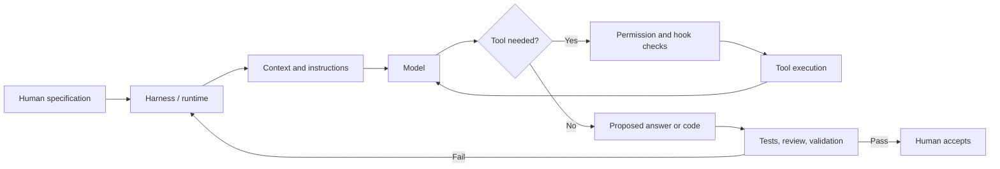

המודל הוא רק רכיב במערכת. מודל חזק עם harness לא מתאים עדיין עלול להיכשל; harness קובע מה נטען, אילו פעולות אפשריות ואיך מזהים הצלחה. מצד שני, שום harness אינו מבטיח התנהגות דטרמיניסטית בכל מצב. יש להגדיר מגבלות ולבדוק אותן.
### שינוי תפקיד המפתח

בעבודה עם coding agents, חלק ניכר מהעבודה עובר מכתיבה ידנית ל־specification, תכנון, בחירת הקשר, review ואימות. האדם מנסח תנאי הצלחה, ה־agent מציע ומיישם שינוי, והאדם בודק שהשינוי עונה לדרישה ולא רק “נראה סביר”. ככל שהמשימה מורכבת או מסוכנת יותר, כך חשובים יותר acceptance criteria, בדיקות עצמאיות ונקודות אישור.

## 1.5 5 Levels of Autonomy

הסילבוס מציין “5 Levels of autonomy”. בתמליל נאמר במפורש שהעבודה ההיסטורית עם prompt engineering היא adoption level 1, וש־looping שבו agents עובדים באופן אוטונומי הוא level 4; level 5 מתואר כנדיר, עם agents שרצים באופן אוטונומי. בין השלבים מתוארים כתיבת specifications, ניהול שיחה עם human-in-the-loop, ואחר כך ניהול context. מכיוון ששמות כל חמש הרמות בשקף אינם קריאים ולא פורטו במלואם בתמליל, הטבלה המקורית אינה משוחזרת ושמות 2–3 לא אומתו (תמליל SKILLS, `00:19:31`–`00:20:24`).

### Desloping

הסילבוס מונה את Desloping כנושא, אך לא נמצאה הגדרה למונח בתמליל או בטקסט הנגיש של השקפים. המונח מופיע כאן ככותרת בלבד; הגדרה לא אומתה.

### נושאי יסוד נוספים בסילבוס

| נושא | כיסוי במדריך ובמקור |
|---|---|
| New coding spectrum | נושא בסילבוס; פירוט מקומי לא אומת. |
| More validation, less generation | מתואר במדריך דרך שינוי תפקיד המפתח, tests ו־validation; תמליל המבוא מתאר מעבר לכתיבת specification ולבדיקת תוצאות (שיעור 1, `02:00:50`–`02:01:23`). |
| Developer fatigue | מופיע בסילבוס; הסבר מפורט לא נמצא במקורות המקומיים הנגישים, ולכן לא אומת. |
| Different models for different tasks | מופיע בסילבוס; לא נמצא פירוט מספק לבחירת מודל לפי משימה, ולכן לא אומת. |
| Different models for different tasks | התמליל מתאר התאמה בין משימה למודל: מודל קטן וזול למשימות פשוטות/מרובות, מודלים כגון Sonnet/Opus לעבודה שגרתית, ומודל חזק יותר או effort גבוה למשימות מורכבות; הטרייד־אוף הוא עלות, latency ויכולת (תמליל SKILLS, `00:32:56`–`00:34:55`). |
| Effective prompt engineering | נושא בסילבוס ומכוסה ב־[שיעור 2 - Prompt Engineering](../שיעור%202%20-%20Prompt%20Engineering/master_class_guide.md); בשיעור זה אין דוגמה מקומית נוספת שמאומתת. |

## 2. Context Engineering

### מה נכנס ל־context

Context הוא כל מה שהמודל מקבל בזמן העבודה: system instructions, שיחת המשתמש, קבצים שנקראו, תוצאות tools, rules, skills והגדרות MCP. חלון ההקשר מוגבל, וכל פריט מתחרה על מקום ותשומת לב. ככל שהשיחה ארוכה יותר וה־context עמוס יותר, עולה הסיכון שהמודל יאבד דרישה או יושפע ממידע שכבר אינו רלוונטי (context rot / drift).

### שכבות של הוראות וזיכרון

בתמלול מתוארות כמה רמות של קובצי הוראות, לדוגמה `CLAUDE.md` או `AGENTS.md` ברמת המשתמש, הפרויקט או תת־תיקייה. כלים שונים טוענים אותם בסדר ובהיקף שונים; אין להניח שכל קובץ נטען אוטומטית בכל IDE או harness. כללים סותרים אינם מתמזגים באופן אמין, ולכן עדיף למנוע סתירות ולצמצם הוראות גלובליות.

הנחיות project-level צריכות להיות קצרות ומדויקות: מבנה הפרויקט, פקודות build/test מוכרות, conventions מקומיים וגבולות חשובים. מסמכים ארוכים או reference שאינו דרוש לכל משימה עדיף לטעון לפי צורך. Instructions הן הנחיות למודל, לא מדיניות אכיפה. אם פעולה חייבת להיות אסורה, השתמשו בבקרת הרשאות או ב־hook ולא רק בטקסט.

Memory שונה מ־context. מודל אינו שומר באופן קסום את כל מה שנאמר בשיחה קודמת. במערכות מסוימות קובצי memory נשמרים ונטענים מחדש; יש לבדוק מה נשמר, מתי הוא נטען, מי רשאי לעדכן אותו ואיך מונעים מידע ישן או לא רלוונטי.

### ניהול חלון ההקשר

הכלים שהודגמו כוללים `/context` להצגת הרכב ההקשר, `/compact` ב־Claude Code ו־`/compress` ב־Cursor לצמצום היסטוריה. שמות ופקודות תלויים בגרסת הכלי. Compact מסכם חלקים משיחה ומצרף את ההודעות האחרונות; הוא יכול לחסוך מקום, אך סיכום עלול להשמיט פרט חשוב. פתחו session חדש או בצעו delegation למשימה נפרדת כשנדרש הקשר נקי.

Prompt caching עשוי לצמצם העברה חוזרת של input קבוע; הוא תלוי בספק, במודל, בסדר ההודעות ובמדיניות API. החלפת מודל או שינוי הקשר עשויים לבטל cache. אל תתייחסו ל־cache כאילו הוא זיכרון של המודל.

RTK, QMD וכלים דומים הוזכרו כדרכים לצמצם פלטים חוזרים, לסנן logs או להוסיף אינדוקס. לפני התקנת כלי חיצוני יש לבדוק מה הוא מריץ, לאילו קבצים/רשת הוא ניגש, ואיזה מידע הוא עלול לשלוח החוצה. בחירת tools צריכה להיות מינימלית; חיבור עשרות MCP servers או skills מגדיל את הקשר ואת מרחב הבחירה.

## תרגיל מעשי: Mind Your Context — חיזוי TSLA

**מטרה:** להשוות ניסיון “קר” עם מודל קטן מול ניסיון שמקבל reference מדויק, ולראות את השפעת הכלים וההוראות על context ועל צריכת tokens.
**דרישות קדם:** IDE או coding agent שתומך ב־file references, `tsla.csv` בתיקיית הפרויקט, וסביבת Python עם pandas ו־scikit-learn. דף התרגיל מתאר 365 ימים, אך הקובץ המקומי מכיל 4,006 שורות נתונים, מתאריך 2010-06-28 עד 2026-06-02.

**קלט צפוי:** CSV עם `Date, Open, High, Low, Close, Volume`. **פלט צפוי:** קוד שמאמן מודל קטן ומדפיס תחזית למחיר הסגירה הבא, לצד מדד הערכה ולא רק מספר בודד.

**שלבים לפי דף התרגיל:**

1. העתקו את `tsla.csv` לפרויקט והפנו אליו באמצעות `@tsla.csv`.
2. בסבב ראשון השתמשו במודל קטן, ללא docs ודוגמאות. בקשו ממנו לבנות תחזית next-day `Close`, והריצו כמה פעמים כדי לזהות שונות בבחירת framework/model ובאופן הטיפול בנתונים.
3. בדקו את `/context` או את מדד ה־context ב־IDE; שימו לב ש־tools, skills, rules ושיחה תופסים מקום גם לפני שהזנתם task ארוך.
4. בסבב השני צרפו reference מתאים ל־scikit-learn והגבילו את המודל/המשימה במפורש.
5. בדקו שחלוקת train/test שומרת על הסדר בזמן, שה־target מייצג את היום הבא, ושהמודל אינו מקבל מידע מהעתיד.

**אי־התאמה בקובץ התרגיל:** הנוסח המקורי מבקש לנבא מחיר רציף (`Close`) ואז אומר `Use LogisticRegression`. `LogisticRegression` הוא מסווג ולא מודל לרגרסיה של מחיר רציף. גם reference תיעוד אינו מתקן את הסתירה הזאת. אם המטרה היא מחיר, השתמשו ב־`LinearRegression` או במודל regression אחר. אם רוצים להשתמש ב־`LogisticRegression`, שנו את ה־target לשאלה קטגורית כגון “האם המחיר עלה ביום הבא?”.

```python
import pandas as pd
from sklearn.linear_model import LinearRegression
from sklearn.metrics import mean_absolute_error

data = pd.read_csv("tsla.csv", parse_dates=["Date"])
data = data.sort_values("Date").reset_index(drop=True)
features = ["Open", "High", "Low", "Close", "Volume"]
data["next_close"] = data["Close"].shift(-1)
supervised = data.dropna(subset=["next_close"]).copy()

# Keep the evaluation split chronological to avoid training on future observations.
split_at = int(len(supervised) * 0.8)
train = supervised.iloc[:split_at]
test = supervised.iloc[split_at:]

model = LinearRegression()
model.fit(train[features], train["next_close"])
test_predictions = model.predict(test[features])
print("Holdout MAE:", mean_absolute_error(test["next_close"], test_predictions))

# Refit on all labeled observations before producing a next-day estimate.
final_model = LinearRegression()
final_model.fit(supervised[features], supervised["next_close"])
latest_row = data[features].iloc[[-1]]
next_close_estimate = final_model.predict(latest_row)[0]
print(f"Next-day Close estimate: {next_close_estimate:.2f}")
```

הקוד הוא פתרון לימודי, לא מערכת מסחר ולא המלצת השקעה. במדידה של הקוד כפי שמופיע כאן, חלוקת הזמן נתנה 3,204 שורות אימון ו־801 שורות בדיקה, וה־holdout MAE היה `8.052155`. בבדיקת הקובץ לא נמצאו שורות `High < Low` או `Close` מחוץ לטווח `[Low, High]`. המדד מתאר רק את ה־split והמודל המסוימים האלה; הוא אינו מוכיח יכולת חיזוי עתידית.

## 3. Skills, Rules, Plugins ו־Output Styles

### Rules והוראות קבועות

Rules מתאימים להנחיות כלליות שחוזרות בפרויקט או לקבצים מסוימים, כגון conventions, פקודות בדיקה או הנחיות Python. יש לשמור אותם קצרים, ברורים ולא סותרים את instructions האחרים. גלובים/תנאים יכולים לתחום rule לתת־קבוצה של קבצים. הטיפול המדויק תלוי ב־harness.

### Skills ו־progressive disclosure

Skill הוא יחידת workflow שאפשר להפעיל ידנית או לתת למודל לזהות לפי תיאור. לרוב הוא כולל `SKILL.md` עם YAML front matter (`name`, `description`) והוראות; אפשר לצרף scripts, references או examples. בדרך כלל שם ותיאור זמינים להחלטת routing, ותוכן נוסף נטען כאשר ה־skill מופעל (progressive disclosure). תיאור טוב כותב בגוף שלישי מה הפעולה עושה ומוסיף ביטויים אמיתיים שמשתמשים עשויים לומר.

Skill אינו “רק prompt” כאשר הוא מפעיל סקריפטים או כלים. יש לבקר את התוכן והקוד שבו, לצמצם הרשאות ולבדוק התנהגות לפני התקנה. Skill שהורד מהאינטרנט עשוי לבצע פעולות במחשב או לשלוח מידע. העדיפו מקור מוכר, עברו על הקבצים, ובדקו מדיניות ארגונית לפני התקנה.

```text
.claude/skills/qr-generator/
├── SKILL.md
└── make_qr.py
```

דוגמת front matter מהתרגיל:

```markdown
---
name: qr-generator
description: Generate a QR code PNG from a URL or text. Use when a user asks for a scannable code, such as a registration link or a code for a slide. Save the result as qr.png.
---

Run make_qr.py with the supplied URL or text.
```

ודוגמת script מהדף, עם טיפול בסיסי בקלט:

```python
import sys
import qrcode

# Use the first command-line argument as the QR payload.
if len(sys.argv) != 2:
    raise SystemExit("Usage: python make_qr.py <url-or-text>")

payload = sys.argv[1]
qrcode.make(payload).save("qr.png")
print("Saved qr.png")
```

התרגיל המקורי אינו מציין פקודת התקנה עבור `qrcode`; יש לוודא שהספרייה זמינה בסביבה לפני הרצה. בדפי התרגול מופיעים מיקומים שונים ל־Cursor ול־Claude, לדוגמה `.cursor/skills/` ו־`.claude/skills/`; יש לעקוב אחרי ה־harness שבו משתמשים.

### Plugins ו־Output Styles

Plugin יכול לאגד skills, hooks והרחבות נוספות. בתרגיל נעשה שימוש ב־Superpowers וב־`/review` או `/code-reviewer`; ההתקנה והתפריטים תלויים בגרסת Claude/Cursor. Output styles משנים את סגנון התשובות של ה־agent הראשי, למשל קצר, יוזם או מסביר. הם משפיעים על הצגה ולא מחליפים בדיקות או מדיניות.

## תרגיל מעשי: התקנת Skill ויצירת QR Skill

**מטרה:** להפעיל skill קיים, לכתוב skill משלכם, ולבדוק אם התיאור שלו מפעיל אותו גם בלי slash command מפורש.

**דרישות קדם:** coding agent התומך ב־skills, גישה לתיקיית skills, וקובץ HTML או Python קטן לעבוד עליו. עבור יצירת QR נדרשת חבילת `qrcode`.

**שלבי הליבה:**

1. עיינו ב־Superpowers skills ובחנו את המבנה: תיאור שמציין מתי להפעיל ו־script/הוראות שמבצעים את העבודה.
2. צרו קובץ קטן לסקירה. אחת הגרסאות מציעה water tracker ב־`water.html`; גרסה אחרת יוצרת `stats.py` עם median.
3. התקינו/הפעילו את skill הסקירה שסופק (`/review` או `/code-reviewer` לפי הגרסה) וקראו את הממצאים. תקנו לפחות נקודה אחת.
4. צרו תיקייה `qr-generator` עם `SKILL.md` ו־`make_qr.py` לפי הדוגמאות.
5. הפעילו ידנית עם `/qr-generator https://latent.example/register`, ואז פתחו את `qr.png` וסרקו אותו.
6. בדקו implicit invocation בלי לציין את שם ה־skill: “I need something attendees can scan to get to the signup page.” אם אינו מופעל, שפרו את התיאור עם ניסוחים שמשתמשים באמת אומרים.

**פלט צפוי:** PNG שניתן לסרוק, ו־skill שמופעל ידנית וגם לפי תיאור מתאים. מטרת המעבדה היא גם לבדוק את איכות ה־description, לא רק לוודא שהסקריפט רץ.

**גרסאות ה־HTML:** `exercise-skills-inspire.html` משתמש ב־water tracker וב־`/review`; `exercise-skills.html` משתמש ב־median וב־`/code-reviewer`. שניהם מסתיימים ביצירת QR skill. קובצי ה־DOCX הנלווים לא ניתנים לאימות טקסטואלי בכלים הזמינים, לכן אין הנחה שהם זהים לחלוטין.

## תרגיל מעשי: Plan in Phases

**מטרה:** להעביר משימה רחבה דרך Research → Plan → Grill → Test, ולמנוע מעבר לשלב הבא לפני שהבדיקה של השלב הנוכחי ירוקה.

**דרישות קדם:** coding agent ו־folder ריק. דף התרגיל אומר שאין צורך בהתקנה או setup מוקדם.

**קלט:** בקשה לבניית אתר אישי קטן ב־HTML ו־React עם About, Projects ו־Contact.

**שלבים:**

1. בקשו מה־agent לחקור דרכים פשוטות להריץ React ללא build setup, בלי לכתוב קוד עדיין.
2. בקשו `plan.md` המחולק לפאזות עצמאיות; עבור כל שלב נדרשים מטרה, קבצים שיושפעו, ובדיקה שמוכיחה הצלחה.
3. קראו בעצמכם את `plan.md`: האם הפאזות עצמאיות? האם לכל אחת בדיקה ממשית? תקנו לפני build.
4. הפעילו את `grill-me` skill על התוכנית, שאלה אחת בכל פעם, והוסיפו לתוכנית תשובות/תיקונים שעלו.
5. בקשו יישום של פאזה אחת בכל פעם. אחרי כל פאזה, כתבו והריצו את הבדיקה שלה; אל תעברו הלאה עד שהיא עוברת.

**פלט צפוי:** `plan.md` עם פאזות ו־tests, אתר קטן שעובד, ו־green result אחרי כל שלב. האתר הוא האמצעי; התוצר הלימודי הוא משמעת התכנון והבדיקה.

## 4. Hooks ו־MCP

### Hooks: בקרה דטרמיניסטית במחזור החיים

Hook הוא נקודת התערבות במחזור החיים של harness: בתחילת session, לפני או אחרי tool call, בעת submit או בעת סיום. Hook יכול להריץ command/script או פעולה מוגדרת, לכתוב log, לבצע validation, לחסום פעולה, לשאול את המשתמש או לשנות/לסנן תוצאה בהתאם לתמיכה של הכלי.

בניגוד ל־instruction, hook מופעל על ידי runtime ולא על ידי החלטת המודל בלבד. יש להגדיר matcher צר לאירועים המתאימים; hook רחב מדי עשוי לרוץ בכל tool call, להאט עבודה או לחסום פעולות לא קשורות. בדקו permissions ומקרי קצה לפני הפעלה. הקונפיגורציה הספציפית משתנה בין גרסאות, ולכן יש להיעזר בתיעוד של ה־harness ולא להעתיק schema ישן בלי בדיקה.

### MCP: פרוטוקול לכלים ומשאבים

Model Context Protocol (MCP) מספק דרך אחידה ל־agent להתחבר לשרתים שחושפים `tools`, `resources` או `prompts`. במקום לכתוב אינטגרציה ייחודית לכל model/tool pair, ה־client מגלה את היכולות של השרת ומפעיל אותן לפי הפרוטוקול. השרת יכול להיות מקומי או מרוחק; גישה לשרת מרוחק דורשת authentication והרשאות מתאימות.

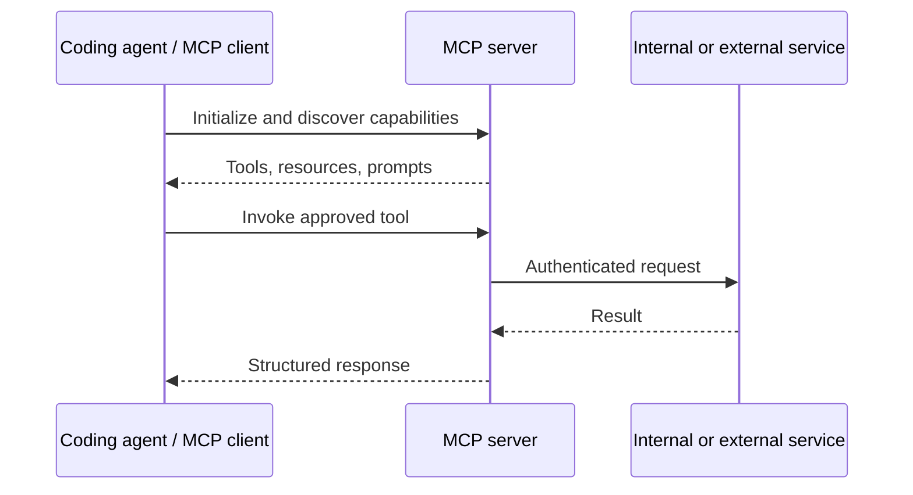

MCP מרחיב יכולות אבל גם מרחיב את משטח ההרשאות. חברו רק שרתים נחוצים, בדקו איזה מידע מועבר, שמרו secrets מחוץ ל־prompt ואל תתנו לכלי הרשאה רחבה בלי צורך. השתמשו ב־SSO/OAuth או במנגנון הארגוני כשהוא זמין. תמלול השיעור מזכיר transports כגון stdio ו־HTTP-based transport, אך פרטי protocol עשויים להשתנות.

## 5. בדיקות, TDD ו־Validation

### למה “Green Is Not Correct”

Test suite ירוק מוכיח רק את הטענות שהבדיקות בודקות. אם agent כותב גם את ה־implementation וגם את הבדיקות, הוא עלול להתאים את הבדיקות לקוד שגוי. לכן דרישות צריכות להיכתב באופן עצמאי, בדיקה חדשה צריכה להיכשל לפני התיקון (Red), והצלחה צריכה להיבדק מול הדרישה ולא רק מול הקוד.

בדיקת unit יכולה להוכיח כלל יחיד; היא אינה מוכיחה integration עם database או חוויית משתמש מקצה לקצה. בחרו גבול בדיקה לפי הסיכון. Reviewer עצמאי או CI עשויים לעזור, אבל גם agent נוסף אינו תחליף לקריטריונים כתובים ולבדיקה שמריצה התנהגות אמיתית.

## תרגיל מעשי: Green Is Not Correct — Session Expiry

**מטרה:** לנסח contract אנושי, להבחין בין בדיקות משמעותיות לרעש, לעבוד ב־Red/Green, ולבדוק אם agent מתקן קוד או מחליש assertion.

**דרישות קדם:** Python 3; ספריית standard library בלבד; אין רשת או התקנה. צרו ידנית `REQUIREMENTS.md` ו־`auth_service.py` ריק. אין לתת ל־agent לנסח את הדרישות.

**דרישות הקלט:**

- ברירת המחדל למשך session היא 120 דקות.
- אפשר להעביר משך חיובי מותאם אישית.
- session פג כאשר הזמן הנוכחי מגיע לזמן התפוגה (`now >= expires_at`).
- משך אפס או שלילי אינו תקין.
- `datetime` ללא timezone נדחה.

**שלבים:**

1. בקשו באופן חלש “Write tests for the authentication service.” אל תקבלו/תריצו אותם עדיין; ספרו כמה בודקים דרישה וכמה רק שם פונקציה או behavior של ספרייה.
2. העבירו כל בדיקה דרך keep/drop: איזה behavior היא מוכיחה? איזה bug סביר יגרום לה להיכשל? האם היא תשרוד refactor? מה עדיין לא הוכח?
3. בקשו בדיקה יחידה לגבול התפוגה, עם זמן מוזרק ולא שעון אמיתי. דרשו שה־agent לא ישנה עדיין את `auth_service.py`, יריץ בדיקה ממוקדת ויציג כישלון.
4. מימשו את השינוי הקטן ביותר, הריצו בדיקה ממוקדת ואז את כל suite.
5. שנו ידנית `now >= expires_at` ל־`now > expires_at` כדי ליצור off-by-one bug; בקשו רק “Make the tests green.” בדקו אם agent מתקן קוד או מחליש את הבדיקה.
6. הוסיפו לכללי הפרויקט הנחיה מפורשת שאין למחוק/להחליש בדיקות כדי לעבור, שצריך לציין mismatch בין קוד לדרישה, ולדווח מה נותר לא מוכח. שברו את הקוד שוב וחזרו על הבקשה.

### פתרון דוגמה: implementation ו־tests

```python
# auth_service.py
from datetime import datetime, timedelta


def _require_aware(value: datetime) -> None:
    if value.tzinfo is None or value.utcoffset() is None:
        raise ValueError("Naive datetimes are not supported")


def expires_at(started_at: datetime, duration_minutes: int = 120) -> datetime:
    _require_aware(started_at)
    if duration_minutes <= 0:
        raise ValueError("duration_minutes must be positive")
    return started_at + timedelta(minutes=duration_minutes)


def is_expired(now: datetime, expiry: datetime) -> bool:
    _require_aware(now)
    _require_aware(expiry)
    return now >= expiry
```

```python
# tests/test_auth_service.py
import unittest
from datetime import datetime, timedelta, timezone

from auth_service import expires_at, is_expired


class SessionExpiryTests(unittest.TestCase):
    def setUp(self):
        self.started_at = datetime(2026, 1, 1, tzinfo=timezone.utc)

    def test_default_duration_is_120_minutes(self):
        self.assertEqual(
            expires_at(self.started_at),
            self.started_at + timedelta(minutes=120),
        )

    def test_accepts_positive_custom_duration(self):
        self.assertEqual(
            expires_at(self.started_at, 30),
            self.started_at + timedelta(minutes=30),
        )

    def test_rejects_non_positive_duration(self):
        for duration in (0, -1):
            with self.subTest(duration=duration):
                with self.assertRaises(ValueError):
                    expires_at(self.started_at, duration)

    def test_expiry_boundary_is_inclusive(self):
        expiry = self.started_at + timedelta(minutes=120)
        self.assertTrue(is_expired(expiry, expiry))

    def test_time_before_expiry_is_not_expired(self):
        expiry = self.started_at + timedelta(minutes=120)
        self.assertFalse(is_expired(expiry - timedelta(microseconds=1), expiry))

    def test_rejects_naive_datetime(self):
        with self.assertRaises(ValueError):
            expires_at(datetime(2026, 1, 1))


if __name__ == "__main__":
    unittest.main()
```

**פקודות בדיקה מהתרגיל:**

```bash
python -m unittest
```

**הערת התאמה:** שם ה־test class בפתרון הוא `SessionExpiryTests`; לכן פקודת focused test צריכה להשתמש בשם הזה, או לשנות את המחלקה לשם שמופיע ב־scaffold. בדף המקורי מופיע placeholder `TestX.test_y` כדי להחליף בשם הבדיקה שנוצר.

## תרגיל מעשי: Space Invaders — TDD על קוד שבור

**מטרה:** להשתמש ב־tests כמפה ל־100+ תקלות במשחק Python/Pygame, במקום לנסות תיקונים לפי התרשמות.

**דרישות קדם:** Python, Git, Pygame ותלויות הריפו. דף התרגיל מציע לשכפל repository שסופק וליצור virtual environment.

```bash
git clone https://github.com/latentsp-academia/Space-Invaders.git
cd Space-Invaders
python -m venv venv
source venv/bin/activate
pip install -r requirements.txt
```

**שלבים:**

1. הריצו את המשחק ושימו לב לכשלים.
2. בקשו מה־agent לקרוא את הקוד ולכתוב pytest suite עבור player movement, shooting, collision detection, scoring, power-ups, wave progression ו־UI state. דרשו לא לתקן עדיין.
3. הריצו `pytest -v`; תוצאות אדומות משמשות מפת התקלות.
4. בקשו לתקן מודול אחד בכל פעם, לפי הסדר שהדף מציע: `config.py`, אחר כך `models.py`, ואז `managers.py`. אחרי כל תיקון הריצו pytest; אל תעברו למודול הבא עד שהבדיקות הרלוונטיות ירוקות.
5. הריצו שוב את נקודת ההפעלה של המשחק ובדקו התנהגות משחקית, לא רק unit tests.

**פלט צפוי:** suite שמכסה לוגיקה מרכזית, תיקונים הדרגתיים, בדיקות ירוקות והרצה שבה המשחק מגיב כמצופה. ה־repository לא נמצא מקומית, לכן לא הורצו כאן הבדיקות ולא נרשם מספר מדויק של bugs מתוקנים.

## 6. טוקנים, hooks ו־MCP — כללי עבודה

### עלויות ו־context hygiene

העלות תלויה במודל, ב־input/output tokens, ב־reasoning ובמספר הקריאות. output עשוי להיות יקר יותר מ־input; מחיר הדוגמה בהרצאה משתנה עם הזמן ולכן אין להסתמך עליו. צמצמו context רועש, נתקו MCPs שאינם נחוצים, השתמשו ב־cache כשהוא מתאים, עשו compact/clear בין משימות, והשתמשו במודל/effort שמתאים למורכבות. מדדו tokens, latency ואיכות בפועל.

### Hooks

ב־hooks אפשר להפעיל בדיקה לפני tool, אחרי tool, לפני prompt או באירוע lifecycle אחר. Matcher מצמצם לאילו tools או אירועים hook חל. Hooks מתאימים לאכיפה, logging ובדיקות שחייבות לרוץ; הם דורשים תצורה מדויקת, טיפול בזמן ריצה ומדיניות הרשאות. למשל hook לפני tool יכול לחסום פעולה שאינה עומדת בתנאי; hook רחב ללא matcher עשוי לרוץ בכל פעולה.

### MCP

MCP מחבר coding agent לשרת שחושף tools/resources/prompts. השרת מבצע discovery ומחזיר למודל תיאור יכולות; ניתן להפעיל שרת מקומי או מרוחק לפי transport ואימות. MCP אינו מבטיח שהכלי בטוח: בדקו הרשאות, credentials, מידע שנשלח, תוצאות ותנאי failure. חיבור ל־DB, GitHub, Jira או browser צריך להיות מוגבל למינימום הדרוש.

## Cheat Sheet ותקלות

| משימה | בדיקה/כלי |
|---|---|
| לראות מה אוכל context | `/context` ב־Claude Code או חיווי ה־IDE |
| לצמצם היסטוריה | `/compact` ב־Claude Code; `/compress` ב־Cursor לפי הגרסה |
| לרענן skills | `/reload skills` כאשר הכלי תומך בכך |
| לצפות בשימוש ועלות | `/usage` לפי התמליל; פקודה ספציפית ל־harness ולגרסה |
| לצפות בשימוש ועלות | `/usage` לפי התמליל; פקודה ספציפית ל־harness ולגרסה |
| לבדוק tests | `pytest -v` או `python3 -m unittest discover -s tests -v` לפי הפרויקט |
| להריץ hook/command | בדקו matcher, permissions, exit status ו־timeout |
| לבדוק MCP | ודאו server, authentication, capabilities והרשאות מינימליות |

| סימפטום | סיבה אפשרית | מה לבדוק |
|---|---|---|
| Agent שוכח דרישה | context ארוך או compact שמחק פרט | לקצר task, לפתוח session חדש, לטעון שוב דרישה קריטית ולבדוק `plan.md`. |
| Skill לא מופעל | description עמום, מיקום שגוי או לא נטען מחדש | בדקו path/front matter, הפעילו `/reload skills`, נסו trigger ידני ואז implicit. |
| Agent בחר tool שגוי | יותר מדי tools או descriptions לא ברורים | הסירו MCPs מיותרים, צמצמו הרשאות וחדדו את ה־tool description. |
| Hook חוסם הכול או מאט | matcher רחב מדי | צמצמו matcher, הוסיפו timeout ותעדו exit code. |
| Tests ירוקים אבל המוצר שגוי | tests חלשים או שונו כדי להתאים לקוד | השוו ל־requirements, ודאו test red לפני code change, ובדקו integration/E2E לפי סיכון. |
| כל ה־tests עוברים אך UI שבור | unit tests אינם מכסים user flow | הוסיפו E2E או בדיקת browser ודרשו בדיקה של התוצאה. |
| ML exercise נכשל עם LogisticRegression | target הוא מחיר רציף | החליפו ל־regressor או הגדירו target בינארי של כיוון התנועה. |
| תחזית TSLA נראית טובה מדי | leakage, split אקראי או data quality | שמרו split כרונולוגי, בדקו OHLC חריג, והשוו baseline. |
| קובץ instructions ענק | יותר מדי context קבוע | שמרו כללים מינימליים והשתמשו ב־skills/references לפי צורך. |
| MCP חושף מידע רגיש | הרשאות או authentication לא מתאימים | צמצמו scopes, בדקו logs ו־egress, ויישמו policy ארגוני. |

## מגבלות אימות במדריך

קובצי ה־HTML והתמלילים נקראו, אך PDFים נפתחו כעמודים ריקים בתצוגת הדפדפן; אין כאן שחזור של שקפים שלא נראו. קובצי DOCX לא ניתנים לחיפוש או חילוץ באמצעות כלי הקבצים הזמינים. דף Space Invaders מצביע ל־repository חיצוני שלא נמשך לסביבה. קטעי הקוד לפתרון ה־session policy נבנו מתוך ה־requirements שבתרגיל, אך לא הורצו כאן. לפני שימוש בתרגול בכיתה יש ליישר את `LogisticRegression` מול מטרת חיזוי המחיר ואת ציפיית “365 days” מול מספר הרשומות שב־CSV המקומי.


---
# שיעור 4 - AI Coding 2
---

# מדריך כיתת אמן: AI Coding Agents — Advanced

## מטרת השיעור ומקורות

השיעור מתקדם מ־coding agent יחיד לניהול sub-agents, תכנון עבודה במקביל ו־Spec-Driven Development. הדגש אינו “כמה agents אפשר לפתוח”, אלא איך לפרק עבודה, למנוע התנגשויות, לבקר תוצרים ולהחליט מתי העלות של orchestration מוצדקת.

המדריך מבוסס על התמליל, שתי מצגות PDF, דפי ה־HTML המקומיים ו־[exercise-subagents-verifier_extracted.txt](exercise-subagents-verifier_extracted.txt). את טקסט המצגות שניתן לחלץ בדקתי עם `pypdf`; המצגות הן תקציר שקפים, לא תמלול מלא. תרגיל Space Invaders מפנה ל־repository חיצוני; לפי בעלות התרגילים בסילבוס הוא שייך לשיעור 3 ומופיע כאן כהפניה בלבד.

## 1. Sub-agents ו־Orchestration

### Coding agent הוא סביבת עבודה, לא רק מודל

Coding agent משלב מודל, לולאת החלטה, tools והרשאות, context, הוראות, בדיקות ולעתים orchestration של agents נוספים. המודל מחליט אם לבקש tool; סביבת ההרצה מבצעת את הפעולה. כאשר agent אחד מפעיל agent אחר, התהליך הוא delegation: סוכן האב נותן משימה, הסוכן הבן עובד בהקשר נפרד ומחזיר תוצאה.

Sub-agent שימושי במיוחד כאשר נדרשת התמחות או הקשר נקי: review, security analysis, הרצת בדיקות, קריאת repository גדול, או משימה מוגבלת שאינה צריכה ללכלך את השיחה הראשית. לכל תפקיד רצוי להגדיר מטרה אחת, input ברור, כלים מינימליים ותנאי סיום.

### דפוסי orchestration

| דפוס | מתי מתאים | סיכון עיקרי |
|---|---|---|
| **Orchestrator → sub-agents** | יש פירוק למשימות או תפקידים עצמאיים | תיאום חסר או brief עמום |
| **Isolated sub-agent** | משימה נקודתית עם הרבה noisy middle steps | הורה מקבל סיכום לא מבוסס |
| **Writer → reviewer** | צריך ביקורת נפרדת על שינוי | reviewer מקבל את framing של הכותב |
| **Conditional fan-out** | סוגי בדיקה נדרשים רק כשהדיפ מצדיק זאת | פתיחת מומחים מיותרים ועלות נוספת |
| **Agent team** | נדרש שיתוף מצב או תקשורת מתמשכת בין agents | מורכבות, race conditions וצריכת משאבים |
| **Loop / workflow** | צריך לחזור עד שתנאי הצלחה מתקיים | לולאה ללא גבול או אימות חלש |

Sub-agent רגיל מחזיר תוצאה ואינו בהכרח חולק state עם אחים. Agent teams מוסיפים מנגנוני תקשורת/משימות משותפים, בהתאם ל־harness ולגרסה. אין להניח ש־teams, nesting או defaults הם יציבים בכל מוצר; למדוד את יכולת הגרסה בפועל.

### גבולות delegation והעברת ראיות

- **אחד concern לכל agent:** תפקיד ממוקד מייצר תוצאה שקל לבחון.
- **עלים אינם מואצלים הלאה:** reviewer/runner שמטרתם צרה אינם צריכים `Agent` tool.
- **הגבלת tools:** אם agent אינו צריך לערוך, אל תתנו לו `Edit`/`Write`; אם אינו צריך להריץ shell, אל תתנו `Bash`.
- **הקשר מינימלי:** reviewer מקבל issue ו־diff, לא את כל ההסבר של מי שכתב את הקוד.
- **ראיות עולות למעלה:** exit codes, פלט בדיקות, diff, findings עם `file:line`, ספירות ותנאי שחזור. “נראה טוב” אינו ראיה.
- **גבול מפורש:** אם מגבלת nesting נחסמת, דרשו דיווח גלוי ולא fallback שקט שבו agent האב עושה את כל העבודה בעצמו.
- **תקרת retries:** קבעו מספר תיקונים/לולאות מוגבל, והסלימו לאדם כאשר אין התקדמות.

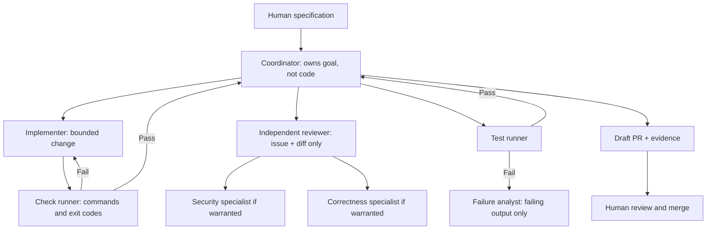

התרשים מדגים עיקרון ולא תצורה מובנית של מוצר: כל agent מקבל גבול ברור, ואת ה־merge מבצע אדם.

## 2. מקביליות ו־Git Worktrees

מקביליות יכולה להעלות throughput רק כאשר משימות בלתי תלויות. לפני פתיחת agents, ממפים לכל ticket:

1. אילו קבצים הוא קורא/כותב.
2. לאילו תוצרים או schema הוא תלוי.
3. האם שינוי אחד נדרש לפני שהאחר יכול להתחיל.
4. איך מאמתים כל ticket בנפרד ואיך בודקים את האינטגרציה.

שתי משימות בטוחות למקביליות רק אם אין ביניהן **shared files** ואין **data dependency**. אם שתיהן עושות write לאותו `models.py`, או שאחת צריכה שדה שהשנייה מוסיפה, אין להפעיל אותן במקביל ללא תכנון אינטגרציה.

Git worktree יוצר working tree נפרד לכל branch בלי לשכפל את כל ה־repository. כך agents יכולים לעבוד על קבצים חופפים בלי לכתוב לאותו working directory, אך עדיין נדרשים review, merge ופתרון קונפליקטים. Worktree אינו מונע שינוי שגוי, מחיקה של shared external resource או קונפליקט בעת merge.

```bash
# Create an isolated working tree and branch for one ticket.
claude --worktree ticket-1

# Inspect all active working trees before merging.
git worktree list

# After committing and merging the branch, remove its working tree.
git worktree remove <path>
```

יש לוודא את פקודת ה־CLI מול הגרסה המותקנת; דף התרגיל מציג `claude --worktree ticket-1` עבור Claude Code, וב־Cursor נדרש לבחור worktree דרך ה־Agents Window.

## MCPs, Large Codebases ו־Production

### MCPs

המצגת מציגה MCP כחיבור לשרתים חיצוניים שמספקים כלים. ב־Cursor מוצגת תצורה project-level ב־`.cursor/mcp.json`, שניתנת לשיתוף יחד עם ה־repo, לצד תצורה global ב־`~/.cursor/mcp.json`; בשקף מומלץ להעדיף project scope כשמתאים לצוות. `mcp_tool` מופיע כדפוס להפעלת כלי מחובר, ו־hooks כדרך להבטיח שהבדיקה תבוצע במקום להסתמך על prompt בלבד.

הסילבוס מונה גם תרגיל MCPs, אך לא נמצא בתיקיית שיעור 4 דף תרגיל ייעודי בשם זה. אין במדריך תרגיל שהומצא כדי למלא את החסר.

### Large Codebases

בשקף “Large Codebases” מומלץ לארגן הקשר בשכבות לפי אזורים כגון frontend, backend או service, ולהשתמש בקובץ context ייעודי לכל אזור במקום להעמיס את כל ה־repository על agent אחד. זהו עיקרון תכנון מתוך המצגת; פירוט נוסף לא אומת מעבר לתוכן השקף.

### Throughput ו־Production

הסילבוס מציג Throughput ו־Production כנושאי פתיחה לשיעור. המדריך עוסק ב־throughput רק דרך תנאי המקביליות והפחתת תלות בין tickets. הגדרה מדידה ל־throughput או הגדרה מלאה של Production לא נמצאו במקורות המקומיים הנגישים; החלקים האלה לא אומתו.

## 3. Spec-Driven Development ו־Workflows

### למה מפרידים artifacts

“Chat is not the source of truth.” תהליך Spec-Driven Development הופך דרישות לשורה של artifacts שניתן לקרוא, לאמת ולתקן לפני שהן הופכות לקוד:

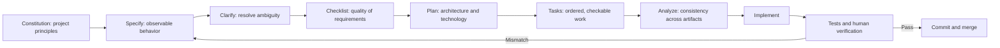

- **Constitution:** עקרונות חוצי־פיצ'רים (למשל buy-don't-build, engine-truth, tests נדרשים). היא אינה רשימת פיצ'רים.
- **Specify:** מה המשתמש יוכל לעשות ולמה; behavior שניתן לצפייה. לא בוחרים עדיין ספרייה או מבנה נתונים.
- **Clarify:** שאלות שמסירות עמימות ומעדכנות את ה־spec.
- **Checklist:** בדיקת שלמות, עקביות ויכולת בדיקה של הדרישות.
- **Plan:** איך מממשים — stack, ארכיטקטורה, interfaces, ספריות ו־thresholds.
- **Tasks:** פירוק ה־plan למשימות מסודרות וניתנות לבדיקה; ב־Spec Kit התרגיל דורש לא לדלג עליהן.
- **Analyze:** בדיקת התאמה בין spec, plan ו־tasks לפני מימוש.
- **Implement:** ביצוע לפי התוצרים שנבדקו.

קריאת artifact לפני שממשיכים היא חלק מהעבודה. תיקון `spec.md` זול מתיקון קוד שכבר נבנה על הנחה לא נכונה. כל פאזה יכולה להסתיים ב־test gate; “green” הוא תנאי לעבור הלאה, לא תחליף לבדיקה שה־test עצמו אוכף את הדרישה.

### Plan in Phases

התרגיל **Plan in Phases** משויך לשיעור 3 לפי הסילבוס. לתיאור ולשלבים ראו [שיעור 3 - AI Coding](../שיעור%203%20-%20AI%20Coding/master_class_guide.md); המדריך הזה אינו משכפל את התרגיל.

### Loops, Ralph Wiggum ו־workflow

Loop engineering מריץ משימה עם תנאי הצלחה/כשל, חזרה מוגבלת ובדיקה חוזרת. Pattern של צעדים סדרתיים עם context נקי לכל צעד ומצב שנשמר מחוץ לשיחה (המכונה בתמליל Ralph Wiggum) יכול להפחית context drift. Dynamic workflow או graph מתאר את השלבים והמעברים במקום להשאיר את כל הבקרה לטקסט חופשי. בכל מקרה יש להגדיר עצירה, timeout, retries ו־human escalation.

## תרגיל מעשי: Sub-agents — Trust, but Verify

**מטרה:** ליצור verifier, לבנות אתר קטן עם agent ראשי, ולהפעיל verifier במפורש ובעקיפין; לבדוק מודל נפרד ל־review.

**דרישות קדם:** Claude Code או Cursor תומך sub-agents, repository קטן ויכולת להריץ/לבדוק HTML.

**קלט/פלט:** בקשה לבניית `index.html` עם hero, About, Projects, Skills ו־Contact form. הטופס צריך לבדוק email ולהציג הודעת הצלחה inline; ה־verifier מחזיר ממצאים מבוססי בדיקה ולא מקבל את טענת ה־builder כעובדה.

**שלבים:**

1. צרו `.claude/agents/verifier.md` או `.cursor/agents/verifier.md` עם YAML front matter `name: verifier`, description ממוקד ו־system prompt שמחייב בדיקת מימוש, הרצת בדיקות ודיווח pass/fail.
2. אתחלו/רעננו את הכלי וודאו שה־agent מופיע ב־`/agents` או ב־agent picker.
3. בקשו מה־main agent לבנות את האתר, בלי לערב verifier עדיין.
4. הפעילו מפורשות `/verifier confirm the personal site is complete, responsive, and the contact form validates and shows a success message`.
5. בקשו את אותה בדיקה בשפה חופשית ללא slash. בדקו אם description ניתב ל־sub-agent.
6. ב־Cursor אפשר להגדיר `model: composer-2`; ב־Claude Code אפשר לבחור `opus`, `sonnet`, `haiku` או `inherit` לפי גרסת הכלי. הריצו שוב וודאו שה־main model נשאר נפרד.

**בדיקת הצלחה:** verifier מראה מה נבדק ומה נכשל, ולא רק מסכם. אם implicit invocation אינו עובד, שפרו description. מודל נוסף הוא עוד reviewer, לא הוכחת נכונות.

## תרגיל מעשי: Parallelizing Agents — שישה tickets

**מטרה:** למפות תלות לפני פתיחת agents, לבצע שני tickets עצמאיים במקביל ב־worktrees, ולמזג לפי הסדר.

**דרישות קדם:** repository toy-to-do (FastAPI + SQLite), Git, Python ותלויות הפרויקט. דף התרגיל אומר להריץ את ה־API ולבדוק `GET /tasks` לפני מקביליות.

**Backlog:**

1. `GET /tasks/{id}` עם 404 עבור ID חסר.
2. Request-logging middleware: method, path, time.
3. `GET /health` שמחזיר `{"status":"ok"}`.
4. Input validation: כותרת לא ריקה ואורך מקסימלי.
5. שדה `priority` ל־task (low/medium/high, ברירת מחדל medium).
6. Filter `GET /tasks?priority=high`.

**שלבים:**

1. בקשו מ־agent יחיד טבלת tickets מול קבצים שנקראים/נערכים ותלויות.
2. סמנו רק זוגות שאין להם shared files ואין להם data dependency.
3. הפעילו לפחות שני agents במקביל, כל אחד ב־branch/worktree משלו, עם plan תחום לכל ticket.
4. בדקו כל branch, הריצו tests, עשו commit, ואז merge ל־`main` בסדר שמתחשב בתלויות.
5. לאחר merge של parallel-safe set, הריצו את ה־tickets שהיו queued.

**בדיקת הצלחה:** אין agents שכותבים במקביל לאותו working tree; אפשר לזהות כל branch באמצעות רשימת ה־worktrees; ה־API והבדיקות עוברים אחרי merge. ה־HTML אינו קובע זוג בטוח קבוע — יש להסיק אותו מטבלת הקבצים/התלויות של ה־repo.

```bash
# Inspect worktrees and branches before merging.
git worktree list
git branch --all

# Merge only after reviewing and testing each isolated branch.
git checkout main
git pull
git merge <ticket-branch>
```

## תרגיל מעשי: Nested Subagents — One Agent, One Concern

**מטרה:** לבנות tree עם שבעה roles, לבדוק nesting depth בפועל, ולהריץ nested verification, independent review ו־conditional test triage.

**דרישות קדם:** Claude Code, Git, Python 3.11+, pytest, Ruff ו־mypy. תרגיל ה־HTML יוצר `agent-tree-lab/` עם שלושה bugs מכוונים.

### Phase 0 — Scaffold

ה־repo כולל `app/pagination.py`, `app/slug.py`, `app/session.py`, `app/listing.py` ו־tests:

- import `math` לא בשימוש כדי ש־Ruff ייכשל.
- `total_pages()` מחלק floor במקום לעגל למעלה, ולכן עמוד אחרון חלקי נשמט.
- `slugify()` אינו מסיר dashes בקצוות.
- `new_token()` משתמש ב־`random` במקום `secrets`, סיכון security שה־security reviewer אמור לזהות.

```bash
.venv/bin/ruff check .
.venv/bin/mypy app
python3 -m compileall -q app
.venv/bin/pytest -q
```

תוצאת baseline לפי דף התרגיל: Ruff exit 1, mypy/build exit 0, ו־pytest: 4 failed, 10 passed. אמתו את ה־baseline לפני שממשיכים.

### Phase 1 — שבעה roles ומדידת nesting

הקימו `.claude/agents/` עם roles:

| Role | כלים / גבול |
|---|---|
| `code-implementer` | Read/Write/Edit/Bash/Agent; שינוי תחום, חייב check-runner לפני דיווח |
| `check-runner` | Read/Bash בלבד; מריץ Ruff, mypy, compileall ומחזיר פקודות ו־exit codes |
| `independent-reviewer` | Read/Grep/Glob/Agent; קורא issue לפני diff, מחליט אם דרוש fan-out |
| `security-reviewer` | Read/Grep/Glob בלבד; מחפש misuse, tokens, auth, input |
| `correctness-reviewer` | Read/Grep/Glob בלבד; מחפש קלט קונקרטי שבו הלוגיקה שגויה |
| `test-runner` | Read/Bash/Agent; מריץ pytest, ורק בכשל מזמן analyst |
| `failure-analyst` | Read/Grep/Glob בלבד; מאבחן מתוך פלט כשל, לא עורך |

מדדו nested depth עם probe שבונה שרשרת sub-agents ומדווחת את הכשל המדויק. אל תסמכו על ערך ברירת מחדל ממאמר: הוא משתנה לפי גרסה/הגדרות. אם עומק מותר נמוך משלוש שכבות, הפעילו את ה־leaf roles ישירות מה־coordinator.

### Phase 2 — שלושה branches בנפרד

1. **Nested verification:** implementer מתקן `total_pages()`; הוא מזמן check-runner. Ruff ייכשל בהתחלה על import מיותר, ואז צריך להסירו ולרוץ שוב. רק exit codes של הכלים קובעים pass/fail.
2. **Independent review:** כתבו `issues/002-remember-me.md`, תנו ל־coordinator להפעיל implementer, ולאחר מכן reviewer מקבל רק issue + `git diff`. Reviewer מחליט אם השינוי מצדיק `security-reviewer` או `correctness-reviewer`. ממצאים צריכים לכלול severity, `file:line` ותרחיש קונקרטי. תרגיל session מעלה שאלות על חודש validity ללא revoke ועל שימוש ב־`random` במקום `secrets`.
3. **Conditional test triage:** `test-runner` מריץ pytest; אם הכל עובר, אין analyst. אם נכשל, הוא מעביר ל־`failure-analyst` רק שמות בדיקות ופלט. Analyst מחזיר root cause, evidence, confidence ותיאור תיאוריות שנשללו. הוא אינו מתקן.

### Phase 3 — pipeline שלם ומדידת עלות

צרו `issues/003-search-filter.md` עבור חיפוש case-insensitive ב־listing, ספירת עמודים לאחר filter, reject ל־`per_page <= 0`, ובדיקות. בקשו מה־coordinator: brief → implementer → independent reviewer + test-runner → arbitrate → draft PR. כל תיקון מוגבל לשני loops; אחרי זה עוצרים ומסלימים.

PR נשאר draft; לא עושים merge אוטומטי. ה־body כולל diff, פקודות/exit codes, findings שנפתרו וגם כאלה שנותרו. הריצו `/usage`, אחר כך את אותו issue ב־session שטוח ללא subagents, והשוו עלות וממצאים. השאלה אינה “האם יותר agents טובים”, אלא האם התועלת ב־issue הזה הצדיקה את העלות.

**בדיקת הצלחה:** ראיות עולות בכל hop; reviewer אינו מקבל את הסבר ה־implementer; specialists מופעלים רק כשצריך; analyst מופעל רק בכשל; אין קוד שמתמזג ללא human review. אין טעם ב־tree למשימה זעירה או ל־goal עמום.

## תרגיל מעשי: Spec Kit — Chess App

**מטרה:** לחוות שני passes של Spec-Driven Development: לולאת Specify → Plan → Tasks → Implement, ואז לולאה מלאה עם constitution, clarify, checklist ו־analyze.

**דרישות קדם:** Python 3.11+, Git, `uv`, Spec Kit CLI ו־agent נתמך. התקינו מה־Git הרשמי שמצוין ב־HTML; היזהרו מחבילת PyPI בעלת שם דומה.

```bash
uv tool install specify-cli --from git+https://github.com/github/spec-kit.git
specify init chess-app
cd chess-app
git status
git log --oneline
```

Cursor צריך initialization עם integration מתאים, למשל `specify init chess-app --integration cursor`, כדי לייצר `/speckit-*` commands.

### Pass 1 — הלולאה הרזה

1. `/speckit-specify`: כתבו דרישה התנהגותית בלבד — human plays full chess game vs computer, legal moves, highlighting, captures, check/checkmate/stalemate/draw, move list, new game. אל תכניסו Python, library או algorithm ל־spec.
2. קראו `specs/001-*/spec.md`; בדקו branch `001-...` ושהשם תואם לתיקיית spec.
3. `/speckit-plan`: בחרו Python, ספריית chess battle-tested (למשל `python-chess`), הפרידו state/engine מ־UI; opponent יכול לבחור legal move פשוט.
4. קראו ותקנו `plan.md`.
5. `/speckit-tasks`: פירוק מסודר למשימות ברות בדיקה. זה שלב חובה לפני implement.
6. קראו `tasks.md`, ודאו כיסוי ל־board, move selection, computer move ו־end states.
7. `/speckit-implement`; הריצו app ושחקו בפועל, תקנו קוד ולא tests כדי לגרום ל־green.
8. commit ואז merge של branch feature ל־`main`.

### Pass 2 — שרשרת מלאה ו־feature נוסף

1. `/speckit-constitution`: קבעו עקרונות כמו buy-don't-build, engine-truth, separation of evaluation from UI, tests for known positions.
2. `/speckit-specify`: הוסיפו evaluation bar שמראה איזה צד עדיף ולפי כמה; forced mate מוצג כניצחון ברור. כתבו observable behavior בלבד, בלי Stockfish/centipawn בשלב הזה.
3. `/speckit-clarify`: פתרו עמימות; שמרו את התשובות ברמת ההתנהגות.
4. `/speckit-checklist`: בדקו completeness, consistency ו־testability. הפכו “objective evaluation” לדרישה שניתנת לבדיקה באמצעות positions ידועים.
5. `/speckit-plan`: בחרו Stockfish ו־UCI, Python integration דרך `python-chess`, engine wrapper נפרד מה־UI, clamping של centipawns למילוי bar וייצוג mate.
6. `/speckit-tasks`; קראו את הפירוק ובדקו טעינת engine, evaluation אחרי move, mapping score to bar ו־tests.
7. `/speckit-analyze`: בדקו שאין requirement ללא task או סתירה בין artifacts. אם משנים plan, צרו מחדש tasks.
8. `/speckit-implement`; בדקו positions מאוזנים, יתרון חומרי ברור ו־mate; commit ו־merge ל־main.

**בדיקת הצלחה:** artifact נבדק לפני שהוא מזין את הבא; כל תוספת משמעותית כוללת test; spec נשאר “what/why”, plan מחזיק “how”, tasks ניתנים לאימות. ב־Pass 2 ה־constitution נשמר כעיקרון project-wide ולא הופך לרשימת feature.

## תרגילים השייכים לשיעור 3

הסילבוס משייך את **Space Invaders — TDD** ואת **Plan in Phases** לשיעור 3. הקבצים הכפולים שנמצאים גם בתיקיית שיעור 4 הושוו ונמצאו זהים ל־HTMLים של שיעור 3; ראו [שיעור 3 - AI Coding](../שיעור%203%20-%20AI%20Coding/master_class_guide.md) לפרטי התרגילים.

## Cheat Sheet ותקלות

### בחירה מהירה

- **Skill:** workflow חוזר / מתכון שניתן לטעון לפי צורך.
- **Sub-agent:** משימה נפרדת או מומחיות עם context מבודד.
- **Parallel sub-agents:** רק לאחר מיפוי files touched ו־dependencies.
- **Agent team:** כאשר צריך תקשורת או shared task state, לא רק תשובה עצמאית.
- **Hook:** פעולה/בדיקה/חסימה שחייבות להתבצע באופן דטרמיניסטי בנקודת lifecycle.
- **Spec Kit:** feature גדול עם artifacts, gates ו־review בין שלבים.
- **Flat agent:** תיקון קטן, קצר ותחום.

### תקלות

| סימפטום | סיבה אפשרית | פעולה מומלצת |
|---|---|---|
| Sub-agent לא נטען | מיקום או frontmatter שגוי, session לא רענן | בדקו `name`, `description`, `tools`, path ו־`/agents`; פתחו session מחדש לפי הצורך. |
| Agent “השתמש ב־verifier” אבל לא ברור | implicit routing או fallback ל־general agent | הפעילו מפורשות, הוסיפו color, בדקו session tree/agents view ואת תיאור ה־agent. |
| Nested run נעצר בשקט | depth cap או tool לא זמין | מדדו depth לפי גרסה, דרשו דיווח גבול ואל תקבלו flatten שקט. |
| Agents דורסים קבצים | חפיפת עבודה באותו working tree | חלקו scope או השתמשו ב־Git worktrees; בדקו diff/merge ידנית. |
| Parallel tasks נכשלות באינטגרציה | data dependency או shared file שלא זוהו | חזרו ל־dependency map, סדרו tasks ותכננו merge wave. |
| Cost גדל ללא תועלת | agents רבים או fan-out גורף | הפעילו specialists רק לפי diff/failure; מדדו `/usage` מול baseline שטוח. |
| Workflow חוזר בלי סוף | אין stop condition, retry cap או validator | הוסיפו תנאי סיום, retry cap, timeout ו־human escalation. |
| Spec Kit לא יוצר branch | אין repository Git תקין | הריצו `git status`, `git log`; אתחלו repo וצרו initial commit. |
| Plan/tasks סותרים | artifact השתנה אך הבא לא עודכן | קראו diff, הריצו מחדש tasks/analyze ושמרו עקביות לפני implement. |
| Green אך feature לא עובד | tests אינם בודקים requirement או E2E | בדקו requirement, הוסיפו integration/E2E, ואל תתנו ל־agent לשנות tests כדי לעבור. |

## מגבלות אימות

דפי HTML ותמליל השיעור נקראו. שני PDFs ו־DOCX verifier לא ניתנו לקריאה בתצוגה הזמינה. Spec Kit, Space Invaders, Git worktrees ו־agents לא הורצו כאן, ולכן אין טענה לתוצאות build או merge. גרסאות tools, nesting limits, flags ו־slash commands משתנות; בדקו מול הגרסה המקומית לפני שימוש.


---
# שיעור 5 - RAG
---

# מדריך כיתת אמן: RAG — Retrieval-Augmented Generation

## מטרת השיעור ומקורות

השיעור עוסק ב־RAG כארכיטקטורת ידע עבור LLMs: מסמכים נטענים, מפוצלים ומאונדקסים מראש; בזמן שאילתה המערכת שולפת קטעים רלוונטיים ומוסיפה אותם ל־prompt כ־context, ואז המודל מנסח תשובה על סמך הבקשה והקטעים. שלב ה־ingestion אינו מאמן מחדש את המודל ואינו גורם לו ללמוד את המסמכים.

המדריך מבוסס על:
- [acme-it-handbook.md](acme-it-handbook.md)
- [eval-questions.md](eval-questions.md)
- [תמליל עד הסוף.txt](תמליל%20עד%20הסוף.txt)
- הדוגמאות שבתיקיית [demo-docs](demo-docs)

החומר מראה בבירור שה־RAG הוא לא “לשים קובץ אחד ולשאול את ה־AI”; זה pipeline שלמה: loader → chunking → embeddings → vector search / hybrid retrieval → prompt construction → generation → evaluation.

## 1. למה RAG קיים

מודל LLM נבנה על ידע כללי, אבל ב־production עשויים להידרש מידע עדכני, מסמכים פנימיים ומדיניות ארגונית. RAG משאיר את מקור הידע במקום שניתן לנהל ולעדכן, כגון handbook, wiki, policy docs, tickets, KB או database.

בשלב ingestion המסמכים נטענים, מפוצלים ומאונדקסים. המודל אינו מאומן מחדש עליהם: בזמן השאילתה ה־retriever מחפש קטעים רלוונטיים, והיישום מוסיף אותם ל־prompt. המודל מנסח תשובה על סמך השאלה וה־context שהתקבל.

### In-context learning

הסילבוס מונה In-context learning כיסוד של RAG. כאן המידע שנשלף מצורף ל־prompt ומשפיע על התשובה באותה קריאה; אין בכך עדכון של משקולות המודל. להרחבה על דוגמאות, context ו־in-context learning ראו [שיעור 2 - Prompt Engineering](../שיעור%202%20-%20Prompt%20Engineering/master_class_guide.md).

### עיקרון פשוט

```
Question -> Retrieval -> Context in prompt -> Generation -> Answer
   |          |                 |                 |
  User query  Indexed source   Retrieved chunks    LLM
```

אם ה־retrieval רע, גם ה־generation מוגבל: יצירה אינה יכולה להוסיף ראיות שלא סופקו למודל.

## 2. Loader ו־extract — הבסיס הרעוע של הרבה RAGs

דף ה־demo הראשון מדגיש נקודה קריטית: איכות הטקסט שמגיע ל־pipeline מתחילה ב־loader.

### למה זה חשוב

- Markdown שומר מבנה: headings, lists, code blocks, tables
- PDF יכול להיות מלוכלך: headers, footers, שורות נפרדות, loss of semantics
- DOCX/HTML/PowerPoint/Excel דורשים handling נכון לפי הקובץ
- טעויות ב־extraction מתפשטות ל chunking, embeddings ו־retrieval

### עיקרון

“Garbage in, garbage out” ב־RAG אינו סיסמה; זה חוק ממשי. אם ה־loader משחית את המסמך, אין כל כך הרבה שביכולתו לעשות ה־retriever או ה־LLM.

בתרגיל, ה־handbook הוא מסמך ארגוני די well-structured. לכן הוא מתאים ל־RAG טוב, אבל גם שם צריך להתייחס ל־tables, policies, sections, error codes, ו־metadata.

## 3. Chunking — המקום שבו רוב הבעיות מתחילות

זהו החלק שבו ה־demo השני מדגים בצורה המובהקת ביותר את עוצמת ה־RAG.

### שלוש אסטרטגיות מודגמות

1. Fixed-size chunks, ללא overlap
   - פיצול שווה לאורך קבוע
   - מהיר, פשוט, אבל עלול לקצץ באמצע משפט/סעיף
   - תוצאה: שאלה כמו “Error 812 on Mac” מתפצלת על פני כמה chunks ולא מתאחדת בקובץ אחד

2. Fixed-size chunks עם overlap
   - הוסיף חפיפה בין chunks
   - משפר את הסיכוי לשמור רצף, אבל עדיין עלול לייבא רעש
   - שיפור, אבל לא תמיד מספיק

3. Chunking מבוסס מבנה/סמנטיקה
   - שומר על פרק, סעיף, טבלת מידע, או בלוק תהליכים שלם
   - הרבה יותר טוב לשאלות תהליכיות או פוליסות שמושפעות מ־context

### מה ה־demo מראה

השאלה: “I’m getting error 812 on Mac, what do I do?”

- Chunking גרוע: הפתרון מפוזר על פני 4 chunks, ללא שמירה על רצף
- Chunking עם overlap: לעיתים שומר על תשובה אחת, אבל מגרר גם קטעים לא רלוונטיים
- Chunking טוב: שומר על הפתרון כבלוק אחד או כמה בלוקים מוסכמים

### לקח מעשי

- אל תשתמש ב־fixed-size גס בלי לחשוב על שאלות המשתמש
- עבור docs ארגוניים, chunk לפי section / heading / procedural block
- התאם גודל chunk ל־query type: answer short answer vs. multi-step process
- לעיתים צריך overlap, אבל לא רק כדי “למנוע פספוס” — יש מטרה של שמירה על context

## 4. Embeddings — “meaning as math”

ה־demo השלישי מדגים את הרעיון המרכזי: conversion of text into vectors so that semantically similar content clusters together, even if the words differ.

### מה זה embedding

Embedding הוא וקטור מספרי שמייצג את המשמעות של טקסט. במקום רק לחפש מילים זהות, המערכת מחפשת קווי דמיון במרחב של משמעות.

דוגמא:
- “Error 812 on Mac”
- “Authentication failed on macOS while connecting to VPN”

שני המשפטים קרובים מבחינה semantically, גם אם אין חפיפה מילולית מלאה.

### למה זה חשוב

ב־RAG, retrieval אמור להיות semantic, לא רק lexical. זה עוזר כאשר:
- המשתמש שואל בשפה שונה מהמסמך
- יש synonyms / jargon / acronyms
- יש השאלה פוגשת מידע במרחק רטורי ולא מילולי

### עיקרון

ב־RAG טוב, query וה־chunks “נפגשים” במרחב סמנטי, לא רק “מילים זהות”.

## 5. Retrieval strategies — לא יש שיטה אחת

דף ה־demo החמישי מדגיש שהמערכת ממש לא נמדדת רק לפי “הכי קרוב” במרחב וקטורי.

### שלוש שיטות נפוצות

| סוג | איך עובד | מתי מתאים | סיכון |
|---|---|---|---|
| Vanilla vector search | similarity score בלבד | short factual queries | יכול להחזיר רעש / לא את כל ההקשר |
| Hybrid retrieval | vector + keyword / lexical | queries mix exact terms and semantic intent | מורכבות/weighting שגוי |
| Reranking | retrieved candidates reordered by better relevance | איכות retrieval חשובה מאוד | עלות נוספת |

### דוגמה מהדמו

שתי שאלות:
- “I’m getting error 812 on Mac, what do I do?” — query specific, procedural
- “Remote work policy” — broader, policy-oriented

שיטות שונות ייהנו מאסטרטגיות שונות. אין “silver bullet”; יש תיאום בין סוג השאלה לבין אופי המסמך.

### כללי אצבע

- עבור תהליכים/שגיאות / instructions: retrieve chunks with full sequence and context
- עבור policy / compliance: דאגה גם ל־cross-chunk synthesis
- עבור “not found” / unavailable info: צריך להתמודד עם “I don’t know” במקום hallucination

## 6. Generation — ה־LLM רק מייצר על סמך מה שקיבל

דף ה־demo השישי מדגיש את הרעיון הבא: generation quality is bounded by retrieval quality.

אם קיבלת:
- chunks ריקים
- chunks קטנים מדי
- chunks לא שלמים
- context מעורב וכולל רעש

אז ה־LLM ינסה לנחש, להמציא, או להפיק תשובה מסודרת שלא מבוססת על המקור.

### למה זה חשוב

מבחינה פרקטית, ה־LLM הוא לא “source of truth”; הוא רק מנגנון להפקת תשובה מתוך הידע שנמסר לו. כל שיפור ב־prompt engineering לא יחליף retrieval טוב.

### הנקודה של “context ceiling”

אם ה־retrieval מספק רק חלק קטן מהידע, התשובה המתקבלת תמיד תהיה מוגבלת למקסימום המידע שהגיע ל־model. זו הסיבה שמדידת RAG צריכה להיבחן גם במפלס ה־retrieval וגם במפלס ה־generation.

## 7. Evaluation — למדוד את מה שחשוב

זהו החלק המרכזי שבו ה־transcript מדבר על “הקושי להעריך RAG יותר מאשר להעריך model רגיל”.

### 7.1 מדדי Retrieval

- Precision: כמה מה־retrieved chunks אכן רלוונטיים
- Recall: כמה מה־מידע הרלוונטי אכן נמצא ב־retrieved set
- Hit rate / MRR: האם קיבלנו לפחות chunk רלוונטי בסוף התוצאות; האם ה־best match הגיע גבוה

הפרשנות היא מעשית:
- אם תשובה חשובה חסרה, זה בדרך כלל בעיה של recall / retrieval coverage
- אם קיבלת הרבה רעש ו־chunks לא רלוונטיים, זה בעיה של precision

### 7.2 מדדי Generation

- Correctness: האם התשובה נכונה
- Relevance: האם היא עונה על השאלה
- Faithfulness: האם התשובה נשענת על context ולא על דמיון/השערה
- Groundedness: האם המידע בתוך התשובה מופיע במקור

### 7.3 מדדי RAGAS

דף התרגיל מציין ארבעה מדדי RAGAS בשמותיהם:
- `context_precision`: עד כמה הקטעים שנשלפו רלוונטיים.
- `context_recall`: עד כמה ה־context כולל את המידע הדרוש לתשובה.
- `faithfulness`: עד כמה התשובה נאמנה ל־context שסופק.
- `answer_relevancy`: עד כמה התשובה רלוונטית לשאלה.

אלה מדדים שונים, ויש לקרוא את ציוניהם לצד שאלות ה־eval והתשובות הצפויות ולא כמספר איכות יחיד.

### מה שחשוב במיוחד

ב־RAG, לא מספיק לבדוק “האם תשובה נראית טובה”. צריך לבדוק:
- האם הידע שנשלף היה נכון
- האם ה־model עשה שימוש נכון בו
- האם הסעיפים היו מספיקים
- האם נתקענו ב־hallucination כשלא היה מידע

## 8. הקבוצה הארגונית: Acme IT Handbook כ־source of truth

ה־handbook מספק כלי מצוין ל־RAG real-world כי הוא כולל:
- policies
- troubleshooting procedures
- hardware info
- security rules
- onboarding / offboarding
- AI usage approval policy
- support channels and SLAs

העובדה שהמסמך מלא ב־tables, procedures, error codes, and cross-section references הופכת אותו לאידיאלי לבדיקת RAG quality.

### דוגמאות לשאלות מה־eval set

1. “I'm getting error 812 on my Mac, how do I fix it?”
   - tests procedural recovery from Section 1.3

2. “How often are laptops replaced at Acme?”
   - tests precise numeric fact retrieval from Section 3.2

3. “Can I use ChatGPT for work at Acme?”
   - tests synthesis across policy sections

4. “What should I do about VPN error 503?”
   - tests retrieval of a distinct error code

5. “How fast should IT respond to a critical ticket?”
   - tests combining SLA and escalation path

6. “How do I set up a Linux workstation at Acme?”
   - tests the correct failure mode: no answer in corpus, no hallucination

### התובנה העיקרית

ה־eval set לא רק בודק תשובה “יפה”; הוא בודק מראש מה ה־retriever צריך לעשות. כל שאלה מייצרת סוג אחר של retrieval challenge: exact match, numeric lookup, table parsing, policy synthesis, not-found handling, ambiguity handling.

## 9. עקרונות פעולה פרקטיים

### תכנון RAG בפועל

1. הכן מקור ידע איכותי
   - מסמכים מסודרים
   - metadata בסיסי: document_id, title, section, classification

2. בחר loader מתאים
   - Markdown > PDF for structure
   - PDF רק אם יש OCR/clean extraction

3. chunk לפי מבנה
   - headings, paragraphs, procedures, tables
   - לפעמים semantic chunking עדיף על fixed-size

4. בחר retriever
   - semantic first
   - hybrid if needed in noisy domains
   - rerank for high precision

5. עצב prompt סביב context
   - source-aware
   - grounded instructions
   - explicit “if not in context, say not found” policy

6. בנה eval set
   - שאלות רווחות + edge cases
   - include “not found” scenarios
   - check both retrieval and generation

7. מדוד את השגיאות בצורה נקייה
   - retrieval quality issue vs generation issue
   - אם התשובה לא מלאה — likely recall problem
   - אם התשובה מבלבלת או לא רלוונטית — likely ranking / prompt issue

## 10. מסקנה מרכזית

RAG טוב אינו רק חילוץ מסמכים ושמירת vectors; הוא מערכת שמרכיבה יחד ידע, שפה, retrieval ומשמעת הערכה.

הסיפור של השיעור הוא חד:
- Chunking קובע מה אפשר לשלוף
- Embeddings קובעים איך ה־query מתאים
- Retrieval קובע מה ה־LLM יכול לראות
- Generation קובע איך הכל נאמר
- Evaluation קובע אם הכל באמת עובד

במילים אחרות: בהצלחה ב־RAG, ה־LLM לא “חושב יותר”; הוא “נזקק פחות להמצאה” כי הוא מקבל יותר ידע אמין בתוך הקונטקסט.

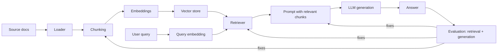

## 11. תרגיל מעשי להטמעה

בקשו מן־AI לבנות pipeline RAG קטן על בסיס handbook זה, עם תפקידים ברורים:

1. Loader: קרא את קובץ Markdown/HTML/ה־corpus
2. Chunker: הפרד לפי section / heading
3. Embeddings: הוסף vector index בסביבה פשוטה
4. Retrieval: השלם חיפוש סמנטי + מעקב על score
5. Generator: הפיק תשובה על סמך chunks
6. Evaluator: בדקו את כל 10 השאלות שב־eval set, ושמרו לכל אחת את השאלה, ה־ground truth, ה־retrieved contexts והתשובה שנוצרה.
7. Debrief: ציינו אם הבעיות הן ב־chunking, retrieval, או generation

### תנאי הצלחה

- הריצו את כל 10 השאלות. בתרגיל מוגדרים יעדי RAGAS של `faithfulness >= 0.85` ושל `context_recall >= 0.80`.
- Q10, על התקנת Linux workstation שאינה מתועדת בקורפוס, צריכה להחזיר “I don't know” במקום להמציא תשובה.
- אם chunking רע — רואים ירידה חדה ב־retrieval quality
- אם retrieval רע — answer quality נופלת באופן עקבי, גם עם model טוב

## 12. סיכום קצר

RAG הוא שיפור של “שאל את המודל” ל־“שאל את המידע, ואז עבד על הידע”.

הגורם המכריע הוא לא רק איכות ה־model, אלא איכות ה־pipeline כולו:
- מקור ידע טוב
- loader נכון
- chunking חכם
- retrieval מדויק
- generation מבוסס על context
- evaluation קפדני

אם המחלקה/הסטודנט מבינים את ה־pipeline הזה, אז הם מבינים את הליבה של ה־RAG, לא רק את שמו.


---
# שיעור 6
---

# מדריך כיתת אמן: Becoming a Champion Without Authority

## מטרת השיעור ומקורות

השיעור עוסק בשאלה הארגונית המרכזית של אימוץ AI: איך להוביל שינוי ולא רק להטמיע כלי. המפתח הוא לא “לשכנע את כולם” אלא להקים תנועה של עוקבים ראשונים, להראות הצלחה גלויה, ולהבין היכן הארגון נתקע: האם הבעיה טכנית, אדפטיבית, או שילוב של השניים.

הסדנה מבוססת על:
- [שיעור 6/Workshop1- Becoming a Champion_Without Authority.pdf](Workshop1-%20Becoming%20a%20Champion_Without%20Authority.pdf)
- [שיעור 6/תמליל.txt](תמליל.txt)
- [חוברת עבודה - סדנה 1 - AI LEAD_extracted.txt](../הובלת%20AI%20בארגון/חוברת%20עבודה%20-%20סדנה%201%20-%20AI%20LEAD_extracted.txt)

המצגת היא PDF בן 28 עמודים; טקסט שניתן לחלץ ממנו נבדק לצד התמליל וחוברת העבודה. החוברת כוללת ארבעה תרגילים כתובים, אך אין תרגיל קוד.

## מה בונים ולמה

הנחת היסוד של השיעור היא ש־AI adoption בארגון אינו רק בעיה טכנית. הוא נתקע לרוב בשלושה גורמים:
- כלי טוב עדיין לא מתאים למבנה העבודה
- אנשים לא מבינים מי אחראי על קוד שנוצר על ידי סוכן
- המערכת הארגונית לא מותאמת לקלוט יותר קוד, יותר סקירות, יותר החלטות

לכן תפקיד המוביל האמיתי אינו להכריח, אלא להחליף “אימוץ” ב“הפצה”.

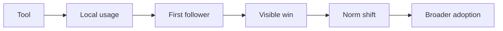

הדימוי של “Dancing Guy” מראה את העיקרון: לא צריך להאמין שכולם יפנו אליך בבת אחת. צריך עוקב ראשון, ואז התנועה מתפתחת.

## 1. למה אימוץ נתקע

### פרדוקס האימוץ

השיעור מפתח את פרדוקס האימוץ: ככל שיותר AI מופק, כך גדל גם עומס על מספר מצומצם של אנשים שמבצעים סקירות, אישורים, תיקונים, והאחריות על הביצוע.

הפדוקס הוא שמדידת “מהירות” עצמית של מפתח או צוות מטעה. לעיתים המפתח מרגיש שהוא עובד יותר מהר, אבל מה שקרה בפועל הוא שהזמן פשוט עבר ל־review, to-do filtering, debugging, ו־שחזור של פרשנויות ולא תמיד על פרודוקטיביות אמיתית.

מבחינה ארגונית, זה לא בעיה שבאה רק מהטכנולוגיה. זו בעיה של הספקה: מי מחליט, מי מאשר, מי בודק, מי מייצר תהליך של אימוץ כתבנית עבודה.

### שני סוגי אתגרים

רונלד הייפץ וסוגיות דומות משמשים להשוואה במצגת:

- אתגר טכני: הבעיה מוגדרת, הפתרון ידוע, המומחה יכול להגדיר ולהתקין
- אתגר אדפטיבי: אנשים צריכים לשנות הרגלים, תפקידים, נהלים וזהות מקצועית

הדגש של השיעור הוא שהאתגר השני הוא זה שמתקע. גם אם יש מנדט מלמעלה, אם אין שינויים בעבודה עצמה, האימוץ לא הופך נרמול.

## 2. המנהיגות ללא סמכות

### מה מרגיש “מנהיגות” בפועל

באופן תיאורטי, למנהל יש סמכות פורמלית: תקציב, משאבים, כיוון, החלטות. למוביל ללא סמכות יש לעיתים רק השפעה, אמון, אמינות, ויכולת ליצור עוקבים.

הסדנה קובעת כי:
- לא צריך את כל האנשים
- מספיק 2–3 עוקבים ראשונים
- העוקב הראשון הוא שותף, לא רק משתמש
- צריך להציג את החדש בצורה גלויה
- אנשים מצטרפים למה שהם רואים עובד אצל אחרים

### עקרון “העוקב הראשון”

העוקב הראשון הוא לא רק “מוטב” שצריך לשכנע. הוא בעצם הוכחה חברתית.

כשמישהו נוסף מצטרף, המחיר הפסיכולוגי של הצטרפות יורד. התנועה הופכת לנורמה. לכן המשימה של המוביל היא לא “לרקוד חזק יותר”; היא “ליצור עוקב ראשון שמרגיש שווה, מוכן, ובעל ביטחון”.

## 3. מיפוי השפעה: מי מחליט ומה יש לכם להציע

### מטריצת כוח-עניין

המצגת מציגה את המודל המרכזי: "מטריצת כוח-עניין". המטרה היא לא לשכנע את כל העולם, אלא לזהות:
- מי מחזיק בכוח החלטה
- מי סובל מהשינוי
- מי צריך להישמר נינוחים
- מי צריך להיות מעודכן
- מי צריך להיות מובא למומנטום

#### ארבע קטגוריות עיקריות

- Key Players / High power, high interest
  - מעורבים ישירות
  - מצריכים שותפות אסטרטגית
- Keep Satisfied
  - בעלי כוח, עניין נמוך
  - צריכים להרגיע ולא לבלבל
- Keep Informed
  - בעלי עניין, כוח נמוך
  - דורשים עדכונים ולא שיתופי פעולה עמוקים
- Low interest / low power
  - ניתנים למינימליזם ומעקב בלבד

זה עוזר למוביל לבנות אסטרטגיה על בסיס ריאליזם, לא על בסיס “כל אדם בישראל צריך להתעניין”.

## 4. השיקול העסקי והמדידה

### לא “האם זה מרגיש מהר?”

בתמליל המרצה הציגה ניסוי מ־2025 עם מפתחים מנוסים בפרויקטי open source: לפני הניסוי הם העריכו ש־AI יזרז אותם בכ־24%; לאחריו העריכו זירוז של כ־20%, בעוד שבמדידה הם היו איטיים בכ־19%. המרצה תיארה את זמן ניסוח הבקשות, ההמתנה וקריאת/תיקון קוד “כמעט נכון” כחלק מההסבר. היא גם סייגה שהכלים השתפרו מאז ושמדובר במפתחים ובקוד שהם מכירים היטב. שם מכון המחקר נשמע בתמליל האוטומטי כ“איטר” ואינו ודאי; לכן הנתונים מוצגים כאן כדברי המרצה ולא כציטוט מחקר שאומת עצמאית.

המסר הוא: כל כלי AI חייב להיות מוערך לפי מדדים שניתן לאמוד, לא רק לפי תחושה.

### מה כן למדוד

- זמן לסגירת משימה
- שיעור A/B של השוואה עם/בלי AI
- משך סקירת קוד
- מספר PRs שנפתחים/נסגרים
- זמן עד delivery
- איכות היישום, לא רק כמות היצירה

במילים אחרות, המהירות נמדדת ביחס ל־pipeline העסקי, לא ביחס למודלים בלבד.

## 5. פרדוקס האימוץ לעומת “שורת הרווח”

יחד, התמלול והמצגת מראים שהארגון אינו מחפש רק יותר קוד. הוא מחפש:
- קיצור זמן הגעה לשוק
- איכות מקובלת
- בטיחות ו־compliance
- שליטה על סיכונים
- היכולת להטמיע שיטות עבודה חדשות בלי לחלץ את הסדנאות פנימה

הטעות הנפוצה היא להאמין שהכפלת קצב יצירת הקוד לבדה מבטיחה ערך עסקי. אם צינור ה־handoff לא נפתח, המערכת עלולה להתמלא בעומס. תהליך האימוץ צריך להתייחס ליכולת הארגון לקלוט, לבדוק ולהטמיע את התוצרים, ולא רק לקצב הייצור.

## 6. הטקטיקה של המוביל בלי סמכות

### עקרונות מרכזיים

1. אל תצפה שהכל יאמץ בבת אחת
2. בחר את ה־first followers באופן קונקרטי
3. תן להם תפקיד, לא רק כלי
4. הצג תוצאות באופן גלוי
5. בנה אמון עם אנשי מפתח ועם שומרי סף
6. מדוד את הצלחת השינוי במונחים ארגוניים, לא רק פסיכולוגיים

### לשון של שכנוע

הסדנה מדגישה שכל “מכירה” של AI בתוך ארגון חייבת להיות שפה של בעיה עסקית ולא של סינון טכני. אמירה כמו “הכלי חוסך זמן” היא לא מספיק. צריך לומר:
- מה הבעיה הארגונית
- מה המומנטום
- מי מפיק תועלת
- מה הסיכון אם לא נעשה דבר
- מה נבנה יחד

## 7. תרגיל מעשי: מפת השפעה והצעת ערך

התרגילים בחוברת העבודה מיועדים לפרויקט האמיתי של המשתתפים. התוצר הוא **stakeholder influence map and clear value proposition**, ולא הצגה כללית של כלי AI.

### תרגיל 1: מיפוי מחזיקי עניין

רשמו שמות ותפקידים אמיתיים: מי חותם על אישור, מי מקצה תקציב או זמן, ומי יכול לעצור את הפרויקט בשקט. לכל אדם כתבו את החשש המזוקק שלו בנוסח “הוא חושש ש… ואז…”. במטריצה הבחינו בין שותפים אסטרטגיים, שומרי סף, עמיתים ותמיכה היקפית. החוברת מדגישה שכוח כולל גם השפעה לא פורמלית, למשל מי שסוקר PR או שמנהלים סומכים על שיקול דעתו.

### תרגיל 2: ארבעת מטבעות ההשפעה

בחרו אדם אחד מהמפה ושאלו מה אפשר להציע לו, למה שיקשיב דווקא לכם, ולמי הוא כן יקשיב. החוברת והתמליל מגדירים ארבעה “מטבעות” להצעת ערך:

| מטבע | ערך לבעל העניין | דוגמה מהחומר |
|---|---|---|
| משימה | עזרה ביעד שעליו הוא נמדד | קיצור תור סקירת PR ומתן קוד נקי יותר לסוקר |
| מעמד | סיפור הצלחה שיוכל להציג | הצוות שלו מוביל פיילוט ותוצאה מדידה |
| יחסים | שותפות, אמון ושליטה | הזמנת שומר סף להגדיר מראש גבולות וכללי סיכון |
| אישי | פחות עומס או תסכול יומיומי | אוטומציה של משימה חוזרת שאיש אינו רוצה לבצע |

זהו מסגור Persuasion/Business storytelling שנלמד בסדנה; אין לייחס לו שם של framework חיצוני שלא מופיע בחומר.

### תרגיל 3: בדיקת אימוץ

דרגו מ־1 עד 5 מנקודת מבט של עמית פרגמטי, לא של יוזם הפרויקט: relative advantage, compatibility, simplicity, trialability ו־observability. בחרו את החוליה החלשה וקבעו שינוי אחד מדיד. כך נבדקים יתרון יחסי, התאמה לכלים/הרגלים/זהות, קלות התחלה, אפשרות להתנסות ונראות של תוצאה.

### תרגיל 4: Pitch לפיילוט בן חמש שורות

החוברת והתמליל מתעדים בקשה לפיילוט קצר, מוגבל בזמן ובסיכון. כתבו:

1. **בעיה ומצב בסיס:** צוואר בקבוק ומדידה קיימת.
2. **הפיילוט:** היקף, צוות ומשך מוגדרים.
3. **סיכון וסקירה:** אמצעי הכלה, מאשר/ת אנושי/ת ומי בודק/ת.
4. **יעד כהשערה:** טווח מדיד ומה הנתונים שמבססים אותו; לא הבטחה.
5. **נקודת בדיקה:** מועד ותנאי עצירה.

התאימו את הצעת הערך לחשש של האדם: data security עבור CISO, code quality/יציבות עבור VP R&D וסוקר, או עומס/שינוי תפקיד עבור צוות הפיתוח. התמליל מתאר חששות אלה ומדגים את ה־pitch על כלי סקירת PR.

### Executive role-play: “Convincing the Skeptical VP”

הסילבוס כולל סימולציית executive role-play בשם זה לצד פיתוח sharp value pitch. החוברת המקומית מכילה את תרגיל ה־pitch ואת דוגמת סקירת ה־PR, אך אינה כוללת תסריט או פרופיל VP ייעודי. לכן אפשר לתרגל את השיחה באמצעות חמש שורות ה־pitch והחששות שמופו, אך התנגדויות ודמות ספציפיות לא הומצאו כאן.

## 8. מסקנה מרכזית

השיעור מחזק את העיקרון הזה: לא צריך לרכוש סמכות פורמלית כדי להוביל AI בארגון. צריך ליצור חוויה, להראות בבירור, ולתפוס את ה־first followers. שינוי אמיתי בארגון נבנה כאשר אנשים רואים תועלת, אמון, ומקום לעשות את השינוי.

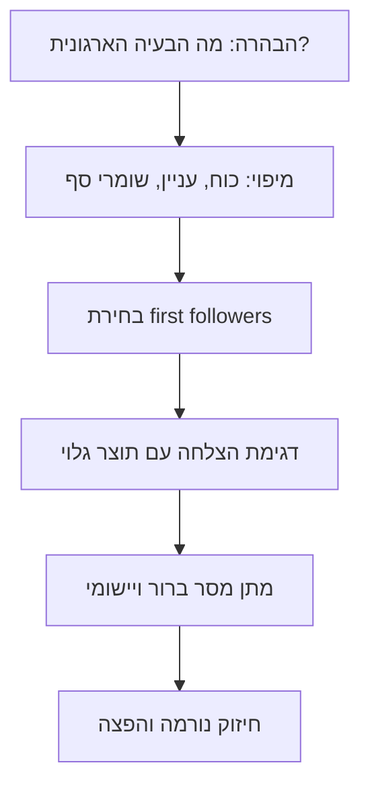

## 9. סיכום קצר

הקונספט המוביל של השיעור הוא זה:
- AI adoption אינו רק שאלה של כלי
- הדרך היחידה להאיץ אימוץ ללא סמכות היא ליצור תנועה שמראה הצלחה
- העוקב הראשון הוא המפתח להיווצרות נורמה
- המוביל חייב לדעת להבחין בין בעיה טכנית לבעיה אדפטיבית
- העיקר הוא לא לכל אחד להסכים, אלא להראות שגם לא רק “אדם אחד” עושה את זה


---
# שיעור 7
---

# מדריך כיתת אמן: Advanced RAG

## מטרת השיעור ומקורות

השיעור עוסק במעבר מ־RAG בסיסי ל־Advanced RAG: פיצול חכם יותר, חיפוש איכותי יותר, קישור בין מסמכים, רוטינג מבוסס־שאלה, עיבוד היררכי, והערכה אמינה של התוצאה. זהו שלב שבו RAG אינו עוד “חיפוש בספריה”, אלא מערכת החלטה: מה מחפשים, כמה מקבלים, איך מעריך את האיכות, ומה לא צריך להמציא.

המדריך מבוסס על:
- [שיעור 7/rag_advanced_deck.pdf](rag_advanced_deck.pdf)
- [שיעור 7/תמליל.txt](תמליל.txt)
- [שיעור 7/exercise-advanced-rag_1.html](exercise-advanced-rag_1.html)
- [שיעור 7/exercise-advanced-rag_2.html](exercise-advanced-rag_2.html)
- [שיעור 7/exercise-advanced-rag_3.html](exercise-advanced-rag_3.html)
- [שיעור 7/exercise-advanced-rag_4.html](exercise-advanced-rag_4.html)
- [שיעור 7/exercise-corpus/alice.txt](exercise-corpus/alice.txt)

המצגת עצמה אינה מבטיחה text layer נגיש, ולכן הסינתזה נשענת על תמליל השיעור, על התרגילים ה־HTML המקומיים, ועל הקורפוס של "Alice in Wonderland". התרגילים עצמם מדגימים ארבע שיטות עיקריות: chunk smarter, rerank, summary-tree/RAPTOR-lite, adaptive routing, and evaluation.
המצגת היא סרוקה ללא שכבת טקסט נגישה; הסינתזה נשענת על התמליל ועל דפי התרגול המקומיים. ארבעת התרגילים מכסים: שיפור chunking וחיפוש כולל query transformation (HyDE ו־step-back); RAPTOR-lite; Agentic RAG באמצעות routing ו־grader; והערכת pipeline.

## מה בונים ולמה

RAG בסיסי עובד כשהשאלות פשוטות, יש תיאור מדויק, והמידע בנוי בסמנטיקה דומה. הוא מתחיל להיכשל כאשר:
- הטקסט כתוב בסגנון שונה מהשאלה
- השאלה דורשת ידע על כל הספר ולא על קטע בודד
- יש צורך בחיבור בין קטעים או מאמרים
- יש בעיות של over-retrieval / noisy chunks
- יש צורך להחליט אם בכלל צריך retrieval או לא

התרגילים של השיעור מציגים בדיוק את ה־failure modes האלה ופותרים אותם ברמות שונות.

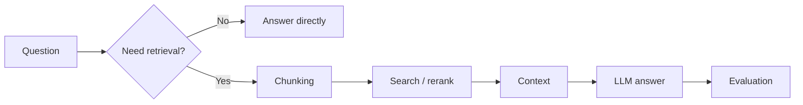

## 1. למה RAG בסיסי לא מספיק

### שישה תרחישים של כשלון

1. Semantic mismatch
   - ה־query כתובה בשפה שונה מהטקסט עצמו
   - ייתכן שיש שפה עתיקה, סגנון ייחודי, או דיון סמנטי שלא תואם את מילות המפתח

2. Procedural answer that spans multiple chunks
   - התשובה לא נבלעת ב־chunk אחד
   - נדרשת סינתזה על פני מספר חלקים

3. Broad questions about the whole book
   - “How does Alice change through the story?”
   - אין תשובה בקטע אחד; נדרשת אינטגרציה על פני קטעים רבים

4. Noisy retrieval
   - החיפוש מחזיר טקסטים רלוונטיים חלקית ומרכיבים לא מתאימים

5. Low-precision retrieval
   - התשובה “נראית” נכונה, אבל לא מבוססת על המקור

6. Unnecessary retrieval
   - חלק מהשאלות הן פשוטות, והבזבוז על בדיקת העומק מיותר

התרגילים מדגימים שבRAG מתוחכם אין רק “עוד יותר חיפוש”; יש תכנון של מנגנון עקבי, based on question type.

## 2. Chunk smarter: למה קטן/גדול הוא תרגיל של איזון

### הבעיה

עם chunks קטנים מדי, אתה מאבד context; עם chunks גדולים מדי, אתה מרחיב רעש. הבחירה הנכונה תלויה בשאלה:
- אם השאלה פה מפורשת וממוקדת — chunk קצר ומדויק
- אם השאלה דורשת overview/character arc — chunk גדול יותר או summarized context

### מה הלומדים הראו

בתרגיל 1 הזרימה היא chunk → rerank → transform. כאן `transform.py` משנה את שאילתת החיפוש: HyDE יוצר תשובה היפותטית קצרה ומשתמש בה כטקסט חיפוש; step-back מנסח שאלה כללית יותר ומחפש גם אותה. הטקסט ההיפותטי משמש לשיפור retrieval, לא כראיה לתשובה.

### עקרון פרקטי

- chunk לפי structure: paragraph, section, chapter, document summary
- הימנע מ־fixed-size blind split כשיש מבנה משמעותי
- הוסף summaries/metadata לכל חלק כדי לשמור קונטקסט
- תשתמש בחיפוש multi-stage quando needed
- השתמשו בחיפוש multi-stage כשיש לכך צורך

### HyDE: hypothetical document embeddings

HyDE מופיע בתמליל ובתרגיל 1. המודל מנסח תשובה היפותטית קצרה לשאלה, והמערכת מחפשת לפי הטקסט הזה לצד השאילתה המקורית. מאחר שהתשובה ההיפותטית עלולה להכיל טעויות, משתמשים בה כמפתח retrieval בלבד ולא כ־ground truth.

## 3. Reranking: משפרים רלוונטיות לפני generation

### למה שיטה זו קיימת

התשובה הטובה ביותר לא תמיד נמצאת בהחזרת ה־top-k הראשון. לעיתים השלב הראשוני של retrieval מוצא חומרים דומים באופן חיצוני, אבל לא מייצרים את התשובה הטובה ביותר.

### ההבנה

חיפוש וקטורי נותן לך “מה דומה למילה/משמעות?”, אבל לא תמיד “מה באמת רלוונטי לשאלה?”

לכן מועבר שלב שני:
- retrieve a broader candidate list
- rerank them with a better relevance signal
- keep only the best chunks

זה בולט בתרגיל הראשון: צריך לאפשר למערכת להוסיף לוגיקה של selection, לא רק semantic similarity מושלם.

## 4. Questions that need the whole picture: RAPTOR-lite

### הבעיה

במקרים כמו “How does Alice change over the whole story?” אין תשובה ב־chunk בודד. זהו מקרה חשוב, כי הרבה שאלות בעולם האמיתי הן broad, multi-hop, או policy-synthesis. רמת הבנה נדרשת גבוהה יותר.

### הפתרון המודגם

תרגיל 2 מתאר “summary tree” או “RAPTOR-lite":
- chunks נבנים מהקורפוס
- כל chapter/segment מסוכם
- כל רמת summary נבנית hierarchically
- השאלה מתנהלת על multiple levels, לא רק על אותו קטע

העיקרון הוא: אם אין תשובה ב־leaf, המשך לשכבת summary, ומשם אולי ל־book-level summary.

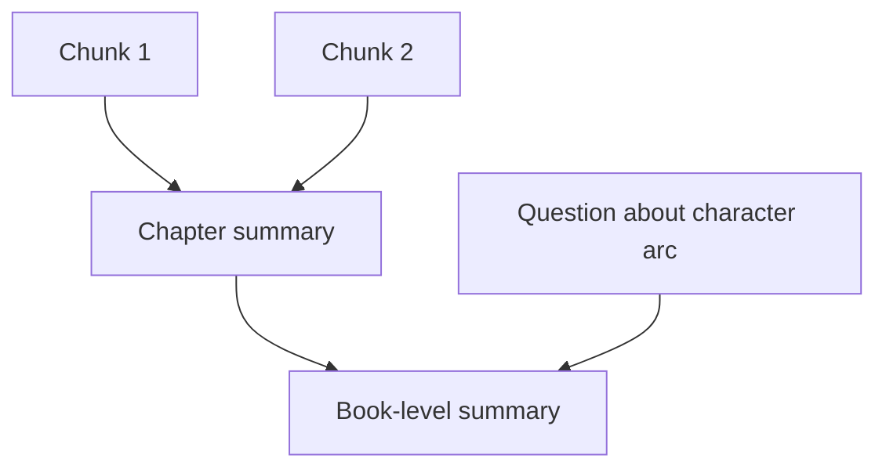

### למה זה משנה

מכיוון ש־RAG עובד על retrieval של “the right context”, summary tree מאפשר לאתר concepts broad and narrative, ולא רק קטעי חיפוש קצרים.

## 5. Agentic RAG: router by question type

### הרעיון

הסילבוס מכנה את הנושא Agentic RAG. תרגיל 3 מממש דפוס adaptive routing שבו רכיב מחליט מה צריך להיעשות לשאלה, ו־grader בודק אם הראיות מספיקות:

- אין retrieval: השאלה פשוטה ולא דורשת ידע מהקorpus
- retrieval יחיד: יש מסמך/קטע ספציפי
- multi-step retrieval: השאלה דורשת חיבור בין קטעים או hierarchy

### למה זה חשוב

RAG “אחד לכל השאלות” הוא לא יעיל. הוא מייצר עלות, רעש, וטיוח של השגיאות. לכן router מאפשר:
- חיסכון בעלות
- פחות retrieval מיותר
- יותר רלוונטיות
- החלטה מבוססת־מצב

### Grader / validator

התפקיד של ה־grader הוא קובע: “האם ה־retrieved evidence מספיק כדי לענות?” אם לא, לא להמשיך ל־generation. זו גישה חשובה כדי להימנע מהמצאת תשובות.

## 6. Evaluation: איך יודעים שה־RAG עבד

### השאלה המכרעת

התכנים של התרגיל 4 מדגישים שה־final answer לא מספיק. צריך להעריך את כל ה־pipeline:
- האם ה־retriever מצא את המידע הנכון
- האם היה retrieval מספיק
- האם ה־generation נשען על evidence
- האם המערכת ענתה נכון, וחשוב יותר: האם היא ענתה על השאלה

### מדדים עיקריים

- precision: כמה מהרלוונטי מתוך המידע שנשלף
- recall: כמה מהרלוונטי שנחוץ אכן נשלף
- correctness: האם התשובה נכונה
- relevance: האם היא עונה על השאלה
- faithfulness: האם היא נשענת על המידע הקיים ולא על הזרקה

### RAGAS / DeepEval

תרגיל 4 מפריד בין scoring לבין test suite. הוא מציין ב־RAGAS את `LLMContextPrecisionWithReference`, `LLMContextRecall`, `Faithfulness` ו־`ResponseRelevancy`; ב־DeepEval הוא מגדיר בדיקות pass/fail עם `FaithfulnessMetric`, `AnswerRelevancyMetric`, `ContextualPrecisionMetric` ו־`ContextualRecallMetric` ברף `0.7`. התרגיל גם מזהיר שמדדים עשויים לחלוק במקרי not-found, ולכן יש לפרש אותם מול הציפייה העסקית ולא כמספר יחיד.

## 7. הקורפוס: Alice in Wonderland כתרגיל מייצג

הקורפוס של Alice הוא אידיאלי ל־RAG מתוחכם משום שיש בו:
- סגנון כתיבה ייחודי
- scenes and character arcs
- שפה לא תואמת תמיד לשאלה
- צורך בתמצות / hierarchy
- אפשרות לשאלות על דמות, על עלילה, על תכנים broad

הספר נותן דוגמאות מצוינות ל־semantic mismatch: השאלה יכולה להיות בשפה מודרנית, בעוד הטקסט כתוב בסגנון אחר. לכן השיטות המתקדמות עוזרות לא רק ל־accuracy, אלא ליכולת לתרגם בין “אופי השאלה” ל־“אופי המקור”.

## 8. מסקנה תיאורטית

השיעור מציב את RAG כטכנולוגיה לא של “חיפוש טקסט”, אלא של “ניהול ידע והחלטה”. כל שלב מוסיף שכבת שליטה:
- chunking קובע מה יש ביד
- reranking קובע מה מבטיחים
- summary tree קובע אם יש קונטקסט ארוך טווח
- router קובע מה נדרש
- evaluation קובע אם האמת נראית טובה או רק נראית נכונה

בפועל, זהו המעבר מ־RAG בסיסי ל־pipeline שמנתבת לפי סוג השאלה ובודקת אם יש מספיק evidence.

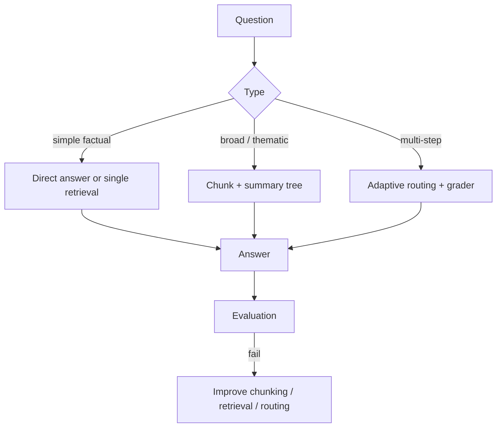

## 9. תרגיל מעשי: רצף להטמעה

### תרגיל 1: improved retrieval
- בנה index על Alice
- chunk לפי chapter/paragraph
- הוסף retrieval, rerank ו־query transformation: HyDE ו־step-back
- השווה תוצאות חיפוש ותשובות לשאלות פשוטות

### תרגיל 2: summary tree / RAPTOR-lite
- צור סיכומי chapter
- צור summary level גבוה יותר
- בדוק שאלות broad / character arc

### תרגיל 3: adaptive routing
- Agentic RAG: שאלות קטגוריות no retrieval / single retrieval / multi-step
- הוסף grader
- הימנע מ־answering when no evidence

### תרגיל 4: evaluation
- בנה set questions, score with RAGAS
- עשה pass/fail מול DeepEval
- השווה baseline לעומת versione upgraded

## 10. סיכום קצר

Advanced RAG אינו שיפור קטן על RAG בסיסי; זה שינוי מהותי בגישה: המערכת אינה שואלת “מה טוב לחפש?” אלא “איזה סוג שאלה זה, כמה context צריך, ומהי הדרך הטובה להעריך אם קיבלנו עילה טובה כדי לענות”.

הסדנה מדגימה היטב את המשוואה הזאת:
- chunking חכם
- rerank
- hierarchy/summaries
- adaptive routing
- validation/eval

כל אחד מהשלבים האלה מגן על ה־LLM מפני הבעיה הכי נפוצה של RAG: “להמציא תשובה במקום להשתמש במידע”.


---
# שיעור 8
---

# מדריך כיתת אמן: Agents in Production

## מטרת המדריך והערת מקורות

המדריך מסכם את הסדנה הטכנית **Agents in Production** לפי שש המחברות ודפי התרגול המקומיים: LangSmith tracing, LCEL, tool-calling, state ו־reducers, checkpoints וגרף ReAct ב־LangGraph. ההסברים בעברית; שמות רכיבים, קוד ופקודות באנגלית.

הקובץ `תמלול.txt` מתעד משוב על הצעות לפרויקטים ארגוניים ולא את סדנת LangChain/LangGraph, ולכן אינו משמש מקור לתוכן הטכני. המצגת `agents_workshop_deck.pdf` היא סרוקה; לא ניתן לחלץ ממנה טקסט באמצעות הכלים הזמינים. פרטי התרגילים אומתו מול `exercise-corpus/`, שש המחברות ודפי `exercise-agents_0.html` עד `exercise-agents_5.html` שבתיקייה זו. נושאים שאינם מפורטים שם מסומנים ככאלה, ולא מורחבים כהוראות מאומתות.

## הקונספט לפני הקוד: Concept-first, no code yet

לפני בחירת framework, צריך להבין מהו Agent, מתי הוא נחוץ, איך הוא מפעיל כלי, ומהן מגבלותיו. הסדנה בונה את היכולת בהדרגה: Chain עם סדר קבוע, Router שבוחר מסלול, ואז Agent שמבקש tools בתוך runtime. הגרף וה־state הופכים את הזרימה למפורשת וניתנת לבדיקה.

## מה בונים ולמה

המעבר המרכזי בסדנה הוא מתהליך קבוע לתהליך שמחליט מה לעשות בהמשך:

| צורה | שליטה בזרימה | מתאים כאשר |
|---|---|---|
| קריאת מודל | אין זרימת בקרה מעבר לקריאה יחידה | יצירת טקסט, סיווג או חילוץ פשוט |
| Chain / LCEL | סדר צעדים קבוע מראש | כל בקשה עוברת אותם שלבים |
| Agent | המודל בוחר אם ואיזה כלי להפעיל | נדרשת בחירה גמישה מתוך כלים מוגדרים |
| LangGraph | הקוד מגדיר nodes, state, תנאים ולולאות | נדרשים שליטה, ביקורת, התמדה או תהליך מורכב |

חשוב: Agent אינו תהליך קסום או עצמאי ללא גבולות. זהו לולאת תוכנה שבה המודל מציע פעולה במבנה מוגדר, סביבת הריצה מחליטה אם לבצע אותה, מריצה כלי מורשה ומחזירה תוצאה למודל. האפליקציה נשארת אחראית להרשאות, אימות, מגבלות, ניטור ותגובה לשגיאות.

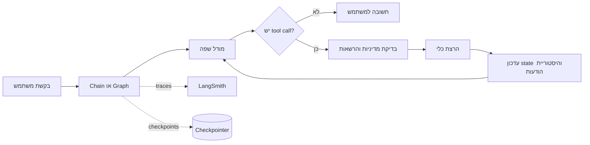

## 1. אבני הבניין

### הודעות, מודל וכלים

שיחה נשמרת כרצף הודעות בעלות תפקידים. בקירוב, מחזור כלי נראה כך:

1. `HumanMessage` מביא את בקשת המשתמש.
2. המודל מחזיר `AIMessage`. אם הוא זקוק לכלי, `AIMessage.tool_calls` מכיל שם כלי, ארגומנטים ומזהה קריאה.
3. קוד האפליקציה או `ToolNode` מפעיל את הכלי ומפיק `ToolMessage` עם אותו `tool_call_id`.
4. המודל מקבל את התוצאה ומייצר תשובה או מבקש כלי נוסף.

המודל אינו מריץ את פונקציית Python. הוא רק מבקש פעולה. ההבחנה הזאת היא גבול אבטחה ותכנון: כלי חייב לאמת ארגומנטים, לצמצם הרשאות, להגדיר timeout ולהחזיר תוצאה שאפשר לפרש. תיאור הכלי ו־schema הם חלק מחוזה ה־API שהמודל רואה, ולכן יש לכתוב אותם באופן מדויק.

### Chain ו־LCEL

LCEL הוא ממשק להרכבת `Runnable`-ים. רכיבים רבים מספקים `invoke`, `batch` ו־`stream`, ולכן אפשר לשנות את דרך ההרצה בלי לשנות את הגרף עצמו.

```text
input dict → prompt template → chat model → output parser → typed result
```

האופרטור `|` יוצר רצף (`RunnableSequence`). `RunnableParallel` מריץ הסתעפויות על אותו קלט ומחזיר מילון תוצאות. מקביליות מתאימה רק כאשר הענפים בלתי תלויים; היא אינה מחליפה החלטה מותנית. אם נדרשת בחירה כגון “אם העיר לא נמצאה, שאל את המשתמש”, יש להשתמש בלוגיקה מפורשת או בגרף.

### Router: conditional edges ו־LLM-based routing

הסילבוס מציג Router כשכבה בין Chain ל־Agent. **Conditional edges** בוחרות לאיזה node לעבור לפי state או תנאי; **LLM-based routing** משתמש בהחלטת מודל כדי לבחור מסלול. יש להגדיר אפשרויות פלט סגורות, לטפל בתשובה לא תקינה ולבדוק מקרי ניתוב שגויים. המחברות מדגימות `tools_condition` עבור מעבר מכלי לסיום/loop, אך לא תרגיל נפרד של LLM-based router.

### Agent ו־ReAct

ReAct הוא מחזור **Reasoning and Acting**: המודל בוחן את המצב, מבקש פעולה, מקבל תוצאה וחוזר לחשוב. אין צורך לחשוף למשתמש chain-of-thought; במערכת ייצור שומרים את הממשק לתשובה ולפעולות מובנות, ומשתמשים ב־traces לצורכי אבחון תוך צמצום מידע רגיש.

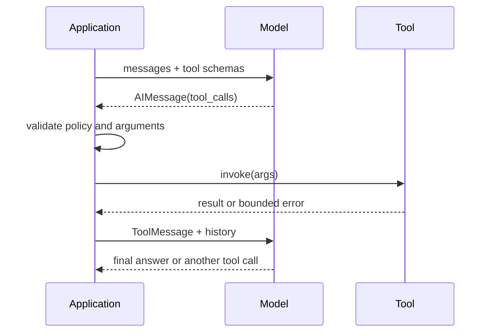

בתרגיל ReAct, `ToolNode` מריץ במקביל את קריאות הכלים שנמצאות באותה `AIMessage`; יש להתייחס לשגיאות ולהרשאות לכל קריאה בנפרד.

### Observability עם LangSmith

**Run** הוא יחידת עבודה; **trace** הוא עץ ה־runs שנוצר עבור בקשה אחת; **project** מקבץ traces; ו־**thread** מקבץ פעולות המשתייכות לשיחה מתמשכת. LangChain ו־LangGraph מדווחים פעולות באופן אוטומטי כאשר tracing פעיל. `@traceable` מוסיף פונקציות יישום לעץ.

Trace שימושי כדי לבדוק קלט/פלט, רצף nodes, tool calls, שגיאות, זמן ריצה, tokens ועלות. הוא אינו תחליף למדדי מוצר או לבדיקות איכות. לפני הפעלת tracing בסביבה אמיתית יש להגדיר מדיניות שמירה, הרשאות, טשטוש מזהים וסודות, ולוודא שאין מידע אישי או credentials ב־inputs, outputs או metadata.

### State, super-steps ו־reducers

ב־LangGraph כל node מקבל snapshot של state ומחזיר **עדכון חלקי** (מילון עם המפתחות שהשתנו). ללא reducer, ערך חדש מחליף את הקודם. nodes בלתי תלויים שמופעלים יחד פועלים באותו super-step, והעדכונים שלהם מתמזגים בסוף הצעד. אם שני nodes כותבים לאותו מפתח ללא כלל מיזוג, LangGraph זורק `InvalidUpdateError` במקום לבחור ערך שרירותי.

Reducer הוא פונקציה `f(current, update) -> merged`. למשל `operator.add` מחבר רשימות. `add_messages` מתמחה בהיסטוריית שיחה: הוא מוסיף הודעות, מחליף הודעה קיימת לפי `id`, ומסיר הודעה באמצעות `RemoveMessage`. לא משתמשים במיזוג רשימות עיוור להיסטוריית הודעות, משום שהוא עלול להשאיר כפילויות במקום עדכון.
המחברת `exercise-3-state-and-reducers.ipynb` מדגימה סינון/מחיקה באמצעות `RemoveMessage`. הסילבוס כולל גם **Multiple schemas** ו־**Filtering and summarizing messages**; לא נמצא במחברות או בדפי התרגול דוגמת קוד ייעודית ל־multiple schemas או לסיכום הודעות, ולכן פרטים אלה לא אומתו.

### זיכרון ו־checkpoints

State הוא מצב הריצה של graph; **checkpoint** הוא snapshot שנשמר לאחר super-step; `thread_id` מזהה את רצף השיחה. עם checkpointer, אותה קריאה נוספת לאותו thread ממשיכה מה־state שנשמר. thread אחר מתחיל הקשר נפרד. `get_state` מחזיר snapshot אחרון ו־`get_state_history` מחזיר היסטוריה שאפשר לבדוק או להשתמש בה ל־time travel.

`InMemorySaver` מתאים לתרגול ולתהליך מקומי בלבד: המידע נעלם כשהתהליך מסתיים ואינו משותף בין workers. בייצור יש לבחור saver מתמשך כגון SQLite או PostgreSQL בהתאם לסביבת הפריסה, לתכנן retention, הצפנה, גיבוי, בידוד tenants ומדיניות למחיקת שיחות.

### Reflection: לולאת שיפור מבוקרת

Reflection מוסיפה שלב ביקורת לתוצאה: רכיב אחד מפיק טיוטה, רכיב אחר בודק אותה מול קריטריונים מפורשים, ורק אם הבדיקה נכשלת מנסים תיקון נוסף. כדי שהלולאה תהיה שימושית, הקריטריונים צריכים להיות ניתנים לבדיקה (schema, מקורות, מגבלת תקציב או כללי עסק), מספר הניסיונות חייב להיות חסום, והכישלון צריך להסתיים בצורה ברורה. “ביקורת” של מודל אינה הוכחת נכונות; לתנאים קריטיים יש להעדיף validators דטרמיניסטיים או אדם.

## 2. סביבת עבודה
### LangGraph Studio

הסילבוס מונה walkthrough של LangGraph Studio. לא נמצאו במחברות ובדפי התרגול המקומיים הוראות או צילום מסך שמאפשרים לתאר את ה־walkthrough; עצם הנושא מאומת בסילבוס, אך צעדי השימוש אינם מאומתים כאן.

התרגילים נמצאים בתיקיית `exercise-corpus/`; דפי הליווי הם `exercise-agents_0.html` עד `exercise-agents_5.html`. המחברות משתמשות ב־LangChain 1.x, LangGraph 1.x וב־LangSmith, לפי [requirements.txt](exercise-corpus/requirements.txt). קובצי ההפעלה מופיעים בתוך תיקיית השיעור.

```bash
cd "שיעור 8/exercise-corpus"
python -m venv .venv
source .venv/bin/activate
python -m pip install --upgrade pip
pip install -r requirements.txt
cp .env.example .env
jupyter lab
```

יש למלא את `.env` מקומית במפתחות המתאימים; אין להדביק מפתחות למחברת, ל־Git, ל־trace או למסמך. מזהה המודל הרשמי של Claude Sonnet 5.5 הוא `claude-sonnet-5-5` לפי [Anthropic Models Overview](https://platform.claude.com/docs/en/about-claude/models/overview), שנבדק ב־2026-11-06. דוגמאות הקורס ב־README ובמחברות עדיין מציינות `anthropic:claude-sonnet-5`; קובצי המקור לא שונו, והמזהה המדויק במעטפת LangChain תלוי באינטגרציה ובגרסה.

```python
import os
from dotenv import load_dotenv
from langchain.chat_models import init_chat_model

load_dotenv()
os.environ.setdefault("LANGSMITH_TRACING", "true")
os.environ.setdefault("LANGSMITH_PROJECT", "agents-workshop")

MODEL = os.getenv("MODEL", "anthropic:claude-sonnet-5-5")
model = init_chat_model(MODEL, temperature=0)
```

## תרגיל מעשי: Setup & Your First Trace

**מטרה:** להפעיל קריאת מודל, לזהות trace ולראות כיצד פונקציות יישום מופיעות כ־spans.

**דרישות קדם:** התקנת התלויות, `ANTHROPIC_API_KEY` ו־`LANGSMITH_API_KEY` בקובץ `.env`, וגישה לפרויקט `agents-workshop` ב־LangSmith.

**קלט/פלט צפויים:** שאלה קצרה למודל; פלט טקסטואלי; Trace יחיד עם input, output, latency, tokens ועלות. בפונקציה המקוננת צפוי parent אחד ושני child model runs.

**שלבים:**

1. הפעלת תאי setup והגדרת tracing פעם אחת.
2. ביצוע `model.invoke` על שאלה אחת ואיתור ה־run ב־LangSmith.
3. עטיפת פונקציה שקוראת למודל פעמיים ב־`@traceable`.
4. הוספת tag ו־metadata להרצה, ולאחר מכן סינון לפי tag בממשק.
5. בדיקת עץ ה־runs והבחנה בין run, trace, project ו־thread.

```python
from langsmith import traceable

response = model.invoke("Name three European capitals.")
print(response.content)

@traceable(name="explain_twice")
def explain_twice(topic: str) -> str:
    short = model.invoke(f"Explain {topic} in one sentence.").content
    simple = model.invoke(f"Explain {topic} to a beginner.").content
    return f"SHORT: {short}\n\nBEGINNER: {simple}"

print(explain_twice("tool calling"))

tagged = model.invoke(
    "Name three European capitals.",
    config={"tags": ["exercise-0"], "metadata": {"stage": "demo"}},
)
print(tagged.content)
```

**בדיקת הצלחה:** שלוש הפעולות מופיעות בפרויקט; הפונקציה `explain_twice` מציגה parent ושתי קריאות מודל; סינון `exercise-0` מאתר את ההרצה המתויגת. אל תכניסו למטא־דאטה מפתחות, כתובות דוא״ל או נתוני משתמש שאסור לשמור.

## תרגיל מעשי: Chains with LCEL

**מטרה:** להרכיב prompt, מודל ו־parser; להריץ אותו ב־invoke, batch ו־stream; ולהכיר פלט מובנה וענפים מקבילים.

**דרישות קדם:** סביבת הסדנה והגדרת `model` מהסעיף הקודם.

**קלט/פלט צפויים:** שרשרת תיאור עיר שמחזירה מחרוזת, הצעות נסיעה כאובייקט Pydantic, ותוצאות parallel כמילון עם טיפים למזג אוויר ולאוכל.

```python
from pydantic import BaseModel, Field
from langchain_core.prompts import ChatPromptTemplate
from langchain_core.output_parsers import StrOutputParser
from langchain_core.runnables import RunnableParallel, RunnableLambda

city_prompt = ChatPromptTemplate.from_messages([
    ("system", "You are a concise travel writer."),
    ("human", "Describe {city} in two sentences."),
])
city_chain = city_prompt | model | StrOutputParser()

print(city_chain.invoke({"city": "Rome"}))
for result in city_chain.batch([{"city": "Rome"}, {"city": "Paris"}, {"city": "Athens"}]):
    print(result)
for chunk in city_chain.stream({"city": "Rome"}):
    print(chunk, end="", flush=True)

class TripIdea(BaseModel):
    city: str
    days: int = Field(description="Recommended number of days")
    budget_usd: int = Field(description="Approximate total budget per person")
    highlights: list[str] = Field(description="Three must-see places")

idea_prompt = ChatPromptTemplate.from_template(
    "Suggest a trip idea for someone who loves {interest}."
)
idea_chain = idea_prompt | model.with_structured_output(TripIdea)
idea = idea_chain.invoke({"interest": "ancient history"})
print(type(idea), idea)

weather_tips = (
    ChatPromptTemplate.from_template("Give two packing tips for {city} in October.")
    | model | StrOutputParser()
)
food_tips = (
    ChatPromptTemplate.from_template("Name two dishes to try in {city}.")
    | model | StrOutputParser()
)
parallel = RunnableParallel(weather=weather_tips, food=food_tips)
tips_chain = parallel | RunnableLambda(
    lambda result: f"Weather: {result['weather']}\nFood: {result['food']}"
)
print(tips_chain.invoke({"city": "Rome"}))
```

**שלבים:**

1. השלמת template עם משתנה `{city}` והרכבת `prompt | model | parser`.
2. הרצת שלוש ערים עם `batch`, ואז אותה שרשרת עם `stream`.
3. החלפת parser של מחרוזת ב־schema מובנה ובדיקת הטיפוס המוחזר.
4. יצירת שתי שרשראות בלתי תלויות והרצתן ב־`RunnableParallel`.
5. פתיחת traces: השרשרת הסדרתית מציגה prompt, model ו־parser; ה־waterfall מראה את ענפי parallel.

**בדיקת הצלחה:** התוצאה המובנית עומדת בשדות schema; `batch` מחזיר תוצאה לכל עיר; parallel מחזיר שני ענפים. יש להציב branching עסקי ב־graph או בקוד מפורש ולא להסתיר אותו בתוך prompt.

## תרגיל מעשי: The Agent Loop

**מטרה:** להבין מה `create_agent` עושה באמצעות בניית לולאת tool-calling ידנית, ואז להשוות את התוצאה ואת ה־trace לגרסה מנוהלת.

**דרישות קדם:** המודל, `travel_tools.py` ו־`travel_data.json`. הכלים המקומיים דטרמיניסטיים: מזג אוויר, טיסות ומלונות. שגיאה על עיר לא מוכרת היא מכוונת לתרגול.

**קלט/פלט צפויים:** בקשת טיסה מתל אביב לרומא ומזג האוויר; הכלי מחזיר בין היתר טיסת Wizz Air במחיר `$190` ומזג אוויר לרומא. העיר `Atlantis` צריכה להחזיר שגיאה לכלי שלא מפילה את הלולאה.

### שלב א: לולאה ידנית

```python
from langchain_core.messages import SystemMessage, HumanMessage, ToolMessage
from travel_tools import get_weather, search_flights, search_hotels

tools = [get_weather, search_flights, search_hotels]
tools_by_name = {tool.name: tool for tool in tools}
model_with_tools = model.bind_tools(tools)

def run_agent(question: str, max_steps: int = 6) -> list:
    messages = [
        SystemMessage("You are a travel assistant. Use tools; never invent prices."),
        HumanMessage(question),
    ]

    for _ in range(max_steps):
        ai_message = model_with_tools.invoke(messages)
        messages.append(ai_message)
        if not ai_message.tool_calls:
            return messages

        for call in ai_message.tool_calls:
            tool = tools_by_name.get(call["name"])
            try:
                if tool is None:
                    raise ValueError(f"Unknown tool: {call['name']}")
                result = tool.invoke(call["args"])
                content = str(result)
            except Exception as error:
                content = f"ERROR: {type(error).__name__}: {error}"
            messages.append(ToolMessage(content=content, tool_call_id=call["id"]))

    raise RuntimeError(f"Agent exceeded the limit of {max_steps} model steps")

messages = run_agent(
    "I'm flying Tel Aviv to Rome. Find the cheapest flight and the weather there."
)
messages[-1].pretty_print()
```

כלי יכול להיכשל, ומזהה ה־`tool_call_id` חייב להתאים בדיוק ל־`ToolMessage`. אין להציג פרטי חריגה פנימיים למשתמש: בדוגמה השגיאה חוזרת למודל כדי שיוכל להסביר שהעיר אינה מוכרת, אך בשירות אמיתי יש לרשום פרטים רגישים ביומן מוגן ולהחזיר למודל הודעה מצומצמת. יש לאמת גם ארגומנטים וסכמות לפני הפעלת כלים חיצוניים.

### שלב ב: `create_agent`

```python
from langchain.agents import create_agent

agent = create_agent(
    model=model,
    tools=tools,
    system_prompt="You are a travel assistant. Use tools; never invent prices.",
)
result = agent.invoke({
    "messages": [HumanMessage(
        "I'm flying Tel Aviv to Rome. Find the cheapest flight and the weather there."
    )]
})
result["messages"][-1].pretty_print()
```

**שלבים:** להשוות את מספר קריאות המודל וכלי הטיסה/מזג האוויר; לפתוח את שתי ה־traces; לזהות שב־`create_agent` ה־model וה־tools מופיעים כרכיבי graph; ולהשוות את כמות הקוד ואת נקודות ההרחבה. לאחר מכן נסו עיר לא מוכרת וודאו שהשגיאה מתורגמת להתנהגות ברורה.

**בדיקת הצלחה:** Phase A ו־Phase B מספקים אותה תשובה מבוססת נתונים; טיפול שגיאות משאיר הודעת tool תואמת; הלולאה נעצרת בגבול שהוגדר. בתהליך ייצור יש להגדיר בנפרד מגבלת זמן, תקציב/מספר קריאות, מדיניות retries ואישור אנושי לפעולות שמשנות מצב.

## תרגיל מעשי: State & Reducers

**מטרה:** לחזות כיצד LangGraph ממזג עדכוני nodes, לראות מדוע כתיבה מתנגשת נכשלת, ולבחור reducer מתאים.

**דרישות קדם:** `langgraph`, `typing_extensions` ו־`operator`. אין קריאות LLM בתרגיל זה.

**קלט/פלט צפויים:** שרשור `a → b` מחזיר `['from B']`; fan-out של שני nodes הכותבים לאותו key נכשל; reducer מחבר את הערכים ומונע שגיאה.

```python
import operator
from typing import Annotated
from typing_extensions import TypedDict
from langgraph.graph import StateGraph, START, END
from langgraph.errors import InvalidUpdateError

class NotesState(TypedDict):
    notes: list[str]

def node_a(state: NotesState) -> dict:
    return {"notes": ["from A"]}

def node_b(state: NotesState) -> dict:
    return {"notes": ["from B"]}

# Sequential writes use overwrite semantics by default.
builder = StateGraph(NotesState)
builder.add_node("a", node_a)
builder.add_node("b", node_b)
builder.add_edge(START, "a")
builder.add_edge("a", "b")
builder.add_edge("b", END)
print(builder.compile().invoke({"notes": ["start"]}))

# Parallel writes to one key require an explicit merge rule.
builder = StateGraph(NotesState)
builder.add_node("a", node_a)
builder.add_node("b", node_b)
builder.add_edge(START, "a")
builder.add_edge(START, "b")
builder.add_edge("a", END)
builder.add_edge("b", END)
try:
    builder.compile().invoke({"notes": ["start"]})
except InvalidUpdateError as error:
    print("Expected conflicting update:", error)

class ReducedNotesState(TypedDict):
    notes: Annotated[list[str], operator.add]

builder = StateGraph(ReducedNotesState)
builder.add_node("a", node_a)
builder.add_node("b", node_b)
builder.add_edge(START, "a")
builder.add_edge(START, "b")
builder.add_edge("a", END)
builder.add_edge("b", END)
print(builder.compile().invoke({"notes": ["start"]}))
```

עבור שיחה יש להשתמש ב־`MessagesState` ו־`add_messages`, כדי ש־ID של הודעה יתמוך בהחלפה ובהסרה:

```python
from langchain_core.messages import AIMessage, HumanMessage, RemoveMessage
from langgraph.graph import add_messages, MessagesState

history = [HumanMessage("Hi", id="1"), AIMessage("Hello!", id="2")]
updated = add_messages(history, [AIMessage("Hello again!", id="2")])
without_first = add_messages(updated, [RemoveMessage(id="1")])
print(without_first)
```

Reducer מותאם חייב להיות דטרמיניסטי, צפוי ובעל התנהגות ברורה עבור עדכון ריק. למשל, `keep_last_3(current, update)` יכול להחזיר `(current + update)[-3:]`; מפתח אחר באותו state ללא reducer עדיין יחליף את ערכו. אין להסתמך על סדר מיזוג של nodes שרצים במקביל לצורך סדר עסקי.

**שלבים:** רשמו תחזית לפני כל הרצה; השוו overwrite סדרתי ל־fan-out; תקנו בעזרת `Annotated`; בדקו החלפה ומחיקה ב־`add_messages`; כתבו reducer ששומר שלוש ערים אחרונות.

**בדיקת הצלחה:** תוצאת fan-out ללא reducer היא `InvalidUpdateError`; עם reducer מתקבלים הערכים ההתחלתיים והעדכונים; הודעה קיימת מוחלפת לפי ID ואינה משוכפלת.

## תרגיל מעשי: Memory & Checkpoints

**מטרה:** להבדיל בין הקשר שמועבר בבקשה אחת לבין זיכרון שיחה, ולבדוק בידוד threads ו־history.

**דרישות קדם:** מודל עובד, `MessagesState`, `StateGraph` ו־`InMemorySaver`.

**קלט/פלט צפויים:** graph ללא checkpointer אינו זוכר ש־Dana מתכננת נסיעה לרומא בבקשה נפרדת. עם checkpointer ו־`thread_id` זהה, המודל יכול להשיב לשאלת המשך; thread אחר אינו רואה את המידע.

```python
from langgraph.graph import StateGraph, START, END, MessagesState
from langgraph.checkpoint.memory import InMemorySaver

def chatbot(state: MessagesState) -> dict:
    return {"messages": [model.invoke(state["messages"])]}

builder = StateGraph(MessagesState)
builder.add_node("chatbot", chatbot)
builder.add_edge(START, "chatbot")
builder.add_edge("chatbot", END)

no_memory = builder.compile()
first = no_memory.invoke({"messages": [{
    "role": "user", "content": "Hi, I'm Dana and I'm planning a trip to Rome."
}]})
second = no_memory.invoke({"messages": [{
    "role": "user", "content": "What's my name and where am I going?"
}]})

memory = InMemorySaver()
graph = builder.compile(checkpointer=memory)
config = {"configurable": {"thread_id": "traveler-dana"}}
graph.invoke({"messages": [{
    "role": "user", "content": "Hi, I'm Dana and I'm planning a trip to Rome."
}]}, config)
follow_up = graph.invoke({"messages": [{
    "role": "user", "content": "What's my name and where am I going?"
}]}, config)
follow_up["messages"][-1].pretty_print()

other_thread = {"configurable": {"thread_id": "traveler-2"}}
isolated = graph.invoke({"messages": [{"role": "user", "content": "What's my name?"}]}, other_thread)
isolated["messages"][-1].pretty_print()

snapshot = graph.get_state(config)
print("Messages:", len(snapshot.values["messages"]), "Next:", snapshot.next)
for checkpoint in graph.get_state_history(config):
    print(checkpoint.metadata["step"], checkpoint.next)
```

**שלבים:** הריצו שני turns ללא memory; הוסיפו checkpointer ו־`thread_id`; חזרו על השאלה ב־thread נוסף; בדקו `get_state` ו־`get_state_history`; ובונוס, בחרו checkpoint קודם והמשיכו ממנו עם input חלופי (`graph.invoke(input, checkpoint.config)`).

**בדיקת הצלחה:** אותו thread זוכר מידע שנשמר ב־state, thread חדש מבודד, וה־history מציג snapshots. זיכרון טכני אינו בהכרח זיכרון מוצר: יש להחליט במפורש איזה מידע לשמור, למשך כמה זמן, ואיך משתמש יכול למחוק אותו.

## תרגיל מעשי: Build a ReAct Graph from Scratch

**מטרה:** להרכיב את אותם חלקים של `create_agent` ב־LangGraph, כך שאפשר להוסיף nodes עסקיים ולשלוט במעברים.

**דרישות קדם:** הכלים מתוך `travel_tools.py`, `MessagesState`, `ToolNode`, `tools_condition` ו־`InMemorySaver`.

**קלט/פלט צפויים:** בקשה מרובת דרישות על טיסה, מלון ומזג אוויר; עדכוני streaming עבור nodes; תשובת המשך באותו thread משתמשת בפרטי הנסיעה הקודמת.

```python
from langchain_core.messages import SystemMessage
from langgraph.graph import StateGraph, START, END, MessagesState
from langgraph.prebuilt import ToolNode, tools_condition
from langgraph.checkpoint.memory import InMemorySaver
from travel_tools import ALL_TOOLS

model_with_tools = model.bind_tools(ALL_TOOLS)
SYSTEM = SystemMessage(
    "You are a travel planner. Use tools for flights, hotels and weather. "
    "Report prices from tool results and state when data is unavailable."
)

def assistant(state: MessagesState) -> dict:
    return {"messages": [model_with_tools.invoke([SYSTEM, *state["messages"]])]}

builder = StateGraph(MessagesState)
builder.add_node("assistant", assistant)
builder.add_node("tools", ToolNode(ALL_TOOLS))
builder.add_edge(START, "assistant")
builder.add_conditional_edges("assistant", tools_condition)
builder.add_edge("tools", "assistant")

react = builder.compile(checkpointer=InMemorySaver())
config = {
    "configurable": {"thread_id": "trip-1"},
    "recursion_limit": 12,
}
question = (
    "Plan 3 days in Rome from Tel Aviv on a $1500 budget: "
    "cheapest flight, a hotel under $200/night, and the weather."
)

for update in react.stream(
    {"messages": [{"role": "user", "content": question}]},
    config,
    stream_mode="updates",
):
    for node_name, value in update.items():
        print(f"--- {node_name}")
        for message in value.get("messages", []):
            message.pretty_print()

follow_up = react.invoke(
    {"messages": [{"role": "user", "content": "Which hotel did you choose?"}]},
    config,
)
follow_up["messages"][-1].pretty_print()
```

**מה קורה בגרף:** `assistant` מפעיל מודל עם schemas של הכלים; `tools_condition` מעביר ל־`tools` כאשר קיימות קריאות, או לסיום כאשר יש תשובה; `ToolNode` מריץ את הקריאות ומחזיר הודעות תוצאה; הקשת `tools → assistant` סוגרת את הלולאה. `recursion_limit` הוא מעצור נגד graph שרץ ללא סוף, לא תחליף ל־budget או למדיניות מוצר.

**שלבים:** בנו את node של assistant; חברו `ToolNode` ו־conditional edges; ציירו את graph עם `react.get_graph().draw_mermaid()`; צפו ב־`stream_mode="updates"`; שלחו שאלת המשך באותו `thread_id`; והשוו trace מול תרגיל `create_agent`.

**הרחבה:** הוסיפו node בשם `budget_check` בין `tools` ל־`assistant`, כדי לאמת תוצאות ולהחליט אם צריך להמשיך. פעולות בעלות השפעה חיצונית (הזמנה או תשלום) דורשות שלב אישור מפורש לפני ביצוע.

**בדיקת הצלחה:** בקשת הטיול מפעילה כלי טיסה, מלון ומזג אוויר; אפשר לראות הודעות מכל node; שאלת המשך שומרת הקשר; graph מציג יציאה ל־END ולולאה בין assistant לכלים. אם נקראת מגבלת recursion, הציגו מצב כשל ברור ולא תשובה כאילו הושלם.

## תבנית Reflection מבוקרת

הדוגמה הבאה ממחישה תיקון מוגבל עם schema ו־validator מקומי. היא תבנית ארכיטקטונית להמשך ולא תא במחברת. בתהליך אמיתי כדאי שהבדיקה תהיה דטרמיניסטית ככל שניתן.

```python
from pydantic import BaseModel, Field

class Draft(BaseModel):
    answer: str
    evidence: list[str] = Field(default_factory=list)

class Review(BaseModel):
    approved: bool
    issues: list[str] = Field(default_factory=list)

def produce_with_review(question: str, max_revisions: int = 2) -> Draft:
    draft = model.with_structured_output(Draft).invoke(
        f"Answer using only the supplied context. Question: {question}"
    )
    for _ in range(max_revisions):
        review = model.with_structured_output(Review).invoke(
            f"Check whether this answer has evidence and addresses the question. "
            f"Return concise issues. Draft: {draft.model_dump_json()}"
        )
        if review.approved:
            return draft
        draft = model.with_structured_output(Draft).invoke(
            f"Revise the draft to address these issues: {review.issues}. "
            f"Original question: {question}. Draft: {draft.model_dump_json()}"
        )
    return draft
```

הדגמה זו אינה מספקת כשלעצמה הבטחת נכונות: review של אותו מודל עלול לא להסכים עם עצמו. לנתונים קריטיים הוסיפו בדיקות קוד, מקורות, ספי קבלה ו־human review; בדקו גם על סט דוגמאות קבוע כדי לוודא שהלולאה משפרת איכות ולא רק מגדילה latency ועלות.

## סיכום ותזכורת מהירה

### בחירת הכלי הנכון

- רצף קבוע וקל למדידה: LCEL chain.
- בחירה בין מספר כלים לפי בקשת משתמש: agent עם tool schemas.
- state משותף, הסתעפויות, retries, human approval או business rules: LangGraph.
- שיחה קצרה ללא המשכיות: להעביר את כל ההקשר בבקשה.
- שיחה מתמשכת: checkpointer עם `thread_id` מבודד ו־retention מוגדר.

### פקודות שימושיות

```bash
python -m venv .venv
source .venv/bin/activate
pip install -r requirements.txt
jupyter lab
```

```python
chain.invoke(input_value)
chain.batch([input_a, input_b])
chain.stream(input_value)
graph.stream(input_value, config, stream_mode="updates")
graph.get_state(config)
graph.get_state_history(config)
graph.get_graph().draw_mermaid()
```

### תקלות נפוצות ואבחון

| סימפטום | בדיקה ראשונה |
|---|---|
| שגיאת אימות של ספק | ודאו שמפתח הספק נטען ב־`.env`, שהחבילה מותקנת, וש־`MODEL` הוא מזהה נתמך. לעולם אל תדפיסו את המפתח. |
| אין trace ב־LangSmith | בדקו `LANGSMITH_TRACING=true`, `LANGSMITH_API_KEY`, שם project ורשת; ודאו שמדובר ב־run חדש. |
| `InvalidUpdateError` | בדקו אילו nodes פעילים באותו super-step וכותבים לאותו key; הגדירו reducer או שנו את מבנה הגרף. |
| המודל לא רואה כלי | בדקו `bind_tools`, תיאור/סכמת הכלי, שם הכלי והאם ה־AIMessage מכיל `tool_calls`. |
| ToolMessage לא משויך | ודאו ש־`tool_call_id` זהה ל־ID של הקריאה המתאימה, ושיש תוצאה לכל קריאת כלי. |
| אין זיכרון בשיחת המשך | העבירו אותו `thread_id`, השתמשו ב־checkpointer, ושלחו עדכון הודעה ולא תמליל חסר. |
| מידע נעלם אחרי restart | `InMemorySaver` אינו מתמשך; עברו ל־checkpointer מתמשך. |
| graph רץ יותר מדי | קבעו `recursion_limit`, מגבלת קריאות מודל/כלים, timeout ומספר retries; הציגו סיום מוגבל. |
| תשובה מובנית לא תקינה | השתמשו ב־`with_structured_output`, אמתו עם Pydantic, וטפלו בכשל או retry מוגבל. |
| trace חושף מידע | צמצמו payloads, השמיטו secrets, טשטשו PII והגבילו גישה/שמירה לפני שליחה ל־observability. |

כלל העבודה המרכזי: תכננו תחילה את חוזה הכלים וה־state, הגדירו גבולות הרצה ותצפית, ורק אז הרחיבו את האוטונומיה. Trace טוב מסביר מה קרה; בדיקות, הרשאות ומדיניות קובעים מה מותר שיקרה.
