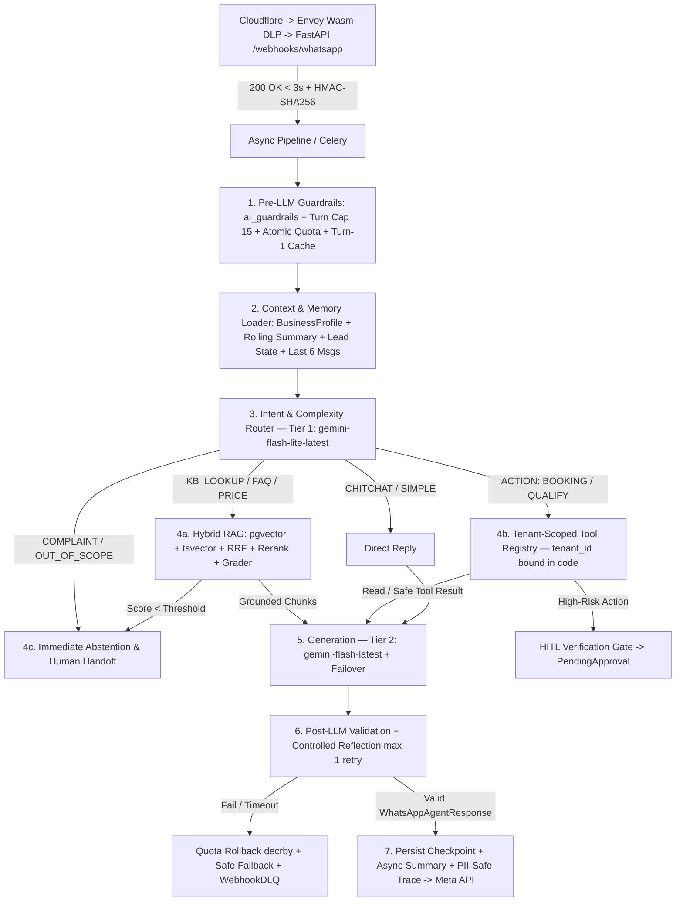

# תוכנית אב ומדריך יישום: שילוב AI Agentic Workflow ב-LeadFlow AI
## מיפוי מלא של תובנות סדנת AI LEAD (שיעורים 1–8) אל קוד וארכיטקטורת הפרויקט

> **מקורות הסדנה שעליהם מבוסס מדריך זה:**
> - `/var/home/shay0129/Code/Projects/leadflow-ai/docs/research/combined_master_class_1_to_8.md`
> - `/var/home/shay0129/Code/Projects/leadflow-ai/docs/research/agentic_workflow_implementation_guide.md`
> - `/var/home/shay0129/Code/Projects/leadflow-ai/docs/research/class_1_and_2_practical_guide.md`
>
> **תאימות לארכיטקטורה ואבטחה:** כל ההנחיות במסמך זה כפופות לכללי `CLAUDE.md` / `.clinerules` — בידוד Multi-Tenant קשיח לפי `user_id`/`tenant_id`, אפס סודות בקוד, הגנת Edge DLP (`data-gate`), מגבלות `RequestBodyLimitMiddleware`, מניעת Prompt Injection ו-Denial-of-Wallet, ומעבר מלא של כל שערי ה-CI (`ruff`, `pip-audit`, `alembic check`, `pytest`).

---

## 1. תקציר מנהלים וניתוח פערים מול הקוד הקיים (Codebase Gap Audit)

בחינה מעמיקה של קוד `leadflow-ai` מול עקרונות הסדנה מעלה שהתשתית ההנדסית והאבטחתית של הפרויקט (FastAPI, PostgreSQL, Redis, Celery, Envoy Wasm DLP, Rate Limiting, Signature Verification, `.claude/settings.json` Hooks) כבר חזקה מאוד. עם זאת, בשכבת ה-AI עצמה קיימים **פערים מבניים ברורים** שניתן לסגור בצורה מדורגת ומבוקרת:

### ממצאים קריטיים שזוהו בסקירת הקוד בפועל
1. **פיצול בין שני מסלולי AI נפרדים:**
   - המסלול הפעיל בפרודקשן (`src/services/communication/whatsapp_pipeline.py`) קורא ישירות ל-Gemini עם Structured Output (`WhatsAppAgentResponse`), **ללא Tools**, **ללא `GeminiTieredRouter`**, **ללא `inspect_and_wrap_input` / `validate_llm_output`**, ו**ללא Redis Response Cache**.
   - במקביל, `src/services/ai/engine.py` (`AIEngine`, שבשימוש הסימולטור ב-`src/routers/settings.py`) מכיל את `ai_guardrails`, את Redis Cache, ואת `AI_TOOLS` (`check_calendar_availability`, `book_appointment`, `qualify_lead`) — אך אינו משתמש ב-`WhatsAppAgentResponse`, והכלים שלו הם **Mocks קשיחים** ללא `tenant_id` וללא שמירה ב-DB.
2. **רכיבים קיימים שאינם מחוברים (Orphaned Wiring — עקרון "Green Is Not Correct"):**
   - `src/services/llm_router.py` (`GeminiTieredRouter`) עובר unit tests ב-`tests/security/test_llm_router.py`, אך **אינו מיובא או מופעל כלל** בצנרת הוואצאפ או ב-`AIEngine`.
   - `PromptBuilder.build_system_instruction()` מזריק `<tool_instructions>` המורות למודל להפעיל כלים גם כאשר הוא נקרא מ-`whatsapp_pipeline.py`, שבו **אין כלים מצורפים** ל-`GenerateContentConfig` — פתח להזיות אישור פגישה.
   - `src/services/communication/conversation.py` (`ConversationManager`), `src/services/ai/personas.py`, ו-`src/config/policy.py` הם רכיבים ישנים/חלקיים שאינם מהווים מקור אמת אחיד.
   - `src/routers/webhooks/campaign.py` (`trigger_outbound_ai_agent`) ו-`src/tasks/followup_tasks.py` (`process_dlq_events`, `process_smart_followups`) מכילים שלד/placeholder לביצוע בפועל.
3. **חלון הקשר חלקי (Context Rot / Loss):** `whatsapp_pipeline.py` טוען רק 6 הודעות אחרונות (`limit(6)`), בעוד תקרת השיחה האוטומטית היא 15 תורות (`MAX_AUTOMATED_TURNS = 15`). מידע עסקי שניתן בהודעות הראשונות אובד החל מהתור השביעי.
4. **אין RAG אמיתי:** מידע העסק נשמר כשדה טקסט שטוח (`BusinessProfile.products_services`), ודוח ה-Virtual CMO ב-`src/routers/insights.py` מבוסס על חיפוש 3 מילות מפתח קשיחות (`"מחיר"`, `"פגישה"`, `"דחוף"`).
5. **אין Observability ל-LLM ואין Golden Set Evals:** קיימות עמודות `Lead.ai_rating` ו-`Lead.ai_feedback_note` וכן `opentelemetry-api` ב-`requirements.txt`, אך אין Tracing מובנה של קריאות AI ואין מערכת בדיקות איכות אוטומטיות (Golden Set / RAGAS).

### טבלת מיפוי מלאה: שיעורי הסדנה ← מצב נוכחי בקוד ← יעד ומיקום יישום

| שיעור | תובנה מרכזית מהסדנה | מצב נוכחי ב-`leadflow-ai` | היכן לממש / לשנות בקוד | עדיפות |
|---|---|---|---|---|
| **1** | Model vs. Harness, הפרדת לוגיקה עסקית מ-LLM | פיצול בין `whatsapp_pipeline.py` ל-`engine.py`; `GeminiTieredRouter` לא מחובר | יצירת `src/services/ai/harness.py` וחיבורו ל-`whatsapp_pipeline.py` ו-`routers/settings.py` | **P0** |
| **2** | תבנית **RESPECT**, מדיניות **Abstention**, Recency, Golden Set | קיימים Guardrails ו-XML, אך חסרים Few-Shot Examples, Pipeline, ו-Abstention מובנה ב-Schema | `src/config/prompts/system_prompts.yaml`, `src/services/ai/prompt_builder.py`, `src/schemas/ai_response.py`, `src/routers/settings.py` | **P0** |
| **3** | Context Engineering (מניעת Context Rot), Coding Agent Harness (Skills, Hooks, TDD) | חלון של 6 הודעות בלבד ללא Rolling Summary; קיימים Hooks ב-`.claude/settings.json` אך ללא `.claude/skills/` | `src/database/models.py` (+ Alembic), `src/services/ai/memory.py`, `.claude/skills/`, `tests/` | **P1** |
| **4** | Sub-agents, Plan in Phases, MCP וכלים עם הרשאות | `AI_TOOLS` ב-`engine.py` הם Mock ללא `tenant_id`; אין Tool Registry / MCP | `src/services/ai/tools/` (`registry.py`, `calendar_tools.py`, `crm_tools.py`, `mcp_adapter.py`), `campaign.py`, `followup_tasks.py` | **P1** |
| **5** | RAG בסיסי: Extraction, Smart Chunking, Embeddings, Hybrid Search, Evaluation | אין Vector DB או Chunking; הכל ב-`BusinessProfile.products_services` | `compose.yaml` (`pgvector`), `src/database/models.py`, `src/services/rag/`, `src/routers/knowledge.py` | **P1** |
| **6** | אימוץ ללא סמכות, מדדי ROI אמיתיים (KPIs), פיילוט (First Follower) | קיימים שדות `qualification_score`, `ai_rating`, `requires_human` אך ללא מדדי KPI מרוכזים | `src/routers/insights.py`, `src/services/ai/tracing.py`, תהליך Onboarding לפיילוט | **P2** |
| **7** | Advanced RAG: Reranking, HyDE, **RAPTOR-lite**, Agentic RAG Router, Grader | `insights.py` עובד על 3 מילות מפתח קשיחות; אין Reranking או שאילתות חוצות-קורפוס | `src/services/rag/reranker.py`, `raptor_lite.py`, `router.py`, `src/routers/insights.py` | **P2** |
| **8** | Agents in Production: KISS, State & Reducers, Checkpoints, Reflection, HITL, Tracing | יש `bot_active` ו-`requires_human`, אך אין Checkpoints, Reflection מבוקר, Approval Gate או LLM Tracing | `src/services/ai/workflow_graph.py`, `models.py` (`AgentCheckpoint`, `PendingApproval`), `routers/leads.py`, `logging_config.py`, `tests/evals/` | **P1–P2** |

---

## 2. עקרון העל (שיעורים 1, 2 ו-8): KISS — מיון Workflows מול Agents

אחת האזהרות המרכזיות בסדנה (שיעור 2 — אדוה, ושיעור 8) היא **לא להפוך כל תהליך ל-Multi-Agent**. מערכת מרובת-סוכנים יקרה לניטור, קשה לדיבוג ונוטה ל-Goal Drift. הכלל המחייב ב-`leadflow-ai`: **קוד דטרמיניסטי בכל מקום שבו הלוגיקה קבועה; Single Prompt (Tier 1) לסיווג וסיכום; Bounded Agentic Graph אך ורק לשיחת המכירה וה-RAG.**

### מטריצת החלטות ארכיטקטוניות לכל תהליכי `leadflow-ai`

| תהליך עסקי (Workflow) | קבצים רלוונטיים בקוד | אבן בניין נבחרת | נימוק ארכיטקטוני |
|---|---|---|---|
| רישום, התחברות, RBAC, ביטול JWT | `src/routers/auth.py`, `src/security/dependencies.py` | **קוד דטרמיניסטי (ללא AI)** | אבטחה דטרמיניסטית בלבד. |
| קליטת ליד מקמפיין + Idempotency | `src/routers/webhooks/campaign.py`, `src/routers/leads.py` | **Deterministic Workflow** | אימות `X-Tenant-Key`, Redis `SET NX`, שמירה ב-PG, שליחת Meta Template מאושר (חוק 24 שעות). |
| סליקה ועדכון מכסות (Meshulam / Grow) | `src/routers/webhooks/meshulam.py`, `src/routers/billing/` | **Deterministic Workflow** | אפס מקום לשיפוט לא-דטרמיניסטי בכספים. |
| תזמון Follow-up ו-DLQ Replay | `src/tasks/followup_tasks.py`, `src/worker.py` | **Deterministic Workflow + Single Prompt** | זיהוי לידים רדומים בקוד; אופציונלי — התאמת משתני תבנית ב-Tier 1 (בכפוף לתבנית Meta מאושרת). |
| תמלול הודעות קוליות / פגישות | `src/tasks/audio_tasks.py`, `src/services/ai/whisper.py` | **Chaining (Pipeline קבוע)** | Whisper → סיכום מובנה ב-Tier 1 → שמירה ב-`MeetingSession` / `MediaInteraction`. |
| סיווג כוונה, ניתוב RAG וסיכום שיחה | `src/services/llm_router.py`, `src/services/ai/memory.py` | **Single Prompt (Tier 1: `gemini-flash-lite-latest`)** | מהיר, זול, פלט JSON קשיח, ללא לולאת סוכן. |
| **בוט הוואצאפ הדו-כיווני (מכירות, מידע, קביעת פגישות)** | `src/services/communication/whatsapp_pipeline.py` + `src/services/ai/workflow_graph.py` | **Bounded Agentic Graph (Single Agent + Conditional Router)** | משלב זיכרון שיחה, שליפת RAG, הפעלת כלים מאובטחים, Reflection מוגבל ו-HITL Escalation. |
| **Virtual CMO & Marketing Insights** | `src/routers/insights.py` + `src/services/rag/raptor_lite.py` | **Workflow + RAPTOR-lite Summarization** | אגרגציה היררכית מתוזמנת ברקע (Celery Beat) + שאילתות סינתזה על פני עץ סיכומים. |

### דיאגרמת ארכיטקטורת היעד (Target Unified Agentic Harness)



---

## 3. פרק 1: איחוד ה-Harness, ניתוב מודלים ו-RESPECT Prompts (שיעורים 1–2)

### 3.1 איחוד `whatsapp_pipeline.py`, `engine.py` ו-`llm_router.py` ל-Unified Harness

**היכן לממש:**
- **קובץ חדש:** `src/services/ai/harness.py` — מעטפת ריצה אחידה לכל שיחות ה-AI.
- **עדכון:** `src/services/llm_router.py` — הרחבת `GeminiTieredRouter` לתמיכה ב-Structured Output, כלים ו-Quota Rollback.
- **עדכון:** `src/services/communication/whatsapp_pipeline.py` — החלפת הקריאה הישירה ל-`client.models.generate_content` בקריאה ל-`AgentHarness.run_turn(...)`.
- **עדכון:** `src/routers/settings.py` — העברת `/simulate` לשימוש באותו `AgentHarness` (כך שהסימולטור ישקף 1:1 את התנהגות הפרודקשן) והסרת הכפילות ב-`_generate_master_prompt()`.
- **ניקוי קוד ישן:** מיגרציה של תבניות התעשייה השימושיות מ-`src/services/ai/personas.py` אל `src/config/prompts/system_prompts.yaml`, וסימון `src/services/communication/conversation.py` ו-`src/config/policy.py` כ-deprecated.

**כיצד לממש:**
1. **השלמת `GeminiTieredRouter` (`src/services/llm_router.py`):**
   - לשמור על `MODEL_LITE = "gemini-flash-lite-latest"`, `MODEL_FLASH = "gemini-flash-latest"` וכל חתימות ה-API הנבדקות ב-`tests/security/test_llm_router.py`.
   - להוסיף rollback מפורש כאשר גם ה-Primary וגם ה-Fallback נכשלים:
     ```python
     # Roll back reserved token quota if both primary and fallback inference fail
     except Exception:
         await self.release_budget(tenant_id, estimated_tokens)
         raise
     ```
2. **איחוד שכבות האבטחה ב-`src/services/ai/harness.py`:**
   - להפעיל `inspect_and_wrap_input()` (`src/security/ai_guardrails.py`) **גם** במסלול הוואצאפ (כיום פועל רק ב-`engine.py`). אם `is_flagged=True`, לדלג על ה-LLM, לרשום אירוע ב-`AuditLog` (`src/security/audit.py`), ולהחזיר מענה זהיר או להעביר לנציג אנושי.
   - להפעיל `validate_llm_output()` ו-`sanitize_ai_output()` על `reply_text` לפני שמירה ושליחה.
3. **תיקון AI Response Caching (`WF-13`) למניעת Context Pollution:**
   - להפעיל Redis Cache **אך ורק** כאשר `len(conversation_history) == 0` (תור ראשון ללא הקשר קודם) וכאשר לא הופעלו כלים דינמיים.
   - לכלול ב-cache key את `tenant_id`, גרסת מאגר הידע `kb_version`, ו-hash של `system_instruction`:
     ```python
     # Isolate cached turn-1 responses per tenant and knowledge-base version
     raw_key = f"{tenant_id}:{kb_version}:{sys_hash}:{normalized_input}"
     cache_key = f"ai_cache:v2:{tenant_id}:{hashlib.sha256(raw_key.encode('utf-8')).hexdigest()}"
     ```
   - בכל עדכון ב-`src/routers/settings.py` או אינדוקס מסמך ידע חדש — להגדיל `kb_version` ב-Redis (`INCR tenant:{tenant_id}:kb_version`) לאינוולידציה מיידית.

### 3.2 שדרוג הפרומפטים לתבנית RESPECT ומדיניות Abstention קשיחה

**היכן לממש:**
- `src/config/prompts/system_prompts.yaml`
- `src/services/ai/prompt_builder.py`
- `src/schemas/ai_response.py`

**כיצד לממש:**
1. **השלמת כל 6 רכיבי RESPECT:**
   - **Role (R):** קיים ב-`archetypes`, יש להזריק גם `ai_tone` מ-`BusinessProfile`.
   - **Examples (E):** להוסיף לכל Archetype ב-`system_prompts.yaml` בלוק `examples` עם 2–3 דוגמאות Few-Shot בעברית: שיחת מידע רגילה, **דוגמת Abstention** (מידע חסר), ו**דוגמת Escalation** (לקוח כועס/חריג).
   - **Structure (S):** להרחיב את `WhatsAppAgentResponse` ב-`src/schemas/ai_response.py` בשדות מובנים ל-Abstention וציטוט מקורות:
     ```python
     # src/schemas/ai_response.py — additive fields preserving backward compatibility
     class WhatsAppAgentResponse(BaseModel):
         reply_text: str = Field(..., max_length=600)
         lead_intent: Literal["INQUIRY", "PRICING", "BOOKING", "COMPLAINT", "UNKNOWN"]
         lead_qualification_score: int = Field(..., ge=0, le=100)
         needs_human_escalation: bool
         abstained: bool = Field(
             default=False,
             description="True when required business facts are absent from verified context.",
         )
         cited_chunk_ids: list[str] = Field(
             default_factory=list,
             description="Tenant knowledge chunk IDs grounding factual claims.",
         )
         extracted_data: LeadExtraction = Field(default_factory=LeadExtraction)
     ```
   - **Pipeline (P):** להוסיף ב-`PromptBuilder.build_system_instruction()` שלבי חשיבה מפורשים: (1) זיהוי כוונה, (2) אימות מול `<tenant_profile>` ו-`<retrieved_knowledge>`, (3) החלטת Tool / Abstention / Reply, (4) הפקת JSON תקף בלבד.
   - **Constraints (C) + Abstention קשיח:** לעדכן את כלל 4 ב-`base_guardrails` כך שבמקרה של היעדר מידע מאומת (מחיר, זמינות, מדיניות) חל איסור ניחוש וחובה להחזיר `abstained=True`, `needs_human_escalation=True`, והודעת העברה לנציג אנושי.
   - **Task (T) + Recency:** להשאיר בסוף `build_lead_turn_prompt()` תזכורת קצרה לאי-ניחוש, הפרדת נתונים לא-מהימנים ועמידה בסכמה.
2. **סנכרון `<tool_instructions>` למציאות:** להוסיף פרמטר `enabled_tools: Sequence[str] = ()` ל-`PromptBuilder.build_system_instruction()`. להזריק הוראות שימוש בכלים **רק עבור כלים שאכן צורפו ל-`GenerateContentConfig`**. כאשר אין כלים מצורפים, להנחות מפורשות שלא לאשר שעות פנויות או פגישות.

---

## 4. פרק 2: Context Engineering וזיכרון שיחה ארוך-טווח (שיעורים 3 ו-8)

### הבעיה שזוהתה בקוד
ב-`src/services/communication/whatsapp_pipeline.py` (שורות 313–322) וב-`PromptBuilder.build_lead_turn_prompt` (שורה 72) נשמרות רק **6 ההודעות האחרונות**, למרות שתקרת השיחה האוטומטית היא 15 תורות (`MAX_AUTOMATED_TURNS = 15`). בשיחת מכירה אמיתית הנמשכת על פני מספר ימים, מידע קריטי מהתורות הראשונים (תקציב, עיר, שירות מבוקש, אילוצי זמן) נמחק מה-Context — תופעת **Context Loss / Context Rot**.

### היכן לממש
- **מודלים ומיגרציה:** `src/database/models.py` (טבלת `Lead`) + מיגרציית Alembic חדשה (`alembic revision --autogenerate`).
- **שירות חדש:** `src/services/ai/memory.py` — ניהול Sliding Window, Rolling Summary ומיזוג `extracted_state`.
- **עדכון פרומפט וצנרת:** `src/services/ai/prompt_builder.py`, `src/services/communication/whatsapp_pipeline.py`, ו-`src/worker.py` (משימת Celery אסינכרונית לעדכון סיכום).

### כיצד לממש
1. **הרחבת מודל `Lead` (`src/database/models.py`):**
   ```python
   # Persistent rolling memory and structured qualification state per lead
   conversation_summary = Column(Text, nullable=True)
   extracted_state = Column(JSON, nullable=True)  # e.g., {"goal": "...", "budget": 5000, "city": "..."}
   summary_message_count = Column(Integer, default=0, nullable=False)
   ```
2. **שלוש שכבות Context נקיות (Context Hygiene):**
   - **שכבה קבועה (Cacheable System Prefix):** `<guardrails>`, `<archetype>`, `<tenant_profile>` (ללא נתוני ליד משתנים — שומר על Prompt Caching!).
   - **שכבת זיכרון דחוס (Per-Lead Memory):** `<conversation_summary>` (עד 150 מילים בעברית) + `<known_lead_state>` (JSON מצומצם של עובדות שכבר נחלצו, כגון `city`, `goal`, `preferred_time`, `budget`).
   - **שכבת Sliding Window:** 6 ההודעות האחרונות (`<recent_conversation>`) + `<latest_message>` + תזכורת Recency.
   - **אבטחת XML חובה:** כל ערך מ-`conversation_summary` ו-`extracted_state` חייב לעבור `PromptBuilder._xml_safe(...)` לפני ההזרקה, כדי שלא ייווצר מסלול **Stored Prompt Injection** (ולשמר את בדיקת `test_rag_history_is_isolated_from_system_instructions`).
3. **עדכון Rolling Summary ברקע (Tier 1):**
   - בכל פעם שמספר ההודעות של הליד גדל ב-4 מאז `summary_message_count`, להפעיל משימת רקע ב-Celery עם `gemini-flash-lite-latest` שממזגת את הסיכום הקודם עם 4 ההודעות החדשות ומעדכנת את `Lead.conversation_summary` ו-`Lead.extracted_state` (בסינון מפורש `Lead.id == lead_id, Lead.user_id == tenant_id`).

---

## 5. פרק 3: מעבר מ-Mock Tools ל-Tenant-Scoped Tools ו-MCP מאובטח (שיעורים 3, 4 ו-8)

### הבעיה שזוהתה בקוד
- הכלים `check_calendar_availability`, `book_appointment` ו-`qualify_lead` ב-`src/services/ai/engine.py` הם פונקציות Mock גלובליות (מחזירות שעות קשיחות, ללא `tenant_id`, ללא כתיבה ל-DB או ליומן).
- `src/routers/webhooks/campaign.py` (`trigger_outbound_ai_agent`) ו-`src/tasks/followup_tasks.py` (`process_dlq_events`, `process_smart_followups`) אינם משלימים את הפעולה העסקית בפועל.

### היכן לממש
- **תיקייה חדשה:** `src/services/ai/tools/`
  - `registry.py` — רישום כלים, רמות הרשאה (`READ`, `WRITE`, `HITL_REQUIRED`), ו-Factory שמצמיד הקשר Tenant.
  - `calendar_tools.py` — בדיקת זמינות וקביעת פגישה אמיתית (DB/Google Calendar OAuth מטבלת `Integration`).
  - `crm_tools.py` — עדכון סטטוס ליד, תקציב, עיר, תגיות (`Lead`, `Tag`) וציון סינון.
  - `mcp_adapter.py` — מתאם מאובטח לשרתי MCP חיצוניים (שלב מתקדם).
- **השלמת Workflows דטרמיניסטיים:** `src/routers/webhooks/campaign.py` (חיבור ל-Meta Approved Template Outbound) ו-`src/tasks/followup_tasks.py` (שליחת Follow-up בפועל ו-DLQ Replay אמיתי מול `process_whatsapp_message`).

### כיצד לממש (אבטחת Zero-Trust & IDOR Prevention)
1. **Dependency-Bound Tools — לעולם לא לקבל `tenant_id` או `lead_id` מה-LLM:**
   ```python
   # src/services/ai/tools/registry.py
   def build_tenant_tools(db: AsyncSession, tenant_id: UUID, lead_id: UUID) -> list[Callable]:
       """Bind server-verified tenant and lead identity via closures to prevent IDOR."""
       async def qualify_lead(budget: int, timeframe: str, goal: str) -> str:
           if budget < 0 or budget > 10_000_000 or len(timeframe) > 60:
               raise ValueError("Invalid qualification parameters")
           # Explicitly filter by both lead_id and tenant_id (user_id)
           stmt = (
               update(Lead)
               .where(Lead.id == lead_id, Lead.user_id == tenant_id)
               .values(status=LeadStatus.QUALIFIED)
           )
           await db.execute(stmt)
           return json.dumps({"status": "qualified"})

       return [qualify_lead]
   ```
2. **Pre/Post-Tool Validation & SSRF Defense:**
   - לשמר ולהרחיב את `_validate_tool_date` ו-`_TIME_FORMAT` מ-`engine.py` (הנבדקים ב-`test_llm_tools_reject_ssrf_url_arguments`), ולעטוף כל קלט כלי ב-Pydantic `ConfigDict(extra="forbid")`.
   - כל הפעלת כלי נרשמת ב-`AuditLog` (`src/security/audit.py`) עם `action="AI_TOOL_EXECUTED"` וללא PII גולמי.
3. **מודל הרשאות מדורג + MCP (שיעורים 3–4):**
   - `READ` (`search_business_kb`, `check_calendar_availability`): ריצה אוטונומית בתוך הגבלת Timeout.
   - `WRITE` (`qualify_lead`, `update_lead_notes`): ריצה אוטונומית לאחר ולידציית Pydantic.
   - `HITL_REQUIRED` (`book_paid_appointment`, `issue_discount`, `send_bulk_campaign`): **עוצר בשער אישור אנושי** (יוצר רשומת `PendingApproval` ומחכה לאישור בעל העסק).
   - **שילוב MCP עתידי (`mcp_adapter.py`):** כאשר מחברים אינטגרציות SMB חיצוניות (Google Calendar, HubSpot, Monday, Grow/Meshulam), להשתמש בפרוטוקול MCP כמתאם אחיד מאחורי **Tool Allowlist קשיח לכל Tenant**, הגבלת Timeout של 3 שניות לכל קריאה, והרשאות Read-Only כברירת מחדל.

---

## 6. פרק 4: RAG ו-Advanced RAG למאגר הידע העסקי ו-Virtual CMO (שיעורים 5 ו-7)

### הבעיה שזוהתה בקוד
- מידע העסק נמצא כיום בשדה טקסט שטוח יחיד (`BusinessProfile.products_services`), קובץ JSON מקומי (`src/services/profile_loader.py`) או מחרוזת קשיחה (`src/config/policy.py`). עסק עם מחירון PDF, מדיניות ביטולים, שאלות נפוצות ונהלים — אינו יכול לאנדקס ולשלוף ידע מדויק.
- דוח ה-Virtual CMO ב-`src/routers/insights.py` מבצע כיום חיפוש 3 מחרוזות קשיחות בלבד (`"מחיר"`, `"פגישה"`, `"דחוף"`).

### היכן לממש
- **תשתית (ללא שרת חדש!):** `compose.yaml` — החלפת תמונת PostgreSQL ל-`pgvector/pgvector:pg15` (הפעלת `CREATE EXTENSION IF NOT EXISTS vector;` + `pg_trgm`).
- **סכמת DB:** `src/database/models.py` (+ Alembic) — טבלאות `KnowledgeDocument`, `KnowledgeChunk`, `KnowledgeSummaryNode` (כולן עם `user_id` כ-`tenant_id` חובה ואינדקס!).
- **שירות RAG חדש:** `src/services/rag/`
  - `chunker.py` — Structure-aware Chunking (כותרות, טבלאות מחירון, זוגות FAQ) עם Metadata.
  - `ingestor.py` — חילוץ טקסט מ-PDF/Markdown/FAQ ב-Celery Worker (`src/tasks/knowledge_tasks.py`) + חישוב Embeddings.
  - `retriever.py` — **Hybrid Search** (Vector Cosine + PostgreSQL `tsvector` / `pg_trgm` עם Reciprocal Rank Fusion — RRF).
  - `reranker.py` — Reranking + Context Grader (סינון ל-Top 3–5 קטעים וסף Abstention).
  - `router.py` — **Agentic RAG Router** (ניתוב ב-Tier 1 לפי סוג שאלה).
  - `raptor_lite.py` — עץ סיכומים היררכי עבור שאלות חוצות-קורפוס ו-Virtual CMO.
- **API & CMO:** `src/routers/knowledge.py` (העלאת מסמכי עסק ל-S3 תחת `get_current_user` ומגבלות `RequestBodyLimitMiddleware`) ועדכון `src/routers/insights.py`.

### כיצד לממש בשני שלבים (Baseline → Advanced)

#### שלב א': Baseline Hybrid RAG בתוך PostgreSQL (שיעור 5)
1. **איכות מקור ו-Smart Chunking:**
   - זיהוי גבולות מבניים (כותרות Markdown/PDF, טבלאות מחירים שלמות שלא נחתכות באמצע, וזוגות שאלה-תשובה) בגודל 300–500 טוקנים עם 10–15% overlap, ושמירת `source_filename`, `section_title`, `updated_at`.
   - כל העלאת מסמך עוברת sanitization של שם הקובץ (`os.path.basename` + regex), בדיקת MIME (`python-magic`), ואחסון ב-S3 (`src/services/storage/s3_service.py`) עם אינדוקס אסינכרוני ב-Celery.
2. **Hybrid Search מבודד Tenant (RRF):**
   - חיפוש סמנטי (`pgvector` cosine distance) לכיסוי ניסוחים שונים ושפה יומיומית בעברית + חיפוש לקסיקלי (`tsvector` / `pg_trgm`) למק"טים, שמות מוצרים, ומספרים מדויקים.
   - **כלל ברזל לאבטחת Multi-Tenancy:** כל שאילתת Vector ו-Lexical חייבת לסנן `WHERE kc.user_id = :tenant_id` **לפני** ה-`ORDER BY ... LIMIT` (Pre-filtering), כדי שלקוח א' לעולם לא יקבל Chunk של לקוח ב'.

#### שלב ב': Advanced RAG (שיעור 7)
1. **Agentic RAG Router (Tier 1: `gemini-flash-lite-latest`):**
   - מסווג כל שאילתה נכנסת ל-4 מסלולים כדי לחסוך latency וטוקנים:
     - `NO_RAG` — ברכות/אישורים קצרים ("היי", "תודה") ← דילוג על RAG.
     - `DIRECT_LOOKUP` — מחיר/שעות/מדיניות ← Hybrid Search (Top 15) ← **Reranker** (Top 4).
     - `HYDE_LOOKUP` — שאלה עמומה/מתארת בעיה ללא מילות מפתח ← יצירת תשובה היפותטית קצרה (**HyDE**) ב-Tier 1 וחיפוש Embedding עליה.
     - `CORPUS_WIDE` — שאלות סיכום ("אילו חבילות יש לכם?", או דוח Virtual CMO) ← שליפה מ-**RAPTOR-lite** summary tree.
2. **Context Grader & Groundedness Gate:**
   - אם ה-Reranker/Grader מחזיר ציון רלוונטיות מתחת לסף (למשל `< 0.35`) על שאלת `DIRECT_LOOKUP`, המערכת **עוצרת ומחזירה Abstention** (`abstained=True`, `needs_human_escalation=True`) במקום לכפות על ה-LLM לענות מרעש ("Context Ceiling" משיעור 5).
3. **שדרוג Virtual CMO (`src/routers/insights.py`) באמצעות RAPTOR-lite:**
   - להוסיף משימת Celery Beat שבועית (`src/worker.py`) המסכמת שיחות לידים של כל Tenant לרמת **סיכום שבועי** ← **סיכום חודשי** בטבלת `KnowledgeSummaryNode` (מבודד לפי `user_id`).
   - נקודת הקצה `GET /api/v1/insights/marketing-report` (עם `response.headers["X-Data-TTL"] = "1"` להגנת DLP במידת הצורך) תחליף את חיפוש 3 המילים הקשיחות בניתוח אמיתי מעץ הסיכומים: התנגדויות נפוצות, שירותים מבוקשים, סיבות אובדן לידים והמלצות פעולה מבוססות נתונים.

---

## 7. פרק 5: Agents in Production — גרף מצבים, Checkpoints, Reflection, HITL ו-Observability (שיעור 8)

### היכן לממש
- **תזמור גרף מצבים:** `src/services/ai/workflow_graph.py` (חדש — LangGraph או State Machine אסינכרוני קל משקל; יש לוודא מעבר `pip-audit -r requirements.txt` לפני הוספת כל חבילה חדשה).
- **מודלי DB:** `src/database/models.py` — טבלאות `AgentCheckpoint` ו-`PendingApproval` (כולן עם `user_id` + `lead_id`).
- **ממשקי HITL:** הרחבת `src/routers/leads.py` (שכבר מכיל `BotStatusRequest` ו-`ManualMessageRequest`).
- **Observability & Tracing:** שדרוג `src/logging_config.py` ל-JSON מובנה (`python-json-logger` כבר מותקן ב-`requirements.txt`) + קובץ חדש `src/services/ai/tracing.py` (מעל `opentelemetry-api` הקיים או LangSmith אופציונלי).

### כיצד לממש

#### 7.1 State, Reducers ו-Checkpoints
- הגדרת `LeadTurnState` קשיח המפריד בין שדות שדורסים ערך (Overwrite: `route_decision`, `draft_response`) לבין שדות צוברים עם Reducer מפורש (Append-only: `tool_traces`, `retrieved_chunks`, `validation_errors`) — בהתאם לשיעור 8.
- שמירת Checkpoint ב-PostgreSQL (`AgentCheckpoint`) לפי מפתח `(user_id, lead_id)` לאחר כל צעד משמעותי, כך ש-Worker crash או retry של Meta Webhook ממשיכים מאותו מצב ללא אובדן הקשר או ביצוע כפול.

#### 7.2 Controlled Reflection Loop (מוגבל ל-1 ניסיון בלבד!)
- לאחר הפקת התשובה מ-Tier 2 (`gemini-flash-latest`), עוברים דרך `PostValidator`:
  1. בדיקת סכמת `WhatsAppAgentResponse` + `validate_llm_output()` (אי-דליפת System Prompt) + `sanitize_ai_output()`.
  2. בדיקת עקביות מול RAG: אם הוזכר מחיר/מדיניות ו-`cited_chunk_ids` ריק ← כשל Groundedness.
- **תיקון מבוקר:** אם נשאר זמן מתקציב ה-7 שניות (`GEMINI_REQUEST_TIMEOUT_MS = 7_000`) ו-`reflection_attempts == 0`, מריצים **מעבר Reflection יחיד** עם הודעת השגיאה המדויקת. בכישלון שני ← עוצרים, מבצעים **Quota Rollback**, שומרים אירוע ב-`WebhookDLQ` או מעבירים ל-`requires_human=True` עם תשובת Fallback בטוחה.

#### 7.3 Human-in-the-Loop (HITL) Verification Gates
- ניצול השדות הקיימים כבר ב-`Lead` (`bot_active`, `requires_human`, `suggested_reply`) והוספת טבלת `PendingApproval(id, user_id, lead_id, action_type, draft_payload, status, expires_at)`:
  - עבור פעולות רגישות (אישור הנחה, הצעת מחיר מותאמת, תלונה מורכבת, קמפיין Follow-up מרוכז): הגרף שומר `draft_payload`, מעדכן `Lead.suggested_reply`, ועוצר ב-**Verification Gate**.
  - הוספת 2 endpoints ב-`src/routers/leads.py` (מאומתים דרך `get_current_user` + סינון `user_id` + `X-Data-TTL: 1`):
    - `GET /api/v1/leads/approvals` — רשימת טיוטות ממתינות לאישור בעל העסק.
    - `POST /api/v1/leads/approvals/{approval_id}/decision` — `APPROVE` (מבצע את הפעולה/שולח בוואצאפ) או `REJECT` / `EDIT` (שומר תיקון לשיפור עתידי).
  - **אופציה לוואצאפ בעל העסק:** שליחת הודעת התראה למספר הבעלים המאומת (*"ליד יעל שואלת על הנחת קבוצה. טיוטה: '...' — השב 1 לאישור / 2 לעריכה"*).

#### 7.4 Observability & PII-Safe Tracing
- לעבור ב-`src/logging_config.py` ל-JSON Formatter (`python-json-logger`) ולתעד בכל תור AI: `trace_id`, `tenant_id` (UUID בלבד), `model_used`, `complexity_tier`, `route_decision`, `rag_chunk_count`, `tool_calls`, `latency_ms`, `input_tokens`, `output_tokens`, `cache_hit`, `abstained`, `needs_human`.
- **כלל אבטחה חובה (`.clinerules` + `src/security/pii.py`):** לפני שליחת כל Trace ל-OpenTelemetry / LangSmith (אם מופעל דרך `src/config.py`), להריץ Masking על מספרי טלפון, תעודות זהות, מיילים וטוקנים — לעולם לא לשלוח סודות או PII גולמי לספק Tracing חיצוני.

---

## 8. פרק 6: Evaluation Pipeline, Golden Set ו-Feedback Loop (שיעורים 2, 5 ו-7)

### היכן לממש
- **תיקיית הערכה חדשה:** `tests/evals/`
  - `golden_set_hebrew.jsonl` — 30 תרחישי בוחן בעברית על פני כל 6 ה-Archetypes (`Clinic`, `Beauty`, `Fitness`, `RealEstate`, `Coaching`, `General`).
  - `eval_runner.py` — סקריפט הרצה המדווח דיוק, עלות ו-Latency.
  - `test_agent_regression_evals.py` — בדיקות דטרמיניסטיות (רצות ב-CI עם Mock) + הרצת Live Eval אופציונלית לפני מיזוג שינויים ב-`system_prompts.yaml`.
- **סגירת לולאת משוב:** `src/routers/leads.py` — הוספת `POST /api/v1/leads/{lead_id}/feedback` שמעדכן את השדות שכבר קיימים במודל `Lead`: `ai_rating` (`1` / `-1`) ו-`ai_feedback_note`.

### מבנה ה-Golden Set ומדדי המעבר (Pass Thresholds)
- **הרכב 30 התרחישים ב-`golden_set_hebrew.jsonl`:**
  - 10 שאלות מחיר/מדיניות עם מידע קיים ב-KB (בדיקת **Recall@5** ו-**Faithfulness**).
  - 6 שאלות **Abstention** שהתשובה עליהן **אינה** קיימת ב-KB (חובה `abstained=True`, אפס הזיות!).
  - 5 תרחישי תיאום פגישה וסינון תקציב (בדיקת קריאה תקינה לכלים וציון `lead_qualification_score`).
  - 5 תרחישי לקוח כועס / שאלה רפואית או משפטית (חובה `needs_human_escalation=True`).
  - 4 ניסיונות **Prompt Injection** בעברית ובאנגלית (חובה חסימה ללא דליפת System Prompt).
- **מדדי איכות מחייבים (RAGAS / LLM-as-a-Judge + דטרמיניסטי):**
  - `Context Recall@5 >= 0.85` ו-`Context Precision@5 >= 0.75`.
  - `Faithfulness / Groundedness >= 0.92` (אפס מחירים מומצאים!).
  - `Abstention Accuracy >= 0.95` בתרחישי מידע חסר.
  - `JSON Schema Compliance == 100%`, `P95 Latency < 5.5s` (מתחת לתקרת 7s).
- **לולאת שיפור מתמיד (`Draft → Test → Diagnose → Refine`):** כל סימון `ai_rating == -1` מבעל עסק בדשבורד מיוצא (לאחר הסרת PII) כשורה חדשה ל-`golden_set_hebrew.jsonl` לפני שינוי פרומפט.

---

## 9. פרק 7: שדרוג ה-Coding Agent Harness בפרויקט (שיעורים 3 ו-4)

הפרויקט כבר מכיל בסיס מתקדם ב-`CLAUDE.md` (מקושר ל-`.clinerules`) וב-`.claude/settings.json` (כולל Hooks של `PreToolUse` החוסם `.env`/`.pem`/`tfstate`/`DROP TABLE`, `PostToolUse` המריץ `ruff`, ו-`Stop` המריץ `pytest`). כדי לממש את מלוא תובנות שיעורים 3–4:

### היכן וכיצד לממש
1. **הוספת Skills עם Progressive Disclosure ב-`.claude/skills/`:**
   - `.claude/skills/tenant-endpoint/SKILL.md`: תבנית יצירת Endpoint חדש ב-`src/routers/` האוכפת `get_current_user`, סינון `user_id == current_user.id`, `X-Data-TTL: 1` לנתוני PII, ו-Rate Limiter.
   - `.claude/skills/ai-eval-gate/SKILL.md`: הרצת `tests/evals/eval_runner.py` אוטומטית בכל שינוי ב-`src/config/prompts/system_prompts.yaml` או `src/services/ai/`.
   - `.claude/skills/safe-alembic-migration/SKILL.md`: יצירת מיגרציה, בדיקת אינדקסים ל-`user_id`, והרצת `alembic check` + `pytest`.
   - `.claude/skills/build-data-gate-wasm/SKILL.md`: בניית `data-gate/src/lib.rs` ב-Podman ואימות סנכרון `envoy.yaml`, `envoy-filter.yaml` ו-`envoy-nofilter.yaml`.
2. **אכיפת עקרון "Green Is Not Correct" ב-`tests/`:**
   - לכתוב בדיקות **Wiring / Integration** ב-`tests/test_whatsapp_pipeline.py` שמוודאות ש-`whatsapp_pipeline.py` אכן עובר דרך `AgentHarness`, `GeminiTieredRouter`, `inspect_and_wrap_input`, ו-`validate_llm_output` — כדי שמצבים של רכיב שעובר unit tests אך אינו מחובר לפרודקשן לא יחזרו.
3. **עבודה לפי Plan in Phases ו-Sub-agent Context Isolation:**
   - ליישם כל פאזה להלן בסשן נקי עם מפרט קצר, בדיקות רגרסיה בסוף הפאזה, ו-commit ממוקד.

---

## 10. פרק 8: הטמעה עסקית, מדדי KPI ופיילוט ראשון (שיעור 6)

תובנת המפתח של שיעור 6 ("Becoming a Champion Without Authority"): לא שואלים *"האם הבוט מרגיש חכם?"* — מודדים ROI עסקי קשיח ובונים אמון בהדרגה מול לקוח הפיילוט הראשון (**First Follower**).

### מדדי KPI למדידה ישירות מתוך PostgreSQL ו-Redis (`src/routers/insights.py`)
| מדד עסקי / תפעולי | מקור מדידה ב-`leadflow-ai` | יעד פיילוט |
|---|---|---|
| **Time to First Response (TTFR)** | הפרש `Message.created_at` בין הודעת `user` להודעת `bot` ראשונה | `< 8 שניות` |
| **Lead Qualification Rate** | `COUNT(status=QUALIFIED) / COUNT(total leads)` | שיפור `>= 25%` מול מצב ידני |
| **Abstention & Human Escalation Rate** | אחוז `Lead.requires_human=True` מתוך שיחות פעילות | `10%–25%` (מאוזן: לא מנחש, לא מעביר הכול) |
| **AI Satisfaction Rate** | אחוז `Lead.ai_rating == 1` מתוך כלל הדירוגים | `>= 85%` |
| **Cost per Qualified Lead (Unit Economics)** | מונה טוקנים ב-Redis (`GeminiTieredRouter`) + שיעור Cache Hit | `< ₪0.15` לליד מסונן |

### מסלול הטמעה מדורג לעסק פיילוט (SMB Adoption Ladder)
1. **שבוע 1 — Shadow / HITL Draft Mode:** הבוט מפיק הצעות תשובה ל-`PendingApproval` (`Lead.suggested_reply`), ובעל העסק מאשר בלחיצה. אפס סיכון תדמיתי + איסוף דאטה ל-Golden Set.
2. **שבוע 2 — Bounded Autonomy:** מענה אוטומטי לשאלות FAQ/מחירון מאומתות (Hybrid RAG) וסינון ראשוני; פעולות רגישות (הנחות/תלונות) נשארות בשער HITL.
3. **שבוע 3+ — Full Qualification & Booking:** הפעלת כלים מחוברים ליומן ודוח Virtual CMO שבועי (RAPTOR-lite).

---

## 11. תוכנית עבודה מדורגת לביצוע (8 שבועות) ושערי אימות

| פאזה | לוח זמנים | משימות עיקריות וקבצי יעד | תנאי סיום (Definition of Done) |
|---|---|---|---|
| **פאזה 1: Unified Harness & RESPECT** | שבועות 1–2 | יצירת `src/services/ai/harness.py`; חיבור `GeminiTieredRouter` + `ai_guardrails` + Turn-1 Cache ל-`whatsapp_pipeline.py` ו-`routers/settings.py`; שדרוג `system_prompts.yaml`, `prompt_builder.py`, `schemas/ai_response.py` (RESPECT + Abstention + סנכרון `<tool_instructions>`). | אפס פיצול בין סימולטור לוואצאפ; בדיקת wiring ב-`test_whatsapp_pipeline.py` עוברת; `Quota Rollback` מאומת בבדיקות. |
| **פאזה 2: Context Memory & Golden Set** | שבועות 3–4 | עמודות `conversation_summary` ו-`extracted_state` ב-`models.py` + מיגרציית Alembic; יצירת `src/services/ai/memory.py`; הקמת `tests/evals/golden_set_hebrew.jsonl` (30 תרחישים) + `eval_runner.py` + endpoint `POST /leads/{id}/feedback`. | שיחה בת 12 תורות שומרת עובדות מהתור ה-1; `Golden Set` רץ ומדווח Abstention, Faithfulness ו-Latency. |
| **פאזה 3: Tenant-Scoped Tools & HITL** | שבועות 4–5 | החלפת Mock Tools ב-`src/services/ai/tools/` עם Closure binding ל-`tenant_id`/`lead_id`; טבלת `PendingApproval` + endpoints אישור ב-`routers/leads.py`; השלמת `campaign.py` ו-`followup_tasks.py`. | בדיקות IDOR ו-SSRF על כל הכלים עוברות; פעולות High-Risk נעצרות בשער HITL ונרשמות ב-`AuditLog`. |
| **פאזה 4: Hybrid RAG + Advanced RAG** | שבועות 6–7 | הפעלת `pgvector` ב-`compose.yaml`; מודלי `KnowledgeDocument`/`KnowledgeChunk`/`KnowledgeSummaryNode`; בניית `src/services/rag/` (Smart Chunking, Hybrid RRF, Reranker, Agentic Router, RAPTOR-lite); `src/routers/knowledge.py` ושדרוג `src/routers/insights.py`. | Pre-filtering מאומת לפי `user_id` (בדיקת אי-זליגה בין Tenants); `Recall@5 >= 0.85`; Virtual CMO מפיק תובנות מ-RAPTOR-lite. |
| **פאזה 5: Production Graph, Tracing & Pilot** | שבוע 8 | `src/services/ai/workflow_graph.py` + `AgentCheckpoint` + Controlled Reflection (1 retry); JSON Logging + PII-safe `src/services/ai/tracing.py`; הוספת `.claude/skills/`; הפעלת פיילוט ראשון ב-HITL Draft Mode. | P95 Latency `< 5.5s`; אפס PII בלוגים/Traces; פיילוט פעיל עם מעקב KPIs. |

### שערי אימות חובה בסיום כל פאזה (Mandatory CI Gates — `.clinerules`)
לפני כל commit או מיזוג, יש להריץ ולוודא אפס שגיאות:

```bash
# 1. Linting & import sorting
ruff check src tests

# 2. Strict formatting check
ruff format --check src tests

# 3. Supply-chain CVE audit (especially after adding any RAG/Graph dependency)
pip-audit -r requirements.txt

# 4. Alembic schema drift check (after every models.py change)
alembic check

# 5. Core unit, security, and AI regression tests
pytest tests/test_main.py tests/security/test_ai_llm_security.py tests/security/test_llm_router.py tests/test_whatsapp_pipeline.py -v
```
---
Recommendation before implement:
המסמך שה-Agent הפיק מבוסס על **בדיקת קוד אמיתית ומדויקת**, ולא על סיכום גנרי של השיעורים. הוא תפס באגים ארכיטקטוניים מהותיים שכבר קיימים במערכת שלך (הפיצול בין `whatsapp_pipeline.py` ל-`engine.py`, הראוטר שלא מחובר לצנרת, והזרקת `<tool_instructions>` כשאין כלים מצורפים), ושמר על משמעת אבטחת מידע גבוהה (Closure-bound `tenant_id`, מניעת Stored Prompt Injection בסיכומים, ו-Pre-filtering ב-Multi-Tenant).

יחד עם זאת, ה-Agent נפל למלכודת קלאסית של סינתזת קורסים: **הוא ניסה לדחוס את כל הטכניקות מכל 8 השיעורים לתוך תוכנית של 8 שבועות למפתח יחיד**. לפני שמתחילים לממש, יש 4 נקודות תורפה טכניות ואסטרטגיות שחשוב לתקן.

---

## 4 סיכונים ונקודות עיוורון במדריך

### 1. סתירה פנימית מול עקרון KISS ויעדי הפרויקט בקורס

המדריך פותח בציטוט עקרון הפשטות (שגם אדווה הדגישה ממאמר Anthropic: להתחיל בפתרון הפשוט ביותר ולהוסיף מורכבות רק כשצריך), אבל בפועל מתכנן מערכת עתירת רכיבים: Unified Harness, Tiered Router, Sliding Window + Rolling Summary, Tenant Tools, MCP Adapter, pgvector Hybrid RRF, Reranker, HyDE, Agentic RAG Router, RAPTOR-lite, LangGraph Checkpoints, Reflection ו-OTel.

* מדריך הפרויקט דורש להתמקד ב**צוואר בקבוק ממוקד אחד** ברמת MVP.


* ה-KPIs שהגדרת בהצעה הם **זמן מענה מתחת ל-60 שניות, העלאת המרה מ-5%–7% ל-12%–15%, וקיצור Onboarding מ-8 שעות לשעתיים**.


* רכיבים כמו **RAPTOR-lite (ל-Virtual CMO), HyDE ו-MCP Adapter** לא מקדמים אף אחד מהמדדים האלה לפני שיש לך לקוחות פיילוט פעילים עם מאות שיחות אמיתיות.

### 2. בעיית מתמטיקה בתקציב ה-Latency (7 שניות)

המדריך מגדיר תקרת `GEMINI_REQUEST_TIMEOUT_MS = 7_000` ויעד `P95 < 5.5s`, אבל הצנרת המתוכננת בפרקים 6–7 עלולה לייצר עד **4–5 קריאות LLM טוריות בתור אחד**:

1. Agentic RAG Router (Tier 1)
2. יצירת מסמך היפותטי ל-HyDE (Tier 1)
3. Embedding + Reranker
4. Generation ראשי (Tier 2)
5. Controlled Reflection Retry (Tier 2)

השרשור הזה יחצה בקלות את תקרת ה-7 שניות, יפעיל Timeout Rollback, ויזרוק לידים חמים להודעות Fallback.

* **תיקון נדרש:** לבטל HyDE במסלול הלייב, ולבצע Reflection **אך ורק** אם ולידציה דטרמיניסטית נכשלה (למשל מחיר ב-`₪` שלא מופיע ב-Context) *וגם* נותרו מעל 2.5 שניות בתקציב הזמן.

### 3. מוקש העברית ב-PostgreSQL (`tsvector`)

המדריך מציע Hybrid Search המבוסס על `pgvector` + `tsvector` + `pg_trgm`. חשוב לדעת ש-PostgreSQL **אינו כולל Stemmer מובנה לעברית** — קונפיגורציית `simple` לא מפרקת אותיות יחס וחיבור (ב/ה/ו/כ/ל/מ/ש), ולכן חיפוש "המחיר" או "במחירים" ב-`tsvector` לא ימצא "מחיר".

* **תיקון נדרש:** להישען על `pgvector` עם מודל Embedding חזק בעברית (כמו `text-embedding-004` / `gemini-embedding-001`) + `pg_trgm` למק"טים ומספרים, או להוסיף פונקציית נרמול קלה בפייתון שמורידה תחיליות נפוצות לפני אינדוקס.
* **שאלת KISS לפני `pgvector`:** לעסק קטן (SMB) יש לרוב מחירון ומדיניות בהיקף של 2–8 עמודים (2,000–5,000 טוקנים). כל עוד המידע נכנס ב-System Prompt Cached (Prompt Caching), שליפה וקטורית עלולה דווקא **להוריד** דיוק ביחס להזרקת כל פרופיל העסק לקונטקסט. כדאי לבנות `pgvector` רק עבור עסקים עם קבצים גדולים או לאחר שה-Golden Set מוכיח ש-Full Context לא מספיק.

### 4. מקרה קצה קריטי בבוט WhatsApp שנשכח: Message Debouncing

לקוחות בוואצאפ לא כותבים פסקה אחת מסודרת — הם שולחים 4 הודעות רצופות תוך 6 שניות (*"היי"*, *"ראיתי מודעה בפייסבוק"*, *"כמה עולה?"*, *"יש תור למחר?"*). ללא מנגנון **Debounce ב-Redis** (המתנה של 3–5 שניות ואיחוד ההודעות לתור אחד לפני קריאה ל-`AgentHarness`), תפעיל 4 ריצות Agent מקבילות על אותו ליד, תיצור Race Condition על ה-Checkpoints ותציף את הליד ב-4 תשובות סותרות.

---

## תעדוף מומלץ: מה נכנס ל-MVP לפיילוט ומה נדחה ל-V2

| רכיב מהמדריך | החלטה | נימוק |
| --- | --- | --- |
| **פאזה 1: Unified Harness + Guardrails + Router + RESPECT + Abstention** | **חובה עכשיו (P0)** | סוגר פער אבטחה ופיצול קוד אמיתי שקיים היום בפרודקשן. |
| **Message Debouncing ב-Redis (תוספת נדרשת)** | **חובה עכשיו (P0)** | מונע כפילויות תשובה ו-Race Conditions בשיחות וואצאפ אמיתיות. |
| **פאזה 2: Rolling Summary + Golden Set (15–20 מקרים) + JSON Logs** | **חובה לפיילוט (P1)** | מונע איבוד הקשר אחרי 6 הודעות ונותן לך גרף מדידה אמיתי להצגה בקורס. |
| **פאזה 3: Tenant-Scoped Tools (`qualify_lead`, יומן) + HITL Draft Mode** | **חובה לפיילוט (P1)** | `Shadow / HITL Draft Mode` הוא כלי המכירה הכי חזק שלך לגיוס Design Partner ראשון ללא סיכון תדמיתי. |
| **פאזה 4א: Hybrid RAG (`pgvector`)** | **אופציונלי / לפי צורך** | לממש רק אם ללקוח הפיילוט יש מסמכים ארוכים מעבר למה שנכנס ב-Cached Context. |
| **MCP Adapter, HyDE, RAPTOR-lite (Virtual CMO), LangGraph מלא** | **דחייה ל-V2** | לא משפרים Speed-to-Lead או Onboarding כרגע; כדאי לבנות רק אחרי שיש דאטה חי מפיילוט. |

---